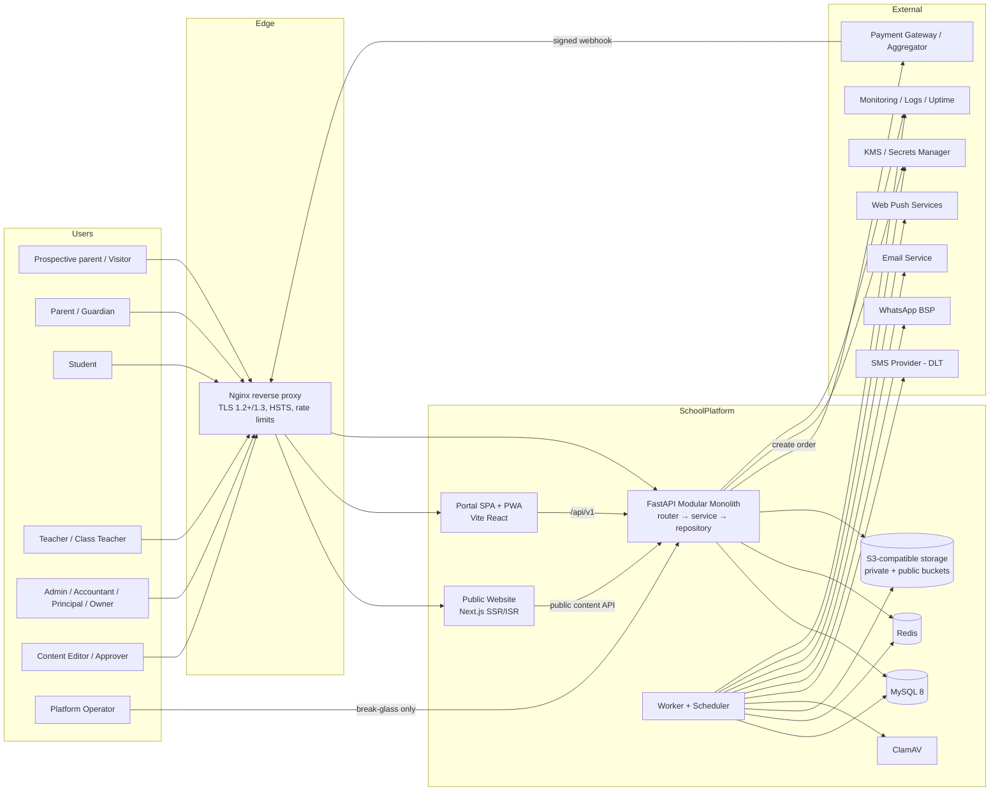
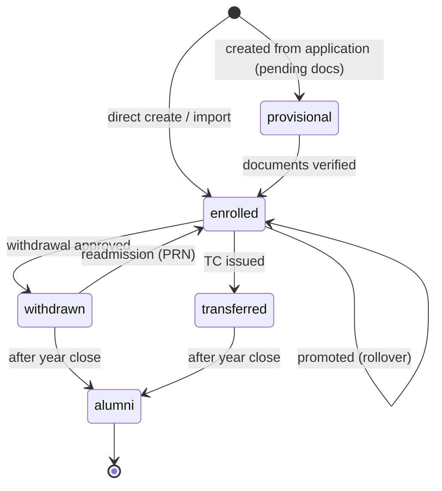
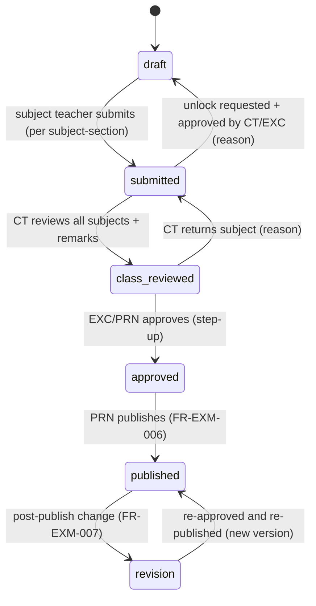
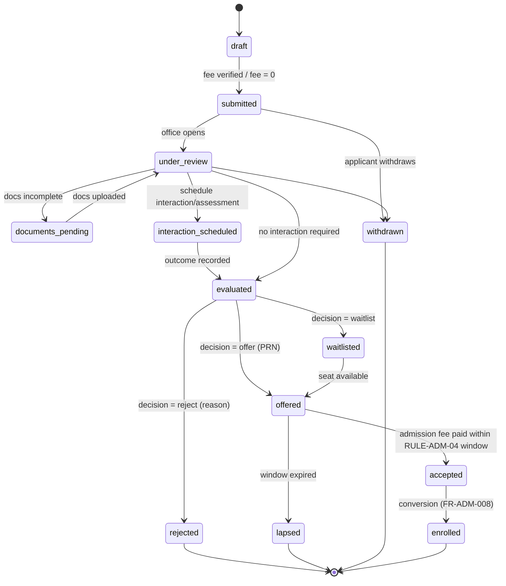
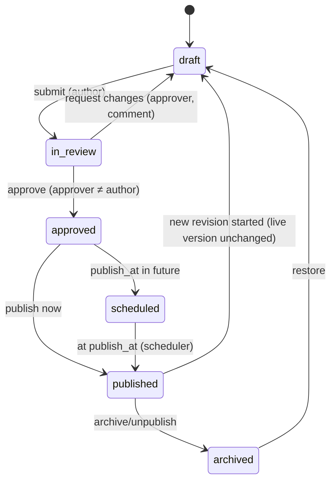
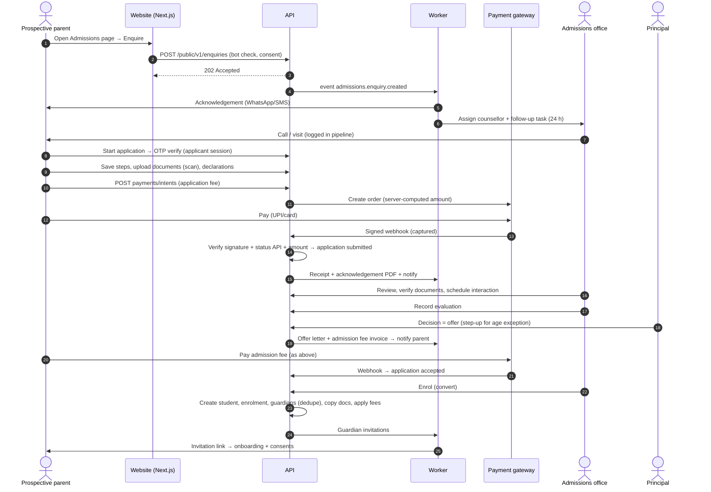
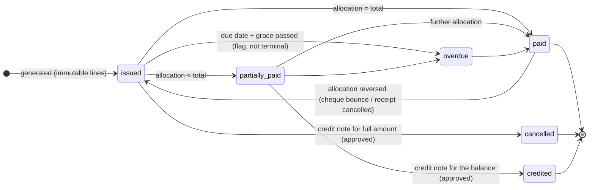
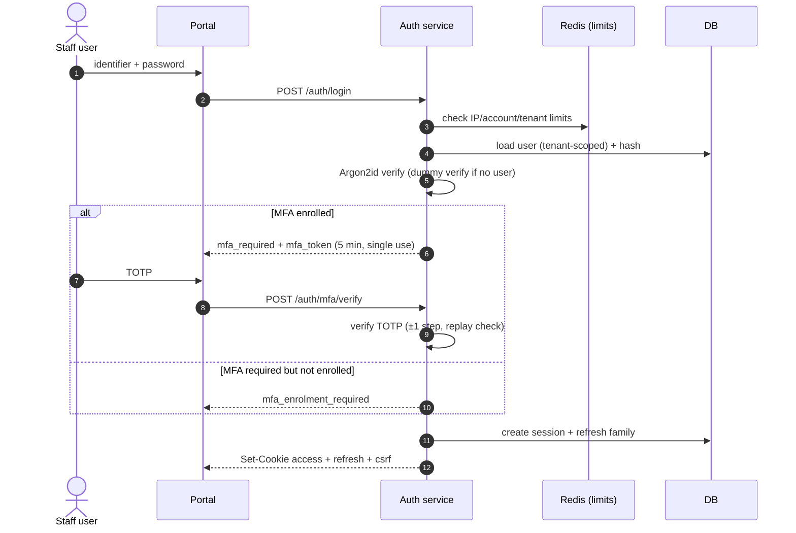

# SchoolPlatform — Functional Requirements Document (FRD)

> **Classification:** Internal – Confidential
> **Product:** SchoolPlatform — Public School Website + CMS, and School Management System (SMS) Portal
> **Source BRD:** [BRD_SchoolPlatform.md](BRD_SchoolPlatform.md) (BRD-SP-001 v0.1)

---

## 1. Document Control and Traceability Approach

### 1.1 Document Control

| Field | Value |
|---|---|
| Document ID | FRD-SP-001 |
| Title | SchoolPlatform Functional Requirements Document |
| Version | 0.1 |
| Status | **Draft — for engineering, QA, UX, and security review** |
| Date | 2026-10-15 |
| Author | Principal Systems Analyst / Solution Architect (AI-assisted draft) |
| Document owner | Product Owner, SchoolPlatform (Ashim Bera) |
| Source | BRD-SP-001 v0.1. ⚠ The BRD is still a **draft**, not yet approved. Any BRD change must be re-traced here (see CNF-01). |
| Required reviewers | Engineering Lead, Security Lead, QA Lead, UX/Design Lead, Product Owner, Legal Counsel (Section 9 DPDP items) |
| Audience | Engineering, QA, and UI/UX agents and humans implementing SchoolPlatform v1 |

| Version | Date | Author | Change |
|---|---|---|---|
| 0.1 | 2026-10-15 | SA (AI-assisted) | Initial complete draft, Sections 1–17, checklist, and clarification list |

### 1.2 Conventions

| Convention | Meaning |
|---|---|
| **shall / should / may** | Mandatory / recommended / optional |
| **MoSCoW** | M Must · S Should · C Could · W Won't (this release) |
| **Phase** | MVP · v1.1 · Future |
| **Data classes** | **C1 Public** · **C2 Internal** · **C3 Confidential (PII)** · **C4 Restricted** (BRD §10.1) |
| **⚖** | Needs legal/regulatory confirmation; not a legal conclusion |
| **⚠** | Stack impact or requirement conflict, recorded in the conflicts register (§16.4) |
| **"Tenant-scoped"** | Every query filtered by the server-resolved `tenant_id`; never client-supplied |
| **Time** | Stored as UTC (`DATETIME(6)`); displayed in tenant time zone (default `Asia/Kolkata`) |
| **Money** | `DECIMAL(14,2)` in INR; never floating point |

### 1.3 Identifier Scheme

| Artefact | Pattern | Example |
|---|---|---|
| Functional requirement | `FR-<MODULE>-NNN` | FR-ATT-001 |
| Security functional requirement | `FR-SEC-NNN` | FR-SEC-011 |
| UI/UX functional requirement | `FR-UX-NNN` | FR-UX-006 |
| Non-functional requirement | `NFR-<AREA>-NN` | NFR-PERF-01 |
| Acceptance criterion | `AC-n` within an FR | FR-ATT-001 AC-3 |
| Test case (unit/integration/API) | `TC-<FR-ID>-NN`, one or more per AC | TC-ATT-001-03 |
| Tenant-isolation test | `ISO-NNN` | ISO-004 |
| Security test | `SEC-T-NNN` | SEC-T-012 |
| Accessibility test | `A11Y-NNN` | A11Y-005 |
| Playwright E2E scenario | `E2E-NNN` | E2E-003 |
| Resource policy | `POL-NN` | POL-03 |
| Permission key | `<module>.<resource>.<action>[.<qualifier>]` | `students.profile.read.restricted` |
| Domain event | `<module>.<entity>.<past-tense-verb>` | `attendance.session.submitted` |
| Audit event | `AUD:<module>.<action>` | `AUD:fees.receipt.cancelled` |
| Conflict | `CNF-NN` | CNF-02 |

**Module codes:** AUTH (Auth & account) · TEN (Tenant settings & branding) · IAM (Users/roles/permissions) · STU (Students) · GRD (Guardians) · STF (Staff) · ACA (Academic year & structure, homework) · TT (Timetable) · ATT (Attendance) · EXM (Exams, grading, report cards) · ADM (Admissions) · FIN (Fees & payments) · COM (Communication & notifications) · CMS (CMS & public website) · MED (Media library & files) · RPT (Reports & dashboards) · AUD (Audit log) · DIO (Data import/export) · CFG (Settings & configuration).

### 1.4 Traceability Approach

```
BR-xxx (BRD) ──► FR-<MOD>-NNN (this FRD) ──► AC-n ──► TC-<FR>-NN (unit/integration/API)
                         │                                 └► E2E-NNN (Playwright journeys)
                         ├► module (§4.x)                  └► ISO-/SEC-T-/A11Y- (cross-cutting suites)
                         └► API endpoints (§7) ─► data entities (§6)
```

1. Every FR lists **Traces to** (one or more BR, SBR, or UXR IDs).
2. Every acceptance criterion produces at least one test case named `TC-<FR-ID>-<AC no.>` (e.g., FR-FIN-006 AC-2 → `TC-FIN-006-02`). QA may add suffixes (`-02a`) for extra cases.
3. Journey-level coverage is given by E2E scenarios (§12.6), each listing the FRs it exercises.
4. The full matrix is in §17. CI fails if an FR in MVP scope has no linked test (lint over test annotations `@covers("FR-ATT-001")`).

---

## 2. System Overview

### 2.1 Overview

SchoolPlatform has two user-facing applications backed by one API:

- **Public website** (`www.<school-domain>`): Next.js (TypeScript), server-rendered/statically generated pages from CMS content, with incremental regeneration on publish. Anonymous visitors; enquiry and application entry points.
- **Portal** (`portal.<school-domain>`): Vite + React SPA (TypeScript strict, Tailwind, TanStack Query, React Hook Form + Zod), installable as a PWA. Used by all authenticated roles.
- **API** (served same-origin at `portal.<school-domain>/api/v1` via Nginx; also `www.<school-domain>/api/public/v1` for public read/write endpoints): FastAPI modular monolith with router → service → repository layers, SQLAlchemy 2.x, Alembic, Pydantic v2.
- **Worker** (same codebase, separate container): background jobs (notifications, PDFs, imports, reminders, retention, reconciliation) consuming a Redis-backed queue, plus a scheduler. ⚠ CNF-02 (Redis required).
- **Data stores:** MySQL 8 (InnoDB, utf8mb4, `utf8mb4_0900_ai_ci`), Redis (queue, rate limits, cache of non-sensitive data), S3-compatible object storage (private + public buckets), ClamAV daemon for malware scanning.

### 2.2 Context Diagram



### 2.3 Module Map

| Module | Responsibility | Owns entities (§6) | Depends on |
|---|---|---|---|
| **Kernel: AUTH** | Sign-in, MFA, OTP, tokens, sessions, password lifecycle, step-up | `user_credential`, `mfa_factor`, `session`, `refresh_token`, `otp_challenge`, `recovery_code` | IAM, AUD, COM |
| **Kernel: TEN** | Tenant record, domain resolution, branding/theme, feature flags | `tenant`, `tenant_domain`, `tenant_branding`, `feature_flag` | MED, AUD |
| **Kernel: IAM** | Users, roles, permissions, scoped role assignments, access reviews | `user`, `role`, `permission`, `role_permission`, `role_assignment`, `access_review` | AUTH, AUD |
| **Kernel: AUD** | Audit events, hash chain, anchoring, viewer | `audit_event`, `audit_anchor` | — |
| **Kernel: COM (engine)** | Notification templates, dispatch, channels, preferences, delivery logs | `notification_template`, `notification`, `delivery_attempt`, `comm_preference`, `push_subscription` | Providers, CFG |
| **Kernel: MED** | File upload, scanning, storage, signed URLs, media library | `file_object`, `media_asset`, `media_usage` | AV, OBJ |
| **Kernel: CFG** | Settings, numbering, rule parameters, approval workflows, localisation | `setting`, `number_sequence`, `rule_parameter`, `approval_flow`, `approval_request` | AUD |
| **Kernel: Privacy (SEC)** | Consent ledger, data-principal requests, retention jobs, incidents | `consent_purpose`, `consent_record`, `dpr_request`, `retention_policy`, `legal_hold`, `security_incident` | AUD, COM |
| **People: STU, GRD, STF** | Students, guardians, staff, relationships, assignments, certificates | `student`, `enrolment`, `guardian`, `student_guardian`, `access_restriction`, `staff`, `teaching_assignment`, `certificate` | ACA, MED |
| **Academics: ACA, TT, ATT, EXM** | Years/terms/calendar, structure, homework, timetable, attendance, exams, report cards | `academic_year`, `term`, `class`, `section`, `subject`, `class_subject`, `homework`, `bell_schedule`, `timetable_*`, `attendance_session`, `attendance_record`, `leave_request`, `assessment*`, `grading_scheme`, `mark`, `result_*`, `report_card` | People, COM, MED |
| **Admissions: ADM** | Enquiries, cycles, forms, applications, decisions, conversion | `enquiry`, `enquiry_activity`, `admission_cycle`, `application`, `application_document`, `seat_capacity` | FIN, STU, GRD, COM |
| **Finance: FIN** | Fee setup, concessions, invoices, payments, receipts, refunds, ledger, reconciliation | `fee_head`, `fee_category`, `fee_structure*`, `concession*`, `invoice`, `invoice_line`, `payment`, `payment_allocation`, `receipt`, `refund`, `ledger_entry`, `gateway_event`, `settlement*` | STU, GRD, COM |
| **Communication: COM** | Notices, emergency broadcasts, parent–teacher messaging | `notice`, `notice_audience`, `notice_receipt`, `conversation`, `message` | Engine, CMS |
| **CMS** | Pages, blocks, posts, events, galleries, menus, SEO, workflow, redirects | `cms_page`, `cms_post`, `cms_revision`, `cms_menu*`, `cms_redirect`, `cms_gallery*` | MED, ADM |
| **RPT** | Dashboards, reports, exports | `report_definition`, `export_job` | All (read models) |
| **DIO** | Bulk import pipelines, list exports | `import_job`, `import_row_error`, `export_job` | All |

**Module boundary rule:** a module may call another module **only through its service interface** (Python package `app.modules.<mod>.service`), never its repository or models directly. Cross-module side effects go through **domain events** written to a transactional **outbox** table and dispatched by the worker (at-least-once; consumers idempotent).

### 2.4 Code Layout (normative)

```
backend/app/
  core/            # config, db session, tenant context, security, errors, pagination, events/outbox
  modules/<mod>/
    router.py      # FastAPI routes: auth dependency + policy declaration + schema validation only
    service.py     # business logic, policy checks, transactions, event emission
    repository.py  # SQLAlchemy queries; tenant scoping enforced by base class
    models.py      # SQLAlchemy models (all tenant-owned models inherit TenantScopedBase)
    schemas.py     # Pydantic request/response models (strict)
    policies.py    # resource-level policy functions
    events.py      # event definitions
  workers/         # job handlers
frontend/portal/   # Vite SPA
frontend/site/     # Next.js public website
packages/ui/       # shared design system (tokens, components) used by both frontends
```

### 2.5 Tenancy Approach

| Aspect | v1 behaviour (single tenant) | Provision for multi-tenancy |
|---|---|---|
| Tenant record | One row in `tenant`, seeded at install | Many rows; provisioning workflow in v2 |
| Resolution | `TenantResolver` middleware maps the request `Host` header to `tenant_domain` → `tenant_id`; unknown hosts get **421/404** and are logged | Same; plus wildcard subdomains and custom domains |
| Context | `tenant_id` stored in a request-scoped `TenantContext` (contextvar); the authenticated session's `tenant_id` **must equal** the resolved host tenant, otherwise **401** and a security event | Same |
| Data | Every tenant-owned table has `tenant_id BINARY(16) NOT NULL`, indexed first in composite indexes | Same |
| Integrity | Foreign keys between tenant-owned tables are **composite** `(tenant_id, x_id)` → `(tenant_id, id)`, so cross-tenant references are impossible at the DB level | Same |
| Uniqueness | Business keys are `UNIQUE (tenant_id, <key>)` | Same |
| Query guard | `TenantScopedRepository` applies `WHERE tenant_id = :ctx` to every select/update/delete via SQLAlchemy `with_loader_criteria`; raw SQL is banned by lint except in reviewed allow-listed files | Same |
| Jobs | Every job payload carries `tenant_id`; the worker sets `TenantContext` before running and fails closed if absent | Same |
| Storage | Object keys prefixed `t/{tenant_id}/…`; signed URLs bound to the prefix | Same; optional bucket-per-tenant |
| Cache/rate limits | Redis keys prefixed `t:{tenant_id}:` | Same |
| Settings/theming | Stored per tenant (`setting`, `tenant_branding`) | Same |
| Global (non-tenant) tables | `tenant`, `tenant_domain`, `permission` (catalogue), `consent_purpose_template`, platform `feature_definition` only | Super-admin tables (v2) |
| Out of scope v1 | Tenant onboarding UI, billing, super-admin portal | v2.0+ |

---

## 3. User Roles and Permission Matrix

### 3.1 Roles

| Code | Role | Description | MFA | Default session |
|---|---|---|---|---|
| OWN | Owner / Trustee | School management; aggregate oversight | Mandatory | 12 h absolute, 60 min idle |
| PRN | Principal (VP = Principal role with configurable reduced scope) | Academic and operational head; approver | Mandatory | 12 h / 60 min |
| ADM | Admin / Office staff | Records, admissions processing, certificates, notices | Mandatory | 12 h / 60 min |
| ACC | Accountant | Finance configuration, collection, reconciliation | Mandatory | 12 h / 30 min |
| EXC | Exam Coordinator | Assessment setup, result approval | Mandatory | 12 h / 60 min |
| CT | Class Teacher | Own section: attendance, remarks, leave, parent messaging | Should (CNF-05) | 12 h / 60 min |
| TCH | Subject Teacher | Assigned subject-sections: marks, homework, messaging | Should (CNF-05) | 12 h / 60 min |
| CNS | Admissions Counsellor | Enquiries and applications only | Mandatory | 12 h / 60 min |
| EDT | Content Editor | CMS drafting and media | Should | 12 h / 60 min |
| APR | Content Approver | CMS approval/publish | Mandatory | 12 h / 60 min |
| PAR | Parent / Guardian | Linked children (subject to restrictions) | Optional (OTP sign-in) | 30 days remembered device / 7 days otherwise |
| STU | Student | Self only (from configured class, default VI) | Optional | 7 days |
| APL | Applicant (prospective parent) | Own applications only | OTP | 24 h |
| OPS | Platform Operator | Infrastructure; **no standing data access** | Mandatory | 8 h / 30 min |

A user may hold several role assignments (e.g., TCH + PAR). The active **role context** is selected after login (FR-AUTH-010); permissions are evaluated against the active context only.

### 3.2 Scope Qualifiers (resource-level)

| Scope code | Meaning |
|---|---|
| **T** | Whole tenant |
| **Sec** | Sections where the user is class teacher or has a teaching assignment for the current academic year |
| **OwnSec** | Section(s) where the user is the **class teacher** |
| **Subj** | Subject-section pairs assigned to the user |
| **Ch** | Students linked to the guardian via `student_guardian` with `portal_access = true` and no active access restriction |
| **Self** | The user's own record |
| **App** | Applications created by the applicant user |
| **Agg** | Aggregated data only; no individual records |
| **Asg** | Records assigned to the user (e.g., enquiries assigned to a counsellor) |
| **Fin** | Finance-relevant subset of student/guardian data (name, admission no., class, fee payer contact) |
| **—** | No access |

### 3.3 Permission Matrix (role × module × action)

Actions: **C** create · **R** read · **U** update · **D** delete (soft) / cancel · **A** approve/publish · **E** export. The cell shows the actions followed by the scope, e.g. `CRU·T` = create/read/update for the whole tenant. `R·T(-C4)` = read, with C4 fields masked.

| Module | OWN | PRN | ADM | ACC | EXC | CT | TCH | CNS | EDT | APR | PAR | STU | OPS |
|---|---|---|---|---|---|---|---|---|---|---|---|---|---|
| Auth & account (own) | RU·Self | RU·Self | RU·Self | RU·Self | RU·Self | RU·Self | RU·Self | RU·Self | RU·Self | RU·Self | RU·Self | RU·Self | RU·Self |
| Tenant settings & branding | RUA·T | RU·T | RU·T | R·T | R·T | — | — | — | R·T (brand) | RU·T (brand) | — | — | R·T (tech cfg) |
| Users/roles/permissions | R·T, A (access review) | CRUDA·T | CRUD·T (non-privileged roles) | — | — | — | — | — | — | — | — | — | — |
| Students | R·Agg; R·T(-C4) on request | CRUDAE·T | CRUDE·T | R·Fin | R·T(-C4) | RU·OwnSec(-C4†); R·Sec(-C4) | R·Subj(-C4) | — | — | — | R·Ch | R·Self | — |
| Guardians | R·Agg | CRUDAE·T | CRUDE·T | R·Fin | — | R·OwnSec (contact masked‡) | — | — | — | — | RU·Self | — | — |
| Staff | R·T | CRUDE·T | CRUD·T(-C4) | R·T(-C4) | R·T (dir.) | R·T (dir.) | R·T (dir.) | R·T (dir.) | — | — | R (child's teachers: name, subject) | R (own teachers) | — |
| Academic year & structure | R·T | CRUDA·T | CRUD·T | R·T | R·T | R·T | R·T | R·T | — | — | R·Ch | R·Self | — |
| Homework | R·Agg | R·T | R·T | — | — | CRUD·OwnSec | CRUD·Subj | — | — | — | R·Ch | R·Self | — |
| Timetable | R·T | CRUDA·T | CRUDA·T | — | R·T | R·Sec | R·Self+Sec | — | — | — | R·Ch | R·Self | — |
| Attendance | R·Agg | RUE·T | RU·T, E | — | R·T | CRU·OwnSec, E·OwnSec | R·Subj (period mode: CRU·Subj) | — | — | — | R·Ch; C (leave req.) | R·Self | — |
| Leave requests (students) | — | RA·T | RA·T | — | — | RA·OwnSec | — | — | — | — | CRD·Ch | R·Self | — |
| Exams, grading, report cards | R·Agg | CRUDAE·T | R·T | — | CRUDAE·T | RU·OwnSec (remarks, review), A·OwnSec (class step) | CRU·Subj (marks) | — | — | — | R·Ch (published) | R·Self (published) | — |
| Admissions | R·Agg (funnel) | CRUDAE·T | CRUDE·T | R (fee status) | — | — | — | CRU·Asg; R·T (pipeline) | — | — | — | — | — |
| Fees & payments | R·Agg; A (fee revision) | R·T; A (concession, refund) | R·Fin | CRUDE·T; A (as checker) | — | R·OwnSec (dues flag only) | — | R (application fee) | — | — | R·Ch (invoices, receipts); C (payment) | — | — |
| Communication: notices | R·T; C·T | CRUDAE·T | CRUD·T | C (finance notices) | C (exam notices) | CRUD·OwnSec | CRUD·Subj | — | — | — | R (targeted) ; U (ack) | R (targeted) | — |
| Emergency broadcast | CA·T | CA·T | — | — | — | — | — | — | — | — | R | R | — |
| Parent–teacher messaging | — | R·T (escalated) | — | — | — | CRU·OwnSec | CRU·Subj | — | — | — | CRU·Ch's teachers | — | — |
| CMS & public website | R·T | RA·T | CRU·T | — | — | — | — | — | CRU·T (draft) | CRUDA·T | — | — | — |
| Media library | R·T | RUD·T | CRU·T | — | — | — | — | — | CRU·T | CRUDA·T | — | — | — |
| Reports & dashboards | R·Agg, E·Agg | RE·T | RE·T (non-finance) | RE·T (finance) | RE·T (exams) | RE·OwnSec | R·Subj | R·Asg, E·Asg | — | — | R·Ch | R·Self | R (system health) |
| Audit log | R·T | R·T | R·T (own module events, non-security) | R·T (finance events) | — | — | — | — | — | — | — | — | — (break-glass only) |
| Data import | — | A (rollover/import approve) | C·T | C·T (fees) | — | — | — | — | — | — | — | — | — |
| Data export (bulk PII) | E·Agg | E·T (step-up) | E·T (step-up) | E·Fin (step-up) | E (results, step-up) | E·OwnSec (non-C4) | — | E·Asg | — | — | E·Self (DPR export) | — | — |
| Settings & configuration | RA·T | RU·T | RU·T (non-security) | RU·T (finance rules) | RU·T (exam rules) | — | — | — | — | — | RU·Self (prefs) | RU·Self (prefs) | R·T (tech) |
| Privacy (consents, DPR, incidents) | R·T | RA·T | R·T, U (process DPR) | — | — | — | — | — | — | — | CRU·Self+Ch (consents, DPRs) | R·Self | — |
| Security dashboard (Trust Centre) | R·T | R·T | — | — | — | — | — | — | — | — | — | — | R (tech health) |

† The class teacher sees the **medical alert flag and summary** (e.g., "Peanut allergy — carries EpiPen") but not full medical documents unless granted `students.health.read`.
‡ Class teachers see guardian name and relationship; phone/email are hidden; contact goes through in-app messaging (BR-092).

### 3.4 Resource-Level Policies

| ID | Policy | Applies to | Enforcement point |
|---|---|---|---|
| POL-01 | **Deny by default**: an action is allowed only if the active role holds the permission **and** the resource passes the scope predicate | All endpoints | Policy layer (FR-SEC-011) |
| POL-02 | Teacher scope (**Sec/Subj**) is derived from `teaching_assignment` and `section.class_teacher_id` for the **current academic year**; past-year access is read-only, for 1 year after year close (configurable) | Attendance, marks, homework, messaging, student lists | Repository scope filter + service check |
| POL-03 | Guardian scope (**Ch**) = `student_guardian` links with `portal_access = true`, `status = active`, and no active `access_restriction` for that guardian–student pair | All parent endpoints, notifications, files | Repository scope filter; notification recipient resolver |
| POL-04 | Student scope (**Self**) = the `student.user_id` of the authenticated user; students never see guardian contact data or finance data | Student endpoints | Repository scope filter |
| POL-05 | Applicant scope (**App**) = applications where `applicant_user_id` = current user | Applicant endpoints | Repository scope filter |
| POL-06 | C4 fields are returned only if the role holds the field-group permission (e.g., `students.health.read`, `students.identifiers.read`, `staff.bank.read`); otherwise masked (`"••••1234"`) or omitted | Student, guardian, staff DTOs | Serializer field-level policy |
| POL-07 | **Maker-checker**: the approver of a request cannot be its maker; approval also requires `*.approve` permission and step-up if configured | Concessions, refunds, receipt cancellation, results publish, role assignment, fee-structure change after demand | Approval service (FR-CFG-003) |
| POL-08 | No self-elevation: users cannot assign roles to themselves or grant permissions they do not hold | IAM | IAM service |
| POL-09 | Out-of-scope object requests return **404 Not Found** (not 403), to avoid confirming that an object exists; 403 is used only when an in-scope object's action is not permitted | All object endpoints | Policy layer |
| POL-10 | Fee-payer visibility: a guardian sees invoices/receipts for linked children; only guardians flagged `is_fee_payer` can download tax certificates and initiate refunds requests | FIN | FIN service |
| POL-11 | Aggregates shown to OWN or in dashboards suppress cells with counts < 5 (configurable) where individual re-identification is possible (e.g., category × section) | RPT | Report service |
| POL-12 | Platform Operator has **no** application permissions on tenant data; access only through break-glass grants (FR-SEC-043), time-boxed and audited | All | IAM + policy layer |
| POL-13 | Counsellor scope (**Asg**) for updates; read of the pipeline (**T**) excludes C4 fields of applicants | ADM | Repository + serializer |
| POL-14 | Past-period finance records are read-only after period lock (FR-FIN-015); corrections only via adjustment entries | FIN | Service check |

### 3.5 Permission Catalogue (excerpt; full catalogue generated from code)

| Permission key | Description | Default roles |
|---|---|---|
| `students.profile.read` | Read student core profile (C3) | PRN, ADM, EXC, CT, TCH (scoped) |
| `students.profile.write` | Create/update student core profile | PRN, ADM |
| `students.health.read` | Read C4 health details | PRN, ADM (configurable), CT (summary only by default) |
| `students.identifiers.read` | Read Aadhaar/APAAR/PEN (masked unless also `.unmask`) | PRN, ADM |
| `students.identifiers.unmask` | View the full identifier (step-up) | PRN |
| `guardians.restriction.manage` | Create/lift access restrictions | PRN |
| `attendance.mark` | Mark attendance for scoped sections | CT (TCH in period mode) |
| `attendance.edit.after_cutoff` | Edit attendance after cut-off | CT, ADM, PRN |
| `marks.enter` | Enter marks for scoped subject-sections | TCH, CT |
| `results.approve` | Approve results | EXC, PRN |
| `results.publish` | Publish results to parents | PRN (EXC configurable) |
| `fees.structure.manage` | Manage fee heads/structures | ACC |
| `fees.concession.request` / `.approve` | Concession maker/checker | ACC, ADM / PRN |
| `fees.payment.record` | Record counter payment | ACC |
| `fees.receipt.cancel.request` / `.approve` | Receipt cancellation | ACC / PRN |
| `fees.refund.request` / `.approve` | Refunds | ACC / PRN, OWN |
| `notices.publish.school` | School-wide notices | PRN, ADM |
| `broadcast.emergency` | Emergency broadcast | PRN, OWN |
| `cms.content.edit` / `.publish` | CMS draft / publish | EDT, ADM / APR |
| `export.bulk_pii` | Bulk export containing C3/C4 | PRN, ADM, ACC (Fin) |
| `iam.roles.assign` | Assign roles | PRN (ADM for non-privileged roles) |
| `audit.read` | Read audit log | OWN, PRN (ADM/ACC module-filtered) |
| `privacy.dpr.process` | Process data-principal requests | PRN, ADM (DPO designee) |
| `settings.security.manage` | Security settings (MFA policy, session lengths) | PRN with step-up + SL approval |

---

## 4. Functional Requirements by Module

**Template.** Each FR states: traces, priority/phase, data class, actors · description · preconditions · trigger · main/alternate/exception flows · validations · acceptance criteria (Given/When/Then) · security & access (authN/authZ, data class, audit events, rate limits) · UI/UX · events/side effects. v1.1/Future FRs use a short form. **Cross-cutting rules that apply to every FR and are not repeated:** tenant scoping (§2.5); POL-01 deny-by-default; POL-09 404 for out-of-scope objects; server-side validation mirrors client Zod schemas; all mutating endpoints require CSRF protection (FR-SEC-006); all write actions emit an audit event if the entity is C3/C4 (FR-AUD-001); optimistic locking via `version` column (HTTP 409 on conflict).

**Common field rules.** `name`-type fields: Unicode NFC-normalised, trimmed, 1–100 chars, letters/marks/spaces/`.'-` allowed. Indian mobile: E.164 `+91` followed by 10 digits starting 6–9 (stored E.164; other country codes allowed for guardians abroad). Email: RFC 5322 simplified, ≤ 254 chars, lowercased. Dates: ISO 8601 `YYYY-MM-DD` in API; displayed `DD-MM-YYYY`. PIN code: 6 digits. Free text: ≤ 2,000 chars unless stated; no HTML except in CMS rich text (sanitised, FR-SEC-018).

### 4.1 Auth and Account Management (AUTH)

#### FR-AUTH-001 — Staff sign-in with password and MFA
**Traces to:** BR-001, BR-002, BR-003, BR-007 · **M / MVP** · **Data class:** C4 (credentials, MFA secrets) · **Actors:** all staff roles, OPS

- **Description:** Staff authenticate with an identifier (email or mobile) and password, followed by a second factor when MFA is enrolled or required.
- **Preconditions:** User account `status = active`; credential set (invitation completed).
- **Trigger:** User submits the sign-in form at `portal.<domain>/login`.

**Main flow**
1. User enters identifier and password; client validates format.
2. API normalises the identifier, looks up the user **in the resolved tenant**, and verifies the password hash (Argon2id) in constant time. If the user doesn't exist, a dummy hash verification runs, so timing doesn't reveal it.
3. If MFA is enrolled, API returns `200 {status:"mfa_required", mfa_token}` (opaque, 5-min TTL, single use) with the available factors.
4. User submits a TOTP code (or a recovery code). API verifies it (FR-SEC-003).
5. API creates a session (FR-SEC-005/007), sets `__Host-sp_at` (access) and `__Host-sp_rt` (refresh) cookies, and returns the user profile + role assignments.
6. If the user holds more than one role assignment, the client shows the role-context picker (FR-AUTH-010); otherwise it lands on the role dashboard.

**Alternate flows**
- **A1 MFA required but not enrolled:** API returns `{status:"mfa_enrolment_required", enrol_token}` → FR-AUTH-003. No access to other endpoints until enrolment completes.
- **A2 New device:** after success, a "new sign-in" notification is sent to the user's email and in-app (BR-009).
- **A3 Password expired by admin force-reset:** user must set a new password (FR-AUTH-006) before continuing.

**Exception flows**
- **E1 Wrong credentials:** generic `401 AUTH_INVALID_CREDENTIALS` ("Incorrect email/mobile or password"); failure counter incremented (FR-SEC-008).
- **E2 Account locked:** `423 AUTH_LOCKED` with `retry_after`; message offers "Unlock via email/SMS link".
- **E3 Suspended/deactivated:** same generic 401 as E1 (no status disclosure); security event logged.
- **E4 Wrong TOTP:** `401 AUTH_MFA_INVALID`; 5 failed MFA attempts invalidate the `mfa_token` and count toward lockout.

**Validations**

| Field | Type | Rules |
|---|---|---|
| identifier | string | Required; 3–254 chars; email or Indian/E.164 mobile |
| password | string | Required; 1–128 chars at login (policy enforced at set time) |
| totp_code | string | 6 digits |
| recovery_code | string | 10 chars, base32 groups `XXXXX-XXXXX` |

**Acceptance criteria**
- **AC-1** Given an active staff user with TOTP enrolled, When they submit correct credentials and a valid TOTP, Then a session is created, both cookies are set as `HttpOnly; Secure; SameSite=Strict; Path=/`, and the response contains no tokens in the body.
- **AC-2** Given a non-existent identifier, When sign-in is attempted, Then the response code, body, and timing (±50 ms p95) are indistinguishable from a wrong-password response.
- **AC-3** Given 5 consecutive failures within 15 minutes, When a 6th attempt is made, Then `423 AUTH_LOCKED` is returned even with the correct password, and the user is notified.
- **AC-4** Given a Principal without MFA enrolled, When they sign in with a correct password, Then they receive `mfa_enrolment_required` and every other API call returns `401` until enrolment.
- **AC-5** Given a session cookie issued for tenant A, When it is presented on tenant B's host, Then `401` is returned and `security.tenant_mismatch` is logged.

**Security & access:** Public endpoint (pre-auth). **Rate limits:** 10 req/min per IP, 5 failures per account per 15 min, 100 req/min per tenant on `/auth/login`. **Audit:** `AUD:auth.login.succeeded`, `AUD:auth.login.failed` (identifier hashed), `AUD:auth.mfa.failed`, `AUD:auth.locked`. Passwords never logged. ASVS Authentication L2.

**UI/UX:** Screen `Login` (school-branded): identifier field (`autocomplete="username"`), password with show/hide (`autocomplete="current-password"`), "Forgot password?", "Parent? Sign in with OTP" link. The MFA step uses a 6-box OTP input with `autocomplete="one-time-code"` that accepts paste. States: loading (button spinner, inputs disabled), error (inline banner, focus moves to banner), locked (countdown + unlock link). Mobile: single column, keyboard type `email`/`tel` auto-switch. Password managers supported (WCAG 3.3.8).

**Events:** `auth.session.created`, `auth.login.failed`, `auth.account.locked`.

#### FR-AUTH-002 — Parent, student, and applicant OTP sign-in
**Traces to:** BR-005, BR-001 · **M / MVP** · **Data class:** C3 (mobile) · **Actors:** PAR, STU (if mobile on record), APL

- **Description:** Passwordless sign-in using a one-time code sent to a mobile number already on record (parents) or verified at first use (applicants).
- **Preconditions:** Parents: a guardian with this mobile exists, `portal_access = true`, invitation accepted or the mobile verified at admission. Applicants: no precondition (creates an applicant identity on first verified OTP).
- **Trigger:** User enters a mobile number on the parent sign-in screen or the application start page.

**Main flow**
1. User enters a mobile number; the client validates it.
2. API always responds `202 {challenge_id, resend_after: 30}`, whether or not the number is known (no enumeration). An OTP is sent only if the number is eligible.
3. OTP: 6 digits, CSPRNG, stored as HMAC-SHA-256, TTL 5 min, max 5 verify attempts, sent via SMS (DLT template) or WhatsApp authentication template (per tenant setting, with fallback).
4. User enters the OTP → API verifies it → creates a session (parent: 7-day absolute; 30 days if "Remember this device" is ticked on a non-shared device) → landing on Parent Home.

**Alternate flows**
- **A1 Resend:** allowed after 30 s, max 3 resends per challenge, max 5 challenges per number per hour.
- **A2 Parent with password set:** "Use password instead" path → same as FR-AUTH-001 without mandatory MFA.
- **A3 Multiple guardian records share the number** (e.g., same parent for siblings): one user account; all linked children are shown.

**Exception flows**
- **E1 Wrong OTP:** `401 OTP_INVALID`, attempts remaining shown; after 5, the challenge is invalidated.
- **E2 Expired OTP:** `410 OTP_EXPIRED`; offer resend.
- **E3 Abuse detected** (rate caps, SMS-pumping heuristics such as many unknown numbers from one IP or premium-rate prefixes): `429` with generic message; CAPTCHA challenge required (FR-SEC-023).

**Validations:** `mobile` E.164, Indian numbers `^\+91[6-9]\d{9}$` (international allowed for guardians if the tenant enables it); `otp` `^\d{6}$`.

**Acceptance criteria**
- **AC-1** Given a mobile number not on record, When an OTP is requested, Then the API returns the same `202` shape and no SMS is sent.
- **AC-2** Given a valid OTP, When it is verified a second time, Then `401 OTP_INVALID` is returned (single use).
- **AC-3** Given 5 challenges for one number in an hour, When a 6th is requested, Then `429` is returned and no message is sent.
- **AC-4** Given a guardian with an active access restriction for every linked child, When they sign in, Then they see an empty state ("No students linked — contact the school office") and no child data.

**Security & access:** Public pre-auth. **Rate limits:** per number 5/h, per IP 20/h, per tenant global cap configurable (default 2,000/h) with alerting. **Audit:** `AUD:auth.otp.requested` (number masked `+91•••••43210`), `AUD:auth.otp.verified`, `AUD:auth.otp.failed`. ASVS Authentication L2.

**UI/UX:** Screen `ParentLogin`: large mobile field with `+91` prefix, "Send OTP" button; OTP screen with 6 boxes, SMS autofill (`autocomplete="one-time-code"`; WebOTP API on Android Chrome), resend countdown, "Change number". Hindi strings in v1.1.

**Events:** `auth.otp.requested`, `auth.session.created`.

#### FR-AUTH-003 — MFA enrolment (TOTP) and recovery codes
**Traces to:** BR-003 · **M / MVP** · **Data class:** C4 · **Actors:** any authenticated user (mandatory for privileged roles)

- **Description:** User links an authenticator app and receives recovery codes.
- **Preconditions:** Valid `enrol_token` or an authenticated session with step-up.
- **Trigger:** First sign-in of a role requiring MFA, or Settings → Security → "Set up authenticator".

**Main flow**
1. API generates a 160-bit TOTP secret, stores it encrypted (FR-SEC-028) as `pending`, and returns an `otpauth://` URI and a QR code (rendered client-side from the URI; the secret is shown only once).
2. User scans the code and enters the current code; API verifies it (±1 time step) and marks the factor `active`.
3. API generates 10 single-use recovery codes, shown once with "Download / Copy / Print"; it stores only their Argon2id hashes.
4. User confirms "I have saved my codes" → session continues.

**Alternate flows:** **A1** user regenerates recovery codes (step-up required; old codes invalidated).
**Exception flows:** **E1** 5 invalid codes during enrolment → factor discarded, restart; **E2** `enrol_token` expired (10 min) → sign in again.

**Acceptance criteria**
- **AC-1** Given enrolment completes, Then the raw secret is never returned by any later API call.
- **AC-2** Given a recovery code is used once, When it is reused, Then it is rejected.
- **AC-3** Given a user with an active factor, When they try to disable MFA while their role requires it, Then `403 MFA_REQUIRED_BY_POLICY` is returned.

**Security & access:** Self only. **Audit:** `AUD:auth.mfa.enrolled`, `AUD:auth.mfa.recovery_regenerated`, `AUD:auth.mfa.recovery_used`. **UI/UX:** Stepper (Scan → Verify → Save codes); QR plus "Can't scan? Enter key" fallback; codes in a monospace grid; a warning before leaving the page without saving.
**Events:** `auth.mfa.enrolled` → notification "Two-step verification turned on".

#### FR-AUTH-004 — MFA reset by administrator (dual control)
**Traces to:** BR-003, BR-014 · **M / MVP** · **Data class:** C4 · **Actors:** ADM/PRN (maker), PRN/OWN (checker)

- **Description:** When a staff user has lost their authenticator and recovery codes, an admin requests an MFA reset and a second authorised person approves it.
- **Main flow:** 1. Maker opens the user → "Reset two-step verification" → records the identity-verification method (in person / video call) and a reason (required, ≥ 15 chars). 2. Approval request is created (FR-CFG-003). 3. Checker approves with step-up. 4. User's factors are revoked, all sessions revoked, and the user is forced into enrolment at next sign-in.
- **Exception:** Maker = checker → `403 SOD_VIOLATION`. A reset of a PRN account requires OWN as checker.
- **AC-1** Given a reset request by user X, When X tries to approve it, Then `403 SOD_VIOLATION`.
- **AC-2** Given an approved reset, Then all of the target's sessions are revoked within 60 s and the target is notified on email and SMS.
- **Security:** permissions `iam.mfa.reset.request` / `.approve`; **Audit:** `AUD:auth.mfa.reset_requested`, `AUD:auth.mfa.reset_approved`. **UI/UX:** destructive-styled confirmation dialog stating the consequence.

#### FR-AUTH-005 — Forgotten password reset
**Traces to:** BR-008 · **M / MVP** · **Data class:** C4 · **Actors:** staff, parents with a password

- **Main flow:** 1. User enters an identifier → API always returns `202` (generic message). 2. If eligible, a reset link with a 256-bit token (stored hashed, TTL 15 min, single use) is sent to the verified email (and an SMS notice "Password reset requested" to the mobile). 3. User opens the link → if MFA is enrolled, must pass MFA → sets a new password meeting policy (FR-SEC-001). 4. All sessions and refresh tokens are revoked; confirmation notifications sent on all channels.
- **Exceptions:** expired/used token → `410 RESET_TOKEN_INVALID`; new password on the breached list → `422 PASSWORD_BREACHED`; same as the last 5 passwords → `422 PASSWORD_REUSED`.
- **AC-1** Given a reset link is used, When it is opened again, Then `410` is returned.
- **AC-2** Given a successful reset, Then every pre-existing refresh token fails with `401`.
- **AC-3** Given an unknown email, When reset is requested, Then the response equals that for a known email, and no email is sent.
- **Security:** rate limit 3 requests/h per identifier, 10/h per IP. The reset page sets `Referrer-Policy: no-referrer`, and the token is removed from the URL via `history.replaceState` after load. **Audit:** `AUD:auth.password.reset_requested`, `AUD:auth.password.reset_completed`.
- **UI/UX:** new-password field with a live strength meter (length-based + breached check on submit), visible rules, show/hide toggle.

#### FR-AUTH-006 — Change password
**Traces to:** BR-002 · **M / MVP** · **Data class:** C4 · **Actors:** any user with a password
- Requires the current password (or a step-up OTP for OTP-only parents setting their first password). New password policy per FR-SEC-001. Other sessions are revoked (the user may keep the current one). **AC-1** Given a wrong current password, Then `401` and the failure counter increments. **AC-2** Given success, Then other sessions are revoked and the user is notified. **Audit:** `AUD:auth.password.changed`.

#### FR-AUTH-007 — Account invitation and activation
**Traces to:** BR-011 · **M / MVP** · **Data class:** C3 · **Actors:** ADM/PRN (inviter), invitee

- **Main flow:** 1. Admin creates the user (FR-IAM-001) or a guardian becomes eligible (FR-GRD-004). 2. System sends an invitation link (token 256-bit, hashed, TTL 72 h staff / 14 days parents) via email/SMS/WhatsApp. 3. Invitee opens the link → verifies OTP to the registered mobile → staff set a password + enrol MFA if their role requires it; parents may continue OTP-only → accept the privacy notice (FR-SEC-032) → account `active`.
- **Alternate:** resend invitation (invalidates the previous token); bulk invite (ADM selects up to 1,000 guardians).
- **Exceptions:** expired → "Ask the school office to resend"; the invitation was revoked → `410`.
- **AC-1** Given an invitation is resent, When the old link is used, Then `410`.
- **AC-2** Given a staff invitee whose role requires MFA, When they set a password, Then they cannot finish activation without enrolling MFA.
- **Security:** invite tokens are bound to the tenant and user; links contain no PII. **Audit:** `AUD:iam.user.invited`, `AUD:iam.user.activated`. **Events:** `iam.user.activated`.

#### FR-AUTH-008 — Session and device management
**Traces to:** BR-009 · **M / MVP** · **Data class:** C3 · **Actors:** any user (own), ADM/PRN (others)

- **Main flow:** User opens Settings → Security → "Devices": list of active sessions (device label from the user agent, OS, browser, approximate city from IP, created, last active, current marker). User can revoke one or "Sign out everywhere else".
- **Admin:** user detail → "Sessions" tab → revoke all (reason required).
- **AC-1** Given a session is revoked, When its access token is used, Then it is rejected within ≤ 60 s (the access-token denylist check covers the remaining TTL).
- **AC-2** Given a staff sign-in from a device not seen in 90 days, Then the user receives a "new sign-in" alert within 2 min.
- **Security:** approximate location from IP only (no GPS). **Audit:** `AUD:auth.session.revoked` (actor, target, reason).
- **UI/UX:** card list on mobile, table on desktop; revoke has a confirm dialog; empty state is impossible (the current session always shows).

#### FR-AUTH-009 — Step-up authentication
**Traces to:** BR-010 · **M / MVP** · **Data class:** n/a · **Actors:** all
- **Description:** Endpoints tagged `requires_step_up` return `401 STEP_UP_REQUIRED {methods}` unless the session has `step_up_at` within 5 minutes. The client shows a modal (TOTP for staff; OTP for parents), calls `/auth/step-up`, then retries the original request automatically (an idempotency key is preserved).
- **Default step-up actions:** bulk PII export; role/permission changes; guardian contact changes; refunds/waivers > ₹10,000; publish/re-open results; payment/bank settings; disable MFA; access restriction changes; academic-year rollover; emergency broadcast; unmask identifiers; audit-log export; security settings.
- **AC-1** Given a step-up older than 5 minutes, When a refund of ₹15,000 is approved, Then `401 STEP_UP_REQUIRED` is returned and no state changes.
- **AC-2** Given the step-up list configuration, When an admin tries to remove a default action, Then `403` unless the change carries Security Lead approval (FR-CFG-002).
- **Audit:** `AUD:auth.stepup.succeeded/failed`. **UI/UX:** modal keeps the context ("Confirm it's you to approve refund ₹15,000"), autofocus on the OTP input, Esc cancels.

#### FR-AUTH-010 — Role context switching
**Traces to:** BR-001, BR-012 · **M / MVP** · **Data class:** C2 · **Actors:** users with more than one role assignment
- After sign-in, or from the avatar menu, the user picks an active context (e.g., "Teacher — 7B Maths" / "Parent — Aarav, Diya"). The API stores `active_assignment_id` on the session; every request is authorised against that assignment only. The switch re-issues the access token and clears the client TanStack Query cache.
- **AC-1** Given a TCH+PAR user in the Parent context, When they call a teacher endpoint, Then `403`.
- **AC-2** Given a context switch, Then cached data from the previous context is purged from client memory and service-worker caches.
- **Audit:** `AUD:auth.context.switched`.

#### FR-AUTH-011 — Passkeys (WebAuthn) — *short form*
**Traces to:** BR-004 · **S / v1.1** · Users register platform/roaming passkeys (step-up required); a passkey satisfies both factors for sign-in, and can serve as the MFA factor. **AC-1** Given a registered passkey, When the user signs in with it, Then no password/TOTP is requested and the session is marked `aal2`. Audit `AUD:auth.passkey.registered/used`. ASVS Authentication L3.

#### FR-AUTH-012 — Staff SSO (OIDC) — *short form*
**Traces to:** BR-016 · **C / v1.1** · OIDC Authorization Code + PKCE with Google Workspace / Microsoft Entra ID; the `email` claim must match a **pre-provisioned** active user; no just-in-time creation; MFA required from the IdP (`amr` claim) or enforced locally. **AC-1** Given an IdP account with no matching user, Then sign-in is refused with a generic error and logged.

### 4.2 Tenant Settings and Branding (TEN)

#### FR-TEN-001 — School profile
**Traces to:** BR-020 · **M / MVP** · **Data class:** C1/C2 · **Actors:** ADM, PRN (edit); OWN (approve affiliation changes)

- **Description:** Maintain the school's identity used across website, documents, and messages.
- **Main flow:** Settings → School profile → edit fields → Save → changes apply to new documents (existing PDFs unchanged).

| Field | Type | Rules |
|---|---|---|
| legal_name | string | Required, 3–200 |
| display_name | string | Required, 2–80 |
| short_name | string | Optional, ≤ 20 (used in SMS) |
| board | enum | `CBSE`, `CISCE`, `STATE`, `IB`, `IGCSE`, `OTHER`; multiple allowed |
| affiliation_no | string | Optional, ≤ 30, unique per tenant per board |
| udise_code | string | Optional, 11 digits |
| address lines, city, district, state, pin | string | Required except line 2; state from ISO 3166-2:IN list; PIN 6 digits |
| phone, email, website | contact | Validated formats |
| timezone | IANA tz | Default `Asia/Kolkata` |
| currency | ISO 4217 | Fixed `INR` in v1 |
| signatory_name, signatory_title, signature_image | string / file | Signature PNG ≤ 200 KB via MED |
| grievance_officer_name, email, phone | contact | Required before go-live (SBR-038) |

- **AC-1** Given the grievance officer fields are empty, When the go-live checklist is viewed, Then it shows a blocking item.
- **AC-2** Given the signatory changes, Then receipts generated afterwards use the new signatory and earlier receipts are unchanged.
- **Security:** `settings.school.update`; **Audit:** `AUD:tenant.profile.updated` (before/after). **UI/UX:** sectioned form with a sticky save bar showing unsaved changes; a preview of the document header.

#### FR-TEN-002 — Branding and theme editor
**Traces to:** BR-021, UXR-002, DEMO-07 · **M / MVP** · **Data class:** C1 · **Actors:** ADM, APR (edit), PRN (publish)

- **Main flow:** 1. Upload a logo (PNG/JPG/SVG ≤ 2 MB; SVG is sanitised server-side and also rasterised for PDFs/emails) and a favicon. 2. System extracts 3–5 candidate brand colours from the logo. 3. User picks primary/secondary/accent (or enters hex), a font pairing from the approved list (each with Devanagari support), and a website theme template (FR-CMS-010). 4. Live side-by-side preview (website hero, portal dashboard, parent mobile, receipt PDF) in light and dark. 5. System generates 50–950 tonal scales (OKLCH-based) and checks contrast for text/background pairs; failing pairs are auto-adjusted, with a notice. 6. "Publish theme" (step-up) → a new `tenant_branding` version becomes active; website ISR revalidation is triggered; PWA manifest and icons are regenerated.
- **Alternate:** save as draft; revert to the previous version (keeps 20 versions).
- **Exceptions:** logo fails the scan or is too small (< 256 px shortest side) → `422`; chosen colours cannot meet AA even after adjustment → the publish button is disabled with an explanation.
- **AC-1** Given primary colour `#FFE600` (yellow), When published, Then the system uses a darker tone for text-on-white so every text pair meets ≥ 4.5:1 (≥ 3:1 for large text/UI components).
- **AC-2** Given a theme is published, Then the public website reflects it within 60 s and the portal on next navigation, without a redeploy.
- **AC-3** Given an SVG logo containing `<script>` or `on*` attributes, When uploaded, Then those are removed and the event is logged.
- **Security:** `settings.branding.manage`, publish requires `settings.branding.publish` + step-up. **Audit:** `AUD:tenant.branding.published`. **UI/UX:** two-pane editor (controls left, preview right; stacked on mobile with a preview toggle); colour pickers with hex input; contrast badges (AA ✓); undo stack.
- **Events:** `tenant.branding.published` → CMS revalidate, PWA manifest regenerate, PDF template cache bust.

#### FR-TEN-003 — Tenant resolution (system)
**Traces to:** BR-116, BR-121, SBR-020 · **M / MVP** · **Data class:** C2
- Middleware resolves `Host` → `tenant_domain.hostname` (exact match, lowercase, port stripped) → `tenant_id`; caches the mapping in-process for 60 s. Unknown host → `404` (website) / `421 Misdirected Request` (API), and a security event when the rate exceeds a threshold. `X-Forwarded-Host` is honoured only from the trusted Nginx proxy.
- **AC-1** Given a request with a forged `X-Tenant-Id` header or `tenant_id` body field, Then it is ignored (the field is rejected by strict Pydantic schemas with `422` if present in a body).
- **AC-2** Given a host not in `tenant_domain`, Then no tenant data is served.

#### FR-TEN-004 — Module enablement and feature flags
**Traces to:** BR-020, BR-118 · **M / MVP** · **Data class:** C2 · **Actors:** PRN (with OWN approval), OPS (platform flags)
- Tenant-level toggles: Admissions, Finance-online-payments, Messaging, Homework, Period-attendance, Student-accounts, Hindi UI (v1.1), Transport fees. Disabling a module hides its navigation and makes its endpoints return `404 MODULE_DISABLED`; data is retained.
- **AC-1** Given Messaging is disabled, When a parent calls `/messages`, Then `404 MODULE_DISABLED`.
- **Audit:** `AUD:tenant.feature.toggled`.

### 4.3 Users, Roles, and Permissions (IAM)

#### FR-IAM-001 — User management
**Traces to:** BR-011, BR-012 · **M / MVP** · **Data class:** C3 · **Actors:** ADM (non-privileged roles), PRN (all roles)

- **Description:** Create, view, edit, suspend, reactivate, and deactivate staff user accounts. Parent/student users are created through GRD/STU flows, not here.
- **Main flow (create):** People → Users → "Add user" → enter name, email, mobile, link to a staff record (required for staff) → choose role assignment(s) with scope → Save → invitation sent (FR-AUTH-007).
- **Deactivate:** reason required → all sessions revoked immediately → role assignments ended (`ended_at`) → user cannot sign in; history retained.

| Field | Type | Rules |
|---|---|---|
| display_name | string | Required, 1–100 |
| email | email | Required for staff; unique per tenant (case-insensitive) |
| mobile | E.164 | Required; unique per tenant among active users |
| staff_id | FK | Required for staff roles |
| status | enum | `invited`, `active`, `suspended`, `deactivated` |
| locale | enum | `en-IN` (default), `hi-IN` (v1.1) |

- **AC-1** Given an ADM, When they try to assign PRN or OWN, Then `403` (privileged roles require PRN; OWN requires OWN).
- **AC-2** Given a deactivation, Then sign-in fails with the generic 401 and existing sessions die within 60 s.
- **AC-3** Given an email already used by another active user in the tenant, Then `409 DUPLICATE_EMAIL`.
- **Security:** `iam.users.manage`; **Audit:** `AUD:iam.user.created/updated/suspended/deactivated`. **UI/UX:** user list with filters (role, status, last login), bulk deactivate with confirmation; "last login" highlighted red if > 90 days.
- **Events:** `iam.user.deactivated` → session revocation, COM conversation reassignment.

#### FR-IAM-002 — Roles and permission catalogue
**Traces to:** BR-012 · **M / MVP** · **Data class:** C2 · **Actors:** PRN

- System roles (§3.1) are seeded and **immutable** (permissions fixed in code, versioned). Custom roles are created by cloning a system role or from scratch, choosing permissions from the catalogue grouped by module, each with a plain-language description and a sensitivity badge (C3/C4).
- **Validations:** role name 3–50, unique per tenant; at least 1 permission; C4 permissions on a custom role require OWN approval.
- **AC-1** Given a custom role containing `students.health.read`, When saved, Then an approval request is created for OWN and the role stays inactive until approved.
- **AC-2** Given a system role, When an update is attempted, Then `403 SYSTEM_ROLE_IMMUTABLE`.
- **Audit:** `AUD:iam.role.created/updated/deleted`. **UI/UX:** permission picker as a grouped checklist with search; diff view against the source role.

#### FR-IAM-003 — Scoped role assignment
**Traces to:** BR-012, BR-013, BR-014, BR-035 · **M / MVP** · **Data class:** C2 · **Actors:** PRN, ADM

- A role assignment = (user, role, scope type, scope ids, academic_year_id nullable, starts_at, ends_at). Teacher scopes are normally **derived** from teaching assignments (FR-STF-002) rather than entered manually.
- Assigning privileged roles (OWN, PRN, ACC, APR, or a custom role with C4 permissions) needs maker-checker (POL-07) and step-up.
- **AC-1** Given a user assigns a role to themselves, Then `403 SELF_ASSIGNMENT_FORBIDDEN` (POL-08).
- **AC-2** Given an assignment with `ends_at` in the past, Then its permissions no longer apply on the next request.
- **Audit:** `AUD:iam.assignment.created/ended` with scope detail.

#### FR-IAM-004 — Access review
**Traces to:** BR-015 · **M / MVP** · **Data class:** C2 · **Actors:** PRN (reviewer), OWN (view)
- Scheduler creates a review every quarter (configurable). The review lists every active user with roles, scopes, last login, MFA status, and flags: dormant (> 60 days no login), privileged without MFA, ex-staff (staff record `left`). The reviewer marks each row **Keep / Revoke / Change**; "Revoke all dormant" bulk action. On submission, revocations execute and a signed PDF summary is stored.
- **AC-1** Given a review not completed within 14 days, Then OWN and PRN get reminders, and the Trust Centre shows "Access review overdue".
- **AC-2** Given "Revoke" on a row, When the review is submitted, Then that assignment is ended and the user notified.
- **Audit:** `AUD:iam.access_review.completed` (counts + reviewer).

### 4.4 Students (STU)

#### FR-STU-001 — Create and edit student record
**Traces to:** BR-029, BR-039 · **M / MVP** · **Data class:** C3 with C4 field groups · **Actors:** ADM, PRN

- **Description:** Maintain the student master. Normally created via admission conversion (FR-ADM-008) or import (FR-DIO-001); manual create is allowed.
- **Main flow:** Students → "Add student" (or Edit) → tabbed form: Basic, Enrolment, Contact & Address, Health (C4), Identifiers (C4), Previous school, Documents → Save. Saving with a section assigned creates/updates the `enrolment` row for the current academic year.

| Field | Type | Rules | Class |
|---|---|---|---|
| admission_no | string | Required, 1–20, `^[A-Za-z0-9/-]+$`; **unique per tenant**; auto-generated from the sequence (FR-CFG-001) unless overridden by ADM | C3 |
| first_name / middle_name / last_name | string | first_name required (single-name students allowed: last_name optional) | C3 |
| name_local | string | Optional, ≤ 150 (Devanagari etc.) | C3 |
| date_of_birth | date | Required; age 2–25 at entry; future dates rejected | C3 |
| gender | enum | `female`, `male`, `other`, `undisclosed` | C3 |
| photo | file | JPG/PNG ≤ 2 MB, re-encoded, EXIF stripped | C3 |
| blood_group | enum | Optional: A+ … O−, unknown | C4 |
| medical_alert_summary | string | Optional, ≤ 200 (visible to class teacher) | C4 (summary) |
| medical_notes | text | Optional, ≤ 2,000; encrypted | C4 |
| disability / special needs | text + enum | Optional; encrypted | C4 |
| social_category | enum | Optional: `GEN`, `SC`, `ST`, `OBC`, `EWS`, `undisclosed`; encrypted | C4 |
| religion | enum | Optional; collected only if a statutory report needs it (default **hidden**) | C4 |
| aadhaar_no | string | Optional; 12 digits + Verhoeff checksum; encrypted; blind index for duplicate check; displayed masked (BR-039) | C4 |
| apaar_id | string | Optional, 12 digits; encrypted | C4 |
| pen | string | Optional, ≤ 20; encrypted | C4 |
| address (line1, line2, city, state, pin) | string | line1, city, state, pin required | C3 |
| previous_school, previous_board, tc_no | string | Optional | C3 |
| admission_date | date | Required; ≤ today | C3 |
| status | enum | `enrolled`, `provisional`, `withdrawn`, `transferred`, `alumni`, `detained-flag` (derived) | C3 |
| house_id | FK | Optional | C2 |

- **Alternate:** **A1** duplicate detection — same first name + DOB + guardian mobile, or the same Aadhaar blind index → warning dialog listing possible matches (masked), with "This is a different student" override (reason required).
- **Exceptions:** admission_no conflict → `409 DUPLICATE_ADMISSION_NO`; concurrent edit → `409 VERSION_CONFLICT` with a "Reload / Compare" option.
- **AC-1** Given a user without `students.health.read`, When they open the Health tab, Then the tab is not rendered and the API omits the health fields.
- **AC-2** Given an Aadhaar number is saved, Then the database column holds ciphertext only, the API returns `••••••••1234`, and the full value is returned only via `/unmask` with step-up and `students.identifiers.unmask`.
- **AC-3** Given an invalid Verhoeff checksum, Then `422 INVALID_AADHAAR` on that field.
- **AC-4** Given a student is saved, Then an audit event records changed fields with C4 values masked.
- **Security:** permissions `students.profile.write`, field-group permissions per POL-06. **Audit:** `AUD:students.created/updated`, `AUD:students.identifier.unmasked`. **Rate limit:** unmask 10/h per user.
- **UI/UX:** desktop tabs; mobile accordion; sticky save bar; dirty-state guard on navigation; photo crop dialog (1:1); C4 fields carry a lock icon and the tooltip "Restricted — visible only to authorised staff".
- **Events:** `students.student.created/updated` (no PII in payload — ids only).

#### FR-STU-002 — Student profile view (360°)
**Traces to:** BR-029, BR-013, BR-111 · **M / MVP** · **Data class:** C3/C4 · **Actors:** PRN, ADM, EXC, CT, TCH, ACC (Fin view), PAR (Ch), STU (Self)
- Profile header (photo, name, class-section, roll, admission no., status chips, medical alert icon if permitted) and tabs: Overview, Attendance, Academics, Fees, Guardians, Documents, Communication, Activity (audit, PRN/ADM only). Tabs render according to permissions; ACC sees Overview + Fees; TCH sees Overview (no contact), Attendance (Subj), Academics (own subjects).
- **AC-1** Given a TCH not assigned to the student's section, When they request `/students/{id}`, Then `404` (POL-09).
- **AC-2** Given a CT of the student's section, Then guardian names and relationships are visible but phone/email are not.
- **Audit:** reading a C4 tab logs `AUD:students.restricted.viewed`. **UI/UX:** skeleton header + tab skeletons; the empty Attendance tab says "No attendance yet this year".

#### FR-STU-003 — Student lifecycle transitions
**Traces to:** BR-031 · **M / MVP** · **Data class:** C3 · **Actors:** ADM (maker), PRN (approver for withdraw/transfer)



- **Withdraw/transfer flow:** ADM opens the student → "Withdraw / Transfer" → effective date, reason (enum + text), dues check (shows outstanding; RULE-FEE-09 governs whether the TC may be blocked — default **not blocked**, shows a warning only) → submit for PRN approval → on approval: enrolment ended, future invoices cancelled per RULE-FEE-04, guardians' portal access becomes **read-only** (past receipts, certificates, report cards) for the retention period, the student user is deactivated, and the TC can be generated (FR-STU-005).
- **AC-1** Given an approved withdrawal effective 15-Nov, Then instalments due after 15-Nov are cancelled (credit-noted, not deleted) and the guardian sees a read-only banner.
- **AC-2** Given RULE-FEE-09 disabled, When a TC is requested for a student with dues, Then it can be issued, with a warning shown to ADM.
- **Audit:** `AUD:students.status.changed`. **Events:** `students.student.withdrawn` → FIN, ATT, COM, IAM consumers.

#### FR-STU-004 — Section, roll number, and house allocation
**Traces to:** BR-032 · **S / MVP** · **Data class:** C2 · **Actors:** ADM
- Select a class → see unallocated/allocated students → choose a method (manual drag/select, balanced by gender, alphabetical, admission order) → preview → apply. Roll numbers are generated per section by rule (alphabetical by first name / last name / admission no.), then locked; changes after lock need a reason.
- **AC-1** Given a preview, When applied, Then roll numbers are contiguous from 1 within each section and parents/teachers receive a notification of the section allocation.
- **AC-2** Given a section capacity of 40, When allocation would exceed it, Then a warning appears and PRN override is required.
- **UI/UX:** two-column board (students ↔ sections) with keyboard alternative (select + "Move to…" menu) per WCAG 2.5.7.

#### FR-STU-005 — Certificates (TC, bonafide, character, fee-paid) and verification
**Traces to:** BR-033 · **M / MVP** · **Data class:** C3 · **Actors:** ADM (generate), PRN (sign-off for TC), public (verify)
- **Main flow:** student → "Issue certificate" → type → template prefilled → editable fields (purpose, conduct, reason for leaving for TC) → preview → issue → serial number from the sequence `TC/2026-27/0001` (unique per tenant per type per FY) → PDF generated with the signature image and QR code `https://<domain>/verify/{token}` (token 128-bit random).
- **Verification page:** shows school name, certificate type, serial, issue date, student name initials + DOB year (e.g., "A. S., born 2012"), status (valid/cancelled). Rate-limited 30/min per IP; no search capability.
- **Cancel:** reason + PRN approval; the status shows "Cancelled on …" on verification; the serial is never reused.
- **AC-1** Given a cancelled certificate, When its QR is scanned, Then the page shows "Cancelled".
- **AC-2** Given a random token, Then the verify endpoint returns a generic "not found" page and the attempt counts toward the rate limit.
- **Audit:** `AUD:certificates.issued/cancelled`. **UI/UX:** template preview in an A4 frame; download/print buttons.

#### FR-STU-006 — Profile change requests
**Traces to:** BR-036 · **S / MVP** · **Data class:** C3 · **Actors:** PAR, STU (request), ADM (approve)
- Parents request changes to address, photo, blood group, and medical alert (C4 → ADM with `students.health.write`); identity fields (name, DOB) need a supporting document. ADM sees a diff, then approves or rejects with a comment.
- **AC-1** Given a name-change request without a document, Then submission is blocked with "Upload a supporting document (birth certificate/affidavit)".
- **AC-2** Given approval, Then the record updates and both requester and ADM are notified; the audit trail links to the request.
- **Audit:** `AUD:students.change_request.submitted/approved/rejected`.

#### FR-STU-007 — Student list, filters, and search
**Traces to:** BR-023, BR-013 · **M / MVP** · **Data class:** C3 · **Actors:** PRN, ADM, EXC, CT, TCH, ACC
- Paginated list (default 50, max 200) filtered by class, section, status, house, gender, category (C4 permission needed), fee status (ACC/PRN), and text search (name, admission no., guardian mobile — exact match on the last 4+ digits). Results are scope-filtered at the repository (POL-02).
- **AC-1** Given a TCH, Then the list contains only students in their Subj scope, with no option to widen it.
- **AC-2** Given a search string of fewer than 2 characters, Then no request is made (client) / `422` (server).
- **Rate limit:** 60 searches/min per user. **UI/UX:** table on desktop, cards on mobile; saved filter views; empty state "No students match — clear filters".

#### FR-STU-008 — Student self-service portal
**Traces to:** BR-013, BR-111 · **S / MVP** · **Data class:** C3 · **Actors:** STU
- Enabled per tenant from a configured class (default VI). The student sees: today's timetable, homework, notices targeted to them, attendance summary, and published results (if the school enables student result access). No guardian contacts, fees, messaging, or other students' data.
- **AC-1** Given a student user, When they call `/fees/*` or `/guardians/*`, Then `403`.

### 4.5 Guardians (GRD)

#### FR-GRD-001 — Guardian records and student linking
**Traces to:** BR-030 · **M / MVP** · **Data class:** C3 · **Actors:** ADM, PRN

| Field | Type | Rules | Class |
|---|---|---|---|
| full_name | string | Required, 1–150 | C3 |
| relationship (on link) | enum | `mother`, `father`, `guardian`, `grandparent`, `sibling`, `other` | C3 |
| mobile | E.164 | Required for at least one guardian per student; **unique per tenant per guardian record** | C3 |
| alt_mobile, email | contact | Optional | C3 |
| occupation, annual_income_band | string / enum | Optional; income band is collected only if needed for concessions/RTE (default hidden) | C3 / C4 (income) |
| address | address | Optional (defaults to the student's) | C3 |
| is_primary_contact (link) | bool | Exactly one per student | C3 |
| is_fee_payer (link) | bool | ≥ 1 per student | C3 |
| pickup_authorised (link) | bool | Default true | C3 |
| portal_access (link) | bool | Default true | C3 |
| preferred_language | enum | `en`, `hi` … | C2 |
| verified_at, verified_by, verification_method | audit | Set when the office verifies identity against documents (SBR-030) | C3 |

- One guardian can be linked to many students (siblings); the link holds relationship flags.
- **AC-1** Given an attempt to unlink a student's only guardian with `portal_access`, Then a warning; the operation is allowed with a reason.
- **AC-2** Given two guardian records with the same mobile in the tenant, Then the second save fails with `409` and offers "Link existing guardian".
- **Audit:** `AUD:guardians.created/updated/linked/unlinked`.

#### FR-GRD-002 — Custody and access restriction
**Traces to:** BR-030, SBR-009 · **M / MVP** · **Data class:** C4 · **Actors:** PRN (create/lift), ADM (request)
- **Main flow:** ADM requests a restriction for a guardian–student pair → type (`no_portal_access`, `no_contact`, `no_pickup`, `full`), effective dates, reference document (court order upload; C4) → PRN approves with step-up → takes effect immediately: the guardian's sessions for that child context are invalidated, notifications to that guardian about the child stop, the pickup flag is false, and messaging threads are closed.
- **AC-1** Given an active `full` restriction, When the restricted guardian requests `/students/{id}`, Then `404`, and the child is excluded from every list, notification, invoice view, and file URL issuance.
- **AC-2** Given a restriction, Then the restricted guardian never receives absence, fee, notice, or result notifications for that child (verified by recipient-resolver tests ISO-012).
- **AC-3** Given the restriction document, Then it is visible only to PRN and to holders of `guardians.restriction.manage`.
- **Audit:** `AUD:guardians.restriction.created/lifted`. **UI/UX:** red "Restricted" chip on the guardian card (visible to ADM/PRN only); no indication to the restricted guardian beyond "No students linked".

#### FR-GRD-003 — Parent multi-child context
**Traces to:** BR-013, UXR-027 · **M / MVP** · **Data class:** C3 · **Actors:** PAR
- Parent Home shows a card per linked child (photo, name, class); selecting a child sets `child_id` context in the client; every child-specific API call includes `student_id`, which the API checks against the Ch scope (POL-03).
- **AC-1** Given a parent tampers with `student_id` to a non-linked student, Then `404` and `security.scope_violation` is logged (alert if > 5 in 10 min).

#### FR-GRD-004 — Guardian invitation, verification, and onboarding
**Traces to:** BR-011, SBR-030 · **M / MVP** · **Data class:** C3 · **Actors:** ADM, PAR
- When a guardian is marked **verified** by ADM (verification method recorded), they become eligible for invitation (FR-AUTH-007). First sign-in flow: OTP → privacy notice → consent choices (FR-SEC-032) → optional profile completion → Parent Home with a 3-step tour.
- **AC-1** Given an unverified guardian, When an invitation is attempted, Then it is blocked with "Verify guardian identity first".
- **AC-2** Given onboarding, Then consents are recorded with the notice version before any optional processing (e.g., photo publication) is applied.

#### FR-GRD-005 — Guardian contact change with dual verification
**Traces to:** BR-036, BR-010 · **M / MVP** · **Data class:** C3 · **Actors:** PAR (self), ADM (on behalf)
- Changing the mobile requires OTP to the **new** number and step-up (OTP to the old number, or ADM-assisted verification if the old number is lost — with a reason, document, and PRN approval). Both numbers receive a notification. The email change needs a verification link to the new address.
- **AC-1** Given a parent changes their mobile, Then sign-in with the old number stops working and a notification is sent to the old number.
- **Audit:** `AUD:guardians.contact.changed`.

### 4.6 Staff (STF)

#### FR-STF-001 — Staff records
**Traces to:** BR-034, BR-039 · **M / MVP** · **Data class:** C3 with C4 groups · **Actors:** ADM, PRN

| Field | Type | Rules | Class |
|---|---|---|---|
| employee_code | string | Required, 1–20; **unique per tenant** | C2 |
| full_name, name_local | string | Required / optional | C3 |
| gender, date_of_birth | enum/date | DOB optional; age 18–80 | C3 |
| designation, department | FK | Required | C2 |
| employment_type | enum | `permanent`, `contract`, `probation`, `visiting` | C2 |
| joining_date, leaving_date | date | joining required; leaving ≥ joining | C2 |
| qualifications | list | Degree, institution, year, document | C3 |
| mobile, email | contact | Required | C3 |
| emergency_contact | contact | Optional | C3 |
| pan | string | Optional, `^[A-Z]{5}[0-9]{4}[A-Z]$`; encrypted | C4 |
| bank_account_no, ifsc | string | Optional; IFSC `^[A-Z]{4}0[A-Z0-9]{6}$`; encrypted | C4 |
| aadhaar_no | string | Optional (BR-039) | C4 |
| photo | file | As for students | C3 |

- **AC-1** Given an ADM without `staff.bank.read`, Then bank fields are omitted from the API response.
- **Audit:** `AUD:staff.created/updated`, `AUD:staff.restricted.viewed`.

#### FR-STF-002 — Teaching assignments
**Traces to:** BR-035 · **M / MVP** · **Data class:** C2 · **Actors:** ADM, PRN
- Per academic year: assign a class teacher per section (exactly one, optional co-class-teacher) and teacher ↔ (section, subject) pairs. Changes take effect immediately and recompute the user's derived scope (cache invalidation within 5 s).
- **Validations:** a teacher can be class teacher of at most 1 section (configurable 2); a subject-section can have ≤ 2 teachers.
- **AC-1** Given a teacher is removed from 7B Maths, When they next open the 7B marks grid, Then `404`.
- **AC-2** Given a mid-year change, Then marks/attendance entered earlier keep the original author in the audit trail.
- **UI/UX:** matrix view (sections × subjects) with teacher chips; conflict warning for over-allocated teachers (periods/week > configured max).
- **Events:** `staff.assignment.changed` → policy cache invalidate, timetable clash re-check.

#### FR-STF-003 — Staff exit (offboarding)
**Traces to:** BR-011, BR-015 · **M / MVP** · **Data class:** C3 · **Actors:** ADM, PRN
- Set leaving date + reason → on that date (or immediately if today): the user is deactivated, sessions revoked, role assignments ended, open conversations reassigned to the class teacher's replacement or PRN, and pending approvals reassigned. A checklist confirms handover of class-teacher duties.
- **AC-1** Given a leaving date of today, Then the user cannot sign in within 60 s of saving.
- **AC-2** Given a scheduled future leaving date, Then the scheduler executes the deactivation at 00:05 IST that day.

#### FR-STF-004 — Staff leave — *short form*
**Traces to:** BR-037 · **S / v1.1** · Staff apply (type, dates, half-day, reason, optional document) → approver per routing (HOD → PRN) → balance updated; approved leave feeds substitution (FR-TT-004). Leave reasons are visible only to approvers. **AC-1** Given insufficient balance, Then submission shows a warning and requires a "leave without pay" acknowledgement.

#### FR-STF-005 — Staff attendance — *short form*
**Traces to:** BR-038 · **C / v1.1** · Self check-in/out via the portal with optional geofence (school polygon; location sent only at check-in and stored as within/outside, not coordinates). Biometric import in Future (INT-18). **AC-1** Given geofencing is on and the device is outside, Then check-in is recorded as "outside campus" for review, not blocked.

### 4.7 Academic Year and Structure (ACA)

#### FR-ACA-001 — Academic years and terms
**Traces to:** BR-040 · **M / MVP** · **Data class:** C2 · **Actors:** ADM, PRN

| Field | Type | Rules |
|---|---|---|
| label | string | Required, e.g. `2026-27`; unique per tenant |
| start_date / end_date | date | Required; default 01-Apr → 31-Mar; end > start; ≤ 400 days |
| status | enum | `planned`, `current`, `closed` — exactly one `current` per tenant |
| terms[] | list | ≥ 1; name, start, end; non-overlapping; within the year |
| working_days | set | Default Mon–Sat; per-term overrides |

- **Main flow:** create year (or clone from the previous year, FR-ACA-005) → define terms → mark current (PRN, step-up).
- **AC-1** Given a year is `closed`, When any attendance/marks/fee-structure write targets it, Then `409 ACADEMIC_YEAR_CLOSED`, unless the user holds `academics.closed_year.edit` and gives a reason (audited).
- **AC-2** Given two years both set as current, Then the second operation fails with `409`.
- **Audit:** `AUD:academics.year.created/activated/closed`.

#### FR-ACA-002 — School calendar (holidays and events)
**Traces to:** BR-040, BR-047 · **M / MVP** · **Data class:** C1/C2 · **Actors:** ADM (edit), all (view)
- Entries: type (`holiday`, `exam`, `event`, `ptm`, `vacation`, `working_saturday`), title, date range, audience (school/classes), visibility (`internal`/`public`). Holidays make attendance sessions non-working (no "unmarked" alerts). Public entries appear on the website calendar (FR-CMS-002). ICS export for authenticated users (per-user tokenised URL, revocable).
- **AC-1** Given a holiday on 2-Oct, Then no attendance is expected for that date and the unmarked-sections widget excludes it.
- **AC-2** Given an `internal` event, Then it never appears in the public content API.

#### FR-ACA-003 — Classes, sections, and streams
**Traces to:** BR-041 · **M / MVP** · **Data class:** C2 · **Actors:** ADM
- Class: name (`Nursery`, `LKG`, `UKG`, `I`–`XII` or custom), numeric order, stage (`pre-primary`, `primary`, `middle`, `secondary`, `senior-secondary`), streams (XI–XII). Section: per class per year, name (1–10 chars, unique within class+year), capacity (1–100, default 40), class teacher (FR-STF-002), room.
- **AC-1** Given a section with enrolled students, When deletion is attempted, Then `409 SECTION_NOT_EMPTY`.
- **AC-2** Given section names `A` and `a` in the same class/year, Then the second is rejected (case-insensitive uniqueness).

#### FR-ACA-004 — Subjects and class–subject mapping
**Traces to:** BR-041 · **M / MVP** · **Data class:** C2 · **Actors:** ADM, EXC
- Subject: code (unique per tenant, ≤ 10), name, type (`scholastic`, `co_scholastic`, `language`, `elective`, `activity`), board code (optional). Class–subject mapping per year with flags: compulsory/elective, elective group (students choose 1 of N), max periods/week, assessed (Y/N). Student elective choices stored per enrolment.
- **AC-1** Given an elective group "Second language: Hindi/Sanskrit/French", When a student has no choice recorded by the configured deadline, Then they appear in the "missing elective" report and are excluded from that subject's marks grid.

#### FR-ACA-005 — Academic-year rollover
**Traces to:** BR-042, RULE-PROM-01..06 · **M / MVP** · **Data class:** C3 · **Actors:** ADM (prepare), PRN (approve)

- **Preconditions:** the next year exists in `planned`; the current year's final results are published (or PRN overrides with a reason).
- **Main flow:**
  1. ADM opens Rollover wizard → Step 1 **Structure**: clone classes/sections/subjects/fee structures (fee amounts optional, flagged "review required").
  2. Step 2 **Promotion rules**: per class, the system proposes an outcome per student from RULE-PROM (promote / detain / provisional / graduate for XII), using final results and attendance.
  3. Step 3 **Exceptions**: ADM overrides individual outcomes (reason required); withdrawn students are excluded.
  4. Step 4 **Dues carry-forward** (RULE-PROM-04): shows the totals that will move to "Previous year dues".
  5. Step 5 **Dry run**: a full simulation report (counts per class, list of changes, warnings) is downloadable; **no data is written**.
  6. ADM submits → PRN approves with step-up → the job runs as one transaction per class (idempotent; resumable).
  7. On completion: the new year becomes `current`, the old year `closed`; parents are notified of the new class/section when sections are allocated.
- **Exceptions:** job failure mid-way → completed classes stay committed, the failed class is rolled back, and the report shows "resume" — no partial class state.
- **AC-1** Given a dry run, Then the row counts in the database are unchanged afterwards (verified by test).
- **AC-2** Given 3 students marked "detain" with RULE-PROM-01 disallowing detention for class VI, Then the wizard blocks the submission and lists the conflicting students.
- **AC-3** Given an approved rollover, When it is re-run, Then no duplicate enrolments are created (idempotency).
- **Audit:** `AUD:academics.rollover.prepared/approved/completed` with summary counts. **UI/UX:** 5-step wizard with a progress rail; each step summarises warnings; the final confirmation names the counts ("Promote 1,742 students into 2027-28?").
- **Events:** `academics.year.rolled_over` → FIN (carry dues), IAM (teacher scopes refresh), COM.

#### FR-ACA-006 — Homework and classwork
**Traces to:** BR-046 · **S / MVP** · **Data class:** C2 (content), C3 (submission status if enabled) · **Actors:** TCH, CT (create); PAR, STU (view)
- **Main flow:** teacher → "Post homework" → select section(s) within Subj scope and a subject → title (≤ 120), description (≤ 2,000, plain text with links), due date (≥ today), attachments (≤ 5 files, ≤ 10 MB each, PDF/JPG/PNG/DOCX via MED) → Post. Parents/students see it under Homework, grouped by date; a daily digest at 17:00 (configurable) lists the day's homework per child (one notification per child per day, not one per item).
- **Alternate:** schedule for later; edit within 24 h (shows "edited"); delete (soft) → removed from parent view.
- **AC-1** Given a teacher selects a section outside their scope, Then the API returns `404` and the UI never lists it.
- **AC-2** Given 4 homework posts for one child today, Then the parent receives 1 digest notification at 17:00.
- **UI/UX:** mobile-first composer (3 taps: section → subject → text), voice-typing friendly; empty state "No homework today 🎉"; attachments previewed inline.
- **Events:** `academics.homework.posted` → digest aggregator.

### 4.8 Timetable (TT)

#### FR-TT-001 — Bell schedules and periods
**Traces to:** BR-043 · **M / MVP** · **Data class:** C2 · **Actors:** ADM
- Define one or more bell schedules (e.g., "Regular", "Saturday", "Exam days"): ordered slots with type (`period`, `break`, `assembly`, `lunch`), start/end time (no overlaps; ≥ 5 min), label. Assign a schedule per class group and weekday.
- **AC-1** Given overlapping slots, Then `422 SLOT_OVERLAP` naming both slots.

#### FR-TT-002 — Timetable builder with clash detection
**Traces to:** BR-043, UXR-041 · **M / MVP** · **Data class:** C2 · **Actors:** ADM (timetable coordinator)
- **Main flow:** choose section → grid (days × periods) → assign subject + teacher (+ room optional) by drag from a palette **or** by selecting a cell and choosing from a dropdown (non-drag alternative, WCAG 2.5.7) → clashes are computed live: teacher double-booked, room double-booked, teacher daily max exceeded, subject weekly periods exceeded/short → the cell shows a red badge with a tooltip and a "Resolve" suggestion (free teachers for that slot).
- **Validations:** a draft can be saved with clashes; **publishing is blocked** while hard clashes (teacher/room double-booking) exist; soft clashes (weekly count) produce warnings.
- **AC-1** Given teacher T assigned to 7A and 8B in period 3 on Monday, Then both cells show a clash and Publish is disabled.
- **AC-2** Given a keyboard-only user, Then they can assign every cell without drag (Enter to open picker, arrow keys to move).
- **UI/UX:** desktop-first editor (min width 1024 px; tablet landscape supported); teacher load sidebar; undo/redo; autosave every 10 s.

#### FR-TT-003 — Publish and view timetables
**Traces to:** BR-043 · **M / MVP** · **Data class:** C2 · **Actors:** ADM (publish); TCH, CT, PAR, STU (view)
- Publishing creates an immutable version with an effective date; teachers get "My timetable" (personal, across sections), parents/students get the section timetable; a "Today" strip on dashboards shows current/next period. The previous version is kept for history.
- **AC-1** Given a new version effective next Monday, Then views before Monday show the old version and from Monday the new one.
- **AC-2** Given publication, Then affected teachers and parents receive one notification each ("Timetable updated from 20-Oct").
- **UI/UX:** mobile shows a day view with swipe between days; desktop shows the week grid; current period highlighted.

#### FR-TT-004 — Daily substitution — *short form*
**Traces to:** BR-044 · **S / v1.1** · ADM marks a teacher absent (from approved leave or manually) → the system lists affected periods and ranks candidates (free in that slot, same subject first, lowest load today) → assign → substitute notified (push) and given temporary attendance-marking rights for that period/section (period mode) or the day (daily mode, if the absent teacher is the class teacher). **AC-1** Given a substitution for the 7B class teacher today, Then the substitute can mark 7B attendance today only.

### 4.9 Attendance (ATT)

#### FR-ATT-001 — Mark daily attendance (signature flow)
**Traces to:** BR-048, BR-049, DEMO-03 · **M / MVP** · **Data class:** C3 · **Actors:** CT (primary), delegated substitute

- **Description:** The class teacher marks attendance for their section in ≤ 30 s (p75 for 40 students with ≤ 5 exceptions).
- **Preconditions:** current academic year; the date is a working day; the user holds `attendance.mark` for the section (OwnSec or a substitution grant).
- **Trigger:** teacher taps "Mark attendance — 7B" on the dashboard or opens Attendance → 7B → Today.

**Main flow**
1. Client loads the roster (`GET /attendance/sessions?section_id&date`) — sorted by roll number, with photo thumbnails, approved leaves pre-applied (status `Leave-approved`, locked unless overridden).
2. Every other student defaults to **Present**.
3. Teacher taps a student to cycle **Present → Absent → Late → Present** (long-press opens the full code list: Half-day, Medical leave, other configured codes).
4. Sticky footer shows live counts (P 37 · A 2 · L 1) and a "Submit" button.
5. Teacher taps Submit → `PUT /attendance/sessions/{section}/{date}` with an idempotency key → the server validates and saves all records in one transaction → `200` with the session status `submitted`.
6. Success state: checkmark animation, "Submitted at 08:42 — parents of 2 absent students will be notified at 09:12" (per RULE-ATT-04) with "Undo" available until the notification is dispatched.

**Alternate flows**
- **A1 Mark all absent** (e.g., school trip excluded): a toolbar "Mark all as…" with confirmation.
- **A2 Re-open before cut-off:** the teacher edits the session; changes are versioned (FR-ATT-005).
- **A3 Offline:** FR-ATT-002.
- **A4 Period-wise mode** (tenant setting, FR-ATT-007): the same UI per period, opened from the teacher's timetable slot.

**Exception flows**
- **E1 Session already submitted by another device:** `409 SESSION_ALREADY_SUBMITTED` → the client shows a diff and "Keep mine / Keep theirs" (the latest version wins only on explicit choice).
- **E2 Not a working day:** `422 NON_WORKING_DAY` (holiday name shown).
- **E3 Roster changed since load** (student added/withdrawn): `409 ROSTER_CHANGED` → reload with the changes highlighted.

**Validations:** each `record.status` ∈ tenant codes; `remarks` ≤ 200 chars; date ≤ today (future dates rejected) and ≥ year start; exactly one record per enrolled student in the session (server rejects missing/extra student IDs).

**Acceptance criteria**
- **AC-1** Given a section of 40 students with 3 absentees, When the teacher submits, Then 40 `attendance_record` rows exist with 37 Present / 3 Absent and the session is `submitted`.
- **AC-2** Given the same idempotency key is replayed, Then no duplicate rows are created and the original response is returned.
- **AC-3** Given a teacher who is not the class teacher (no substitution grant), When they submit for 7B, Then `404`.
- **AC-4** Given a student with approved leave for today, Then their status is preset to `Leave-approved` and counted as such.
- **AC-5** Given telemetry on the pilot, Then the p75 time from screen load to successful submit ≤ 30 s (NFR-UX-01).

**Security & access:** `attendance.mark` + OwnSec/substitution scope. **Audit:** `AUD:attendance.session.submitted` (counts, actor; per-record details in `attendance_record_history`). **Rate limit:** 30 submits/min per user.

**UI/UX:** Screen `AttendanceMark` (FR-UX-006 has the full layout). Large tap targets (≥ 56 px rows), status as icon + letter + colour, haptic feedback (Vibration API where supported), search-by-name box for large sections, sticky counts footer. Loading: roster skeleton (8 rows). Error: inline banner with retry; unsaved changes are kept locally.

**Events:** `attendance.session.submitted {section_id, date, absent_student_ids}` → FR-ATT-003 notifier, dashboard counters, threshold evaluator (FR-ATT-006).

#### FR-ATT-002 — Offline attendance and sync
**Traces to:** BR-048 · **M / MVP** · **Data class:** C3 · **Actors:** CT
- **Description:** If the device is offline when loading or submitting, attendance can still be marked and is synced later.
- **Main flow:** the service worker caches the teacher's own sections' rosters for today (fetched on dashboard load; names + roll + thumbnail only, no contacts). Offline submit → the record is stored in IndexedDB **encrypted with a per-session key** held in memory (and wrapped by a key derived from the refresh session; cleared at logout) → queued with an idempotency key → Background Sync (or retry on `online` event / app open) sends it → the server applies the same validation; conflicts per FR-ATT-001 E1/E3.
- **Constraints:** offline queue entries expire after 24 h; on logout, the queue is flushed (if online) or deleted with a warning ("2 unsynced attendance sessions will be lost").
- **AC-1** Given airplane mode, When the teacher submits, Then the UI shows "Saved offline — will sync automatically" and the session syncs within 60 s of connectivity returning.
- **AC-2** Given logout with unsynced data and no connectivity, Then a blocking dialog warns before deletion.
- **AC-3** Given the device storage is inspected, Then no plaintext student names exist in IndexedDB.
- ⚠ CNF-04: iOS Safari lacks the Background Sync API → fallback: sync on app foreground/online event.

#### FR-ATT-003 — Absence notification to guardians
**Traces to:** BR-050, RULE-ATT-04 · **M / MVP** · **Data class:** C3 · **Actors:** system → PAR
- On `attendance.session.submitted`, a job is scheduled at `submitted_at + delay` (default 30 min). At execution it re-reads the **current** status (so corrections within the window cancel the alert) and sends to each eligible guardian (POL-03; restricted guardians excluded; channel per preference; fallback chain RULE-COM-04): "Aarav (7B) was marked absent today, 15-Oct. If this is unexpected, contact the school. — <School>". Late arrivals get an optional (off by default) "marked late" message.
- **AC-1** Given a student is marked absent and corrected to present 10 min later, Then no absence notification is sent.
- **AC-2** Given 2 guardians, one restricted, Then only the unrestricted guardian is notified.
- **AC-3** Given 300 absences across the school at 09:00, Then all notifications are dispatched by 09:45 (NFR-PERF-06).
- **Audit:** delivery logs (FR-COM-008). **Events:** `attendance.absence_notified`.

#### FR-ATT-004 — Leave requests from parents
**Traces to:** BR-051 · **M / MVP** · **Data class:** C3 (C4 if a medical document is attached) · **Actors:** PAR (request), CT (approve)
- Parent → child → "Apply for leave" → from/to dates (≥ today − 3 days, configurable; ≤ 30 days span), type (`sick`, `family`, `other`), reason (≤ 500), optional document (≤ 5 MB) → submit. The class teacher gets a push and an item in the approvals inbox → approve/reject with an optional comment → on approval, matching attendance days are preset (future) or updated (past, within the edit window; otherwise flagged for CT edit with reason).
- **AC-1** Given an approved leave covering today, When the teacher opens today's roster, Then the student shows `Leave-approved`.
- **AC-2** Given a rejected leave, Then the parent receives the rejection with the comment.
- **AC-3** Given a medical certificate attachment, Then only CT, ADM, and PRN can open it.
- **Audit:** `AUD:attendance.leave.requested/approved/rejected`.

#### FR-ATT-005 — Attendance edits, cut-off, and history
**Traces to:** BR-052, RULE-ATT-02 · **M / MVP** · **Data class:** C3 · **Actors:** CT (before cut-off), CT/ADM/PRN with `attendance.edit.after_cutoff`
- Before the cut-off (default 18:00 IST same day), the CT edits freely (each save versioned). After the cut-off, edits need the elevated permission + reason (enum: `data_entry_error`, `late_information`, `leave_approved`, `other` + text) and create history rows with before/after values.
- **AC-1** Given 18:01 IST, When the CT without elevated permission edits, Then `403 ATTENDANCE_LOCKED`.
- **AC-2** Given an after-cut-off edit, Then the history shows actor, timestamp, before → after, and reason.

#### FR-ATT-006 — Attendance computation, thresholds, and unmarked-section alerts
**Traces to:** BR-053, RULE-ATT-03/05/06/07/08 · **M / MVP** · **Data class:** C3 · **Actors:** system; CT, PRN, PAR (recipients)
- Percentages are computed per student per term/year: `present_equivalent / working_days_since_enrolment` (half-day 0.5; Leave-approved and Medical leave counted per tenant rule — default counted as absent for percentage but marked "authorised"). Materialised nightly and incrementally on submit.
- Alerts: (a) a student crosses below 80% (warning) / 75% (critical) → CT + PRN in-app, guardians (configurable, default on for critical); (b) 3 consecutive unexplained absences → CT + PRN; (c) at 10:00 (configurable), sections not yet submitted → CT push reminder + PRN dashboard list.
- **AC-1** Given a student at 75.4% who is absent today, When the percentage drops to 74.9%, Then a critical alert is created once (no duplicate alert until they recover above the threshold and fall again).
- **AC-2** Given 10:00 and 2 sections not marked, Then those CTs receive a reminder and the PRN dashboard shows "2 sections not marked" with names.

#### FR-ATT-007 — Period-wise attendance mode — *short form*
**Traces to:** BR-049 · **S / MVP** (tenant setting, off by default) · Attendance per timetable period by the subject teacher (Subj scope); daily status is derived (configurable: present if present in ≥ N% of periods; first-period status as the "daily" one for notifications). **AC-1** Given period mode, When the 1st-period teacher marks a student absent, Then the absence notification follows the same rules as FR-ATT-003.

### 4.10 Exams, Grading, and Report Cards (EXM)

#### FR-EXM-001 — Assessment structure configuration
**Traces to:** BR-055 · **M / MVP** · **Data class:** C2 · **Actors:** EXC, PRN
- Per class group and year: **terms** → **assessments** (name, type `periodic_test`/`half_yearly`/`annual`/`practical`/`internal`/`project`/`notebook`/`subject_enrichment`/`custom`, date range, max marks per subject or component, weightage %, included-in-final Y/N) → **components** per subject (e.g., Theory 80 + Internal 20). Aggregation formula from a fixed set: weighted sum, best-of-N, average-of-N, then scaled to 100. Board templates (CBSE-style, State template) can be loaded and edited.
- **Validations:** weightages per term sum to 100% (± 0.01); max marks 1–1000, `DECIMAL(6,2)`; components per subject sum to the subject max.
- **AC-1** Given weightages summing to 95%, Then save is blocked with `422 WEIGHTAGE_SUM`.
- **AC-2** Given marks have been entered for an assessment, When its max marks are changed, Then `409 STRUCTURE_LOCKED` unless PRN unlocks (reason; audited) and affected marks are flagged for re-validation.

#### FR-EXM-002 — Grading schemes
**Traces to:** BR-056, RULE-EXM-01..05 · **M / MVP** · **Data class:** C2 · **Actors:** EXC, PRN
- Scheme: name, type (`marks_to_grade`, `grade_only`, `descriptive`), bands (min %, max %, grade label, grade point, descriptor), rounding rule (RULE-EXM-03), pass threshold (RULE-EXM-02), special codes (AB, ML, NA, EX) and their aggregation treatment (RULE-EXM-05). Bands must be contiguous and non-overlapping across 0–100.
- **AC-1** Given bands 91–100 A1 and 81–90 A2, When a student scores 90.5% with rounding "grade from unrounded value", Then the grade is A2.
- **AC-2** Given a gap between 32.99 and 33, Then validation rejects the scheme (`422 BANDS_NOT_CONTIGUOUS`).

#### FR-EXM-003 — Marks entry grid
**Traces to:** BR-057 · **M / MVP** · **Data class:** C3 · **Actors:** TCH (Subj), CT (own section, all subjects read)

- **Main flow:** Marks → assessment → section+subject (only Subj scope) → grid: rows = students (roll, name), columns = components; cells accept numbers (≤ max, 2 decimals) or codes. Autosave after each cell blur (debounced 1 s; per-cell PATCH with version). Paste a column/range from a spreadsheet (TSV) → client validation → preview of the errors → apply. Progress bar "38/40 entered". **Submit & lock** → status `submitted`; the teacher can no longer edit.
- **Validations:** value ∈ [0, max] or allowed code; non-numeric rejected; > max shows an inline error "Max 80"; empty allowed until submit; submit requires all cells filled (blank → must enter a code).
- **Exceptions:** stale version → cell flagged "Changed by X at 10:42 — reload"; assessment locked → read-only grid.
- **AC-1** Given a value 85 in a component with max 80, Then the cell shows an error and the value is not saved.
- **AC-2** Given a paste of 40 rows with 2 invalid cells, Then 38 cells are applied after confirmation and the 2 invalid cells are highlighted.
- **AC-3** Given submit with 1 blank cell, Then `422 MARKS_INCOMPLETE` lists the student.
- **AC-4** Given marks for 40 students × 2 components entered via keyboard, Then the task completes in ≤ 3 min in usability testing (NFR-UX-02).
- **Security:** `marks.enter` + Subj; **Audit:** each cell change in `mark_history` (before/after/actor); `AUD:exams.marks.submitted`. **Rate limit:** 300 cell writes/min per user.
- **UI/UX:** desktop spreadsheet-like grid (arrow/Enter/Tab navigation, frozen first columns); mobile: one student per card with large numeric keypad input and Next button; colour + icon for invalid cells; "Saved ✓" indicator.

#### FR-EXM-004 — Result approval workflow
**Traces to:** BR-058, RULE-EXM-06 · **M / MVP** · **Data class:** C3 · **Actors:** TCH → CT → EXC/PRN



- **CT review screen:** consolidated sheet (students × subjects, computed totals, %, grades, pass/fail flags, attendance %), filters for "failed in any subject", and a remarks column with a suggestion library (tenant-managed phrases, ≤ 300 chars each). CT approves the class step.
- **AC-1** Given 1 subject still `draft`, When CT attempts class review approval, Then `409 SUBJECTS_PENDING` lists the subject and teacher.
- **AC-2** Given approval by EXC, Then the totals/grades are frozen in `result_snapshot` (values stored, not recomputed later).
- **Audit:** every transition `AUD:exams.result.<transition>` with actor and reason.

#### FR-EXM-005 — Report card templates and generation
**Traces to:** BR-059 · **M / MVP** · **Data class:** C3 · **Actors:** EXC (templates, generate), PRN

- **Templates:** HTML/CSS templates (Jinja2, sandboxed environment, autoescape on) rendered to PDF (WeasyPrint, CNF-03), chosen per class group; editable blocks: header (logo, school name, affiliation no.), student block, scholastic table, co-scholastic table, attendance, remarks, result/promotion line, signatures (CT, PRN), QR verification, footer. Template edits are restricted to EXC/PRN with preview against sample synthetic data; custom template code upload is **not** allowed in v1 (only configuration of the provided templates).
- **Generation:** "Generate report cards" for a section → job → per-student PDF (A4, ≤ 500 KB each) stored privately → progress bar → ZIP download for printing (C3 export → step-up + watermark).
- **AC-1** Given a section of 50 students, Then generation completes in ≤ 2 min (NFR-PERF-08).
- **AC-2** Given a student name in Devanagari, Then it renders correctly (font embedding verified in a visual test).
- **AC-3** Given the QR on a report card, Then it resolves to a verification page showing school, student initials, class, year, and "Valid", with no marks displayed.

#### FR-EXM-006 — Publish results to parents and students
**Traces to:** BR-060, RULE-FEE-09 · **M / MVP** · **Data class:** C3 · **Actors:** PRN (publish)
- **Main flow:** PRN → section(s)/class → "Publish" → confirmation "Publish results for 7A, 7B to 84 families?" → step-up → the status becomes `published` at a scheduled time (immediate or a chosen time, e.g., 16:00) → notifications to eligible guardians (and students if enabled) with a deep link → the parent sees the report card in-app (rendered HTML view + PDF download).
- **Holds:** PRN can place a hold on specific students (reason, enum + text); held students' guardians see "Result will be available after you meet the class teacher" (configurable text). Hold-for-dues is **disabled by default** (⚖ RULE-FEE-09); if a tenant enables it, the setting requires OWN approval and shows a legal-review warning.
- **AC-1** Given a scheduled publish at 16:00, Then no parent can access results before 16:00 (API-enforced, not just UI).
- **AC-2** Given a held student, Then their guardians receive no result notification and the API returns `403 RESULT_ON_HOLD` for their report card.
- **AC-3** Given publish, Then the notification load is spread over ≤ 10 min to avoid a traffic spike (staggered dispatch) and the portal sustains the peak per NFR-PERF-04.
- **Audit:** `AUD:exams.result.published`, `AUD:exams.result.hold_placed/lifted`.

#### FR-EXM-007 — Post-publication revision
**Traces to:** BR-061 · **M / MVP** · **Data class:** C3 · **Actors:** EXC/TCH (request), PRN (approve)
- Request a revision for a student/subject → reason (required) → PRN approval (step-up) → the marks become editable for that scope only → re-approval → a new `report_card` version is generated; the old version stays accessible to staff with a "superseded" watermark; the parent sees the latest and a notice "Result updated on <date>".
- **AC-1** Given a revision, Then version 1 remains retrievable by PRN and the parent is notified once.

#### FR-EXM-008 — Result analytics
**Traces to:** BR-063 · **S / MVP** · **Data class:** C3 (individual) / C2 (aggregate) · **Actors:** PRN, EXC, CT (OwnSec), TCH (Subj)
- Views: subject averages per section, grade distribution histogram, pass %, top/bottom performers (staff only), student trend across assessments, at-risk list (below pass or ≥ 15-point drop). Parents see only their child's trend vs their own previous terms; class averages are shown to parents only if the tenant enables it (default off).
- **AC-1** Given a TCH, Then analytics cover only their Subj scope.

#### FR-EXM-009 — Exam schedule, seating, and hall tickets — *short form*
**Traces to:** BR-062 · **S / v1.1** · Exam timetable per class (date, subject, slot, room) with clash checks; seating plan generator (rooms × capacity, alternate-class seating); hall tickets (PDF, minimal PII: name, roll, class, photo, schedule). **AC-1** Given two exams for the same class at the same slot, Then publication is blocked.

#### FR-EXM-010 — Holistic progress card — *short form*
**Traces to:** BR-064 · **C / v1.1** · An additional report-card template family aligned to NEP 2020 / PARAKH holistic progress card guidance: self-assessment, peer-assessment, and teacher-assessment sections with descriptive indicators per domain, configured per class band. Peer assessments are visible only to teachers; parents see the teacher-curated summary. ⚖/to verify: the board's adoption status and the current official format. **AC-1** Given a peer-assessment entry, When a parent views the card, Then the individual peer inputs are not shown.

### 4.11 Admissions (ADM)

#### FR-ADM-001 — Enquiry capture
**Traces to:** BR-065, BR-105 · **M / MVP** · **Data class:** C3 · **Actors:** VIS (public form), ADM/CNS (walk-in/phone)

- **Main flow (public):** Website enquiry form (FR-CMS-007) → fields below → consent checkbox (unticked by default) → bot check (FR-SEC-023) → `POST /api/public/v1/enquiries` → `202` → thank-you screen with next steps and a WhatsApp link → an auto-acknowledgement goes to the parent (SMS/WhatsApp/email) → the enquiry is assigned to a counsellor (round-robin or by class rule) with a follow-up task due in 24 h (configurable).
- **Main flow (staff):** Admissions → "New enquiry" → the same fields + source (`walk_in`, `phone`, `event`, `referral`, `campaign`, `website`, `whatsapp`, `other`).

| Field | Type | Rules | Class |
|---|---|---|---|
| parent_name | string | Required, 2–100 | C3 |
| mobile | E.164 | Required; Indian format by default | C3 |
| email | email | Optional | C3 |
| child_name | string | Optional at enquiry, 1–100 | C3 |
| child_dob | date | Optional; drives the eligibility hint | C3 |
| class_sought | FK | Required | C2 |
| academic_year | FK | Required (default: the next admission cycle) | C2 |
| message | text | Optional ≤ 1,000 (plain text) | C3 |
| source / utm_source / utm_medium / utm_campaign / referrer | string | Captured automatically (≤ 100 each) | C2 |
| consent_contact | bool | Required = true for public submission | C3 |

- **Duplicate handling:** same mobile + class + cycle within 30 days → the existing enquiry is updated with a new activity ("Re-enquired via website"), not duplicated.
- **AC-1** Given a public submission, Then the response never reveals whether the mobile already exists (always `202`).
- **AC-2** Given UTM parameters on the landing URL, Then they are stored on the enquiry and visible in the funnel report by source.
- **AC-3** Given 6 submissions from one IP in 10 min, Then the 6th requires a bot challenge, and after 20/h the IP is blocked for 1 h.
- **Security:** public endpoint, rate limits per FR-SEC-022; honeypot field; payload ≤ 8 KB. **Audit:** `AUD:admissions.enquiry.created`. **Events:** `admissions.enquiry.created` → acknowledgement + assignment.

#### FR-ADM-002 — Enquiry pipeline and follow-ups
**Traces to:** BR-066 · **M / MVP** · **Data class:** C3 · **Actors:** CNS (Asg), ADM, PRN
- Stages (configurable; default): `new` → `contacted` → `visit_scheduled` → `visited` → `application_started` → `applied` → `admitted` / `lost` (lost reason required: `fees`, `distance`, `chose_other_school`, `not_eligible`, `no_response`, `other`).
- Views: Kanban (drag or "Move to…" menu), list with filters (stage, counsellor, class, source, follow-up due). Activities: call log (outcome enum), note, WhatsApp/SMS from approved templates (opens with a prefilled template; sending is logged), scheduled visit (date/time; reminder to parent 24 h before).
- **SLA:** follow-ups overdue > 24 h are highlighted red and counted on the admissions dashboard.
- **AC-1** Given a counsellor, When they try to update an enquiry assigned to someone else, Then `403` (read allowed per POL-13).
- **AC-2** Given an enquiry moved to `lost`, Then a lost reason is mandatory.
- **AC-3** Given an overdue follow-up, Then the assigned counsellor receives a push at 09:30 the next working day.
- **UI/UX:** Kanban columns with counts and stage-conversion %; card shows child name, class, source tag, last activity age; the keyboard alternative for drag (WCAG 2.5.7).

#### FR-ADM-003 — Admission cycle and form configuration
**Traces to:** BR-067, BR-070, BR-072 · **M / MVP** · **Data class:** C2 · **Actors:** ADM, PRN
- Cycle: academic year, classes open, open/close dates, application fee per class (₹, `DECIMAL(14,2)`, 0 allowed), age criteria per class (RULE-ADM-01: min/max age on the cut-off date), seat capacity per class, required documents per class (RULE-ADM-03), stages (FR-ADM-006), declarations text (versioned).
- Form builder: standard fields (always present) + up to 20 custom fields (types: text, number, date, select, multi-select, yes/no, file); each with required flag, help text, and classification (custom fields default C3; marking C4 requires PRN).
- **AC-1** Given a cycle closed on 31-Jan, When a new application is started on 1-Feb, Then the form shows "Admissions closed" and the API returns `409 CYCLE_CLOSED`.
- **AC-2** Given a custom field marked C4, Then its values are encrypted at rest and masked in pipeline lists.

#### FR-ADM-004 — Online application (applicant)
**Traces to:** BR-067, BR-070 · **M / MVP** · **Data class:** C3/C4 · **Actors:** APL

- **Main flow:**
  1. Applicant opens "Apply" → verifies their mobile via OTP (FR-AUTH-002) → an applicant session is created.
  2. Multi-step form (save-and-resume at every step): **Child** (name, DOB, gender, class, previous school) → **Parents/guardians** (≥ 1, mobile verified, email optional) → **Address** → **Additional** (custom fields) → **Documents** (per class list; each ≤ 5 MB, PDF/JPG/PNG; malware-scanned) → **Review & declarations** (consents: data processing for admission, optional photo/marketing consents unticked) → **Pay application fee** (FR-ADM-005) → submitted.
  3. The eligibility check runs at the Child step: if the DOB is outside the class's age range, a warning shows "Your child may not meet the age criteria for Class I (6+ years on 31-Mar-2027). You can still apply; the school will review." (the flag `age_exception = true`).
  4. On submit: application number `APP/2027-28/000123` (unique per tenant per cycle); a PDF acknowledgement; notifications; the linked enquiry (matched by mobile) moves to `applied`.
- **Alternate:** multiple children (siblings) → "Add another application" reuses the parent details.
- **Exceptions:** document scan fails → that file is rejected with "This file couldn't be accepted. Please upload a different copy." (no malware details shown); session expired → resume after OTP.
- **AC-1** Given an applicant, When they request another applicant's application ID, Then `404` (POL-05).
- **AC-2** Given the browser closes at the Documents step, When the applicant returns and verifies OTP, Then the form resumes at Documents with earlier data intact.
- **AC-3** Given a required document missing, Then "Review" lists it and submission is blocked.
- **AC-4** Given the form on a 360 px wide screen, Then no horizontal scroll occurs and each step fits with the sticky Next button visible.
- **Security:** applicant role scope App; files private; drafts are deleted 90 days after cycle close if never submitted (RULE-RET-05). **Audit:** `AUD:admissions.application.submitted`. **UI/UX:** stepper with progress %, autosave indicator, mobile camera capture for documents, file thumbnails with remove/replace.

#### FR-ADM-005 — Application fee payment
**Traces to:** BR-068, BR-079 · **M / MVP** · **Data class:** C3 · **Actors:** APL
- Uses the same payment pipeline as FR-FIN-006/007 with `purpose = application_fee`, an order amount from the cycle configuration (server-side), and a receipt `APPRCPT/2027-28/…`. The application status becomes `submitted` only after payment is **verified server-side**; if the fee is ₹0, the step is skipped.
- **AC-1** Given the client tampers with the amount, Then the order is still created with the configured amount.
- **AC-2** Given the gateway redirect succeeds but the webhook is not yet received, Then the UI shows "Payment processing — we'll confirm in a few minutes" and polls the status (max 2 min), and the final state comes from the verified webhook/status API.

#### FR-ADM-006 — Application review and decision workflow
**Traces to:** BR-069, BR-070 · **M / MVP** · **Data class:** C3/C4 · **Actors:** ADM, CNS (read), PRN (decision)



- **Review screen:** applicant summary, documents viewer (in-browser, watermarked "Admissions use only"), checklist (each required doc: verified / rejected with reason), age-exception flag, sibling flag (matched by guardian mobile against enrolled students' guardians), notes.
- **Interaction scheduling:** slot picker (date, time, venue/online link) → notification to the applicant; reschedule allowed once by the applicant (configurable).
- **Decision:** offer / waitlist / reject (reason required; the rejection reason sent to the applicant uses neutral template text, not internal notes). Age-exception offers require PRN approval.
- **Offer:** an offer letter PDF + admission fee invoice (FIN) with a due date of offer + 7 days (RULE-ADM-04); reminders at T-2 and T-0.
- **AC-1** Given an offer whose admission fee is unpaid at expiry, Then the status becomes `lapsed` at 23:59 IST on the due date, the seat is released, and the next waitlisted applicant is offered (or flagged for manual offer, per setting).
- **AC-2** Given a rejection, Then the applicant receives the template message and internal notes are never included.
- **AC-3** Given a CNS, Then C4 custom fields are masked in the review screen.
- **Audit:** every transition `AUD:admissions.application.<state>`.

#### FR-ADM-007 — Seat capacity and waitlist
**Traces to:** BR-072 · **S / MVP** · **Data class:** C2 · **Actors:** ADM, PRN
- Capacity per class per cycle; seats counted as `offered + accepted + enrolled`; the waitlist is ordered by decision timestamp (or manual rank). Offer beyond capacity requires PRN override (reason).
- **AC-1** Given capacity 80 and 80 seats taken, When ADM offers another seat, Then `409 CAPACITY_FULL` unless PRN override.

#### FR-ADM-008 — Convert accepted applicant to enrolled student
**Traces to:** BR-069, BR-029, BR-030 · **M / MVP** · **Data class:** C3/C4 · **Actors:** ADM
- "Enrol" (single or bulk) → creates `student` (admission number from the sequence), `enrolment` (class; section later via FR-STU-004), `guardian` records (dedupe by mobile; links existing sibling guardians), copies documents to the student record (moved, not duplicated), applies the fee structure by class/category (FIN), marks guardians **verified** if the office verified them during review, and queues invitations (FR-AUTH-007). The application becomes `enrolled` and read-only.
- **AC-1** Given an applicant whose guardian mobile matches an existing guardian, Then the existing guardian is linked (no duplicate) and the sibling flag is set.
- **AC-2** Given conversion, Then no field from the application needs to be re-typed (all standard fields map; custom fields are stored on `student.custom_fields` per mapping).
- **AC-3** Given a failure during conversion, Then no partial student/guardian records remain (single transaction).

#### FR-ADM-009 — Admissions data retention
**Traces to:** BR-074, RULE-RET-04/05 · **M / MVP** · **Data class:** C3 · **Actors:** system
- A nightly job: non-converted enquiries whose last activity is > 12 months ago → anonymised (names/contact replaced by hashes; class/source/stage retained for aggregate reports). Applications in `rejected`/`lapsed`/`withdrawn`/`draft` 6 months after the cycle's close date → documents deleted from storage (and their versions), the personal fields anonymised. Legal hold (FR-SEC-037) suspends deletion.
- **AC-1** Given a rejected application from a cycle that closed 6 months and 1 day ago, Then its document objects no longer exist in storage and the record shows "anonymised".
- **AC-2** Given a legal hold on an application, Then the job skips it and reports it as held.
- **Audit:** `AUD:privacy.retention.executed` (counts per category).

#### FR-ADM-010 — Admissions funnel dashboard
**Traces to:** BR-073 · **M / MVP** · **Data class:** C2 (aggregate) · **Actors:** OWN (Agg), PRN, ADM, CNS (own)
- Funnel (enquiries → visits → applications → offers → enrolled) by cycle, class, source, counsellor, with conversion % per step and year-on-year comparison at the same calendar date. Drill-down to lists for ADM/PRN only.
- **AC-1** Given OWN, When they click a funnel bar, Then no individual records are shown (aggregate tooltip only).

#### FR-ADM-011 — Reserved-seat category tracking — *short form*
**Traces to:** BR-071, RULE-ADM-06 · **C / v1.1** · Applications and students can be tagged with a reserved-seat category (e.g., RTE Section 12(1)(c) EWS/DG where applicable), with the allotment reference from the state portal, for reporting only (allocation happens outside SchoolPlatform). The category is C4 Restricted and is linked to the `RTE` fee category for fee treatment. ⚖ Applicability to the school to be confirmed (OQ-22 in BRD). **AC-1** Given a CNS, Then the reserved-category tag is masked in the pipeline.

### 4.12 Fees and Payments (FIN)

#### FR-FIN-001 — Fee heads and fee categories
**Traces to:** BR-075 · **M / MVP** · **Data class:** C2 · **Actors:** ACC
- Fee head: code (unique per tenant, ≤ 20), name, type (`recurring`, `one_time`, `optional`, `deposit`), refundable (Y/N, RULE-FEE-08), taxable flag + GST rate (default non-taxable ⚖ RULE-FEE-13), ledger code (for export), priority (allocation order, RULE-FEE-06). Category: code, name (General, Staff ward, Sibling, Scholarship, RTE …).
- **AC-1** Given a fee head used on any invoice, When deletion is attempted, Then `409`; it can only be deactivated.

#### FR-FIN-002 — Fee structures and instalment plans
**Traces to:** BR-075, RULE-FEE-01/02/10/11 · **M / MVP** · **Data class:** C2 · **Actors:** ACC (maker), PRN/OWN (approve when revised after demand)
- Structure = (academic year, class or class group, category) → lines (fee head, annual amount `DECIMAL(14,2)` ≥ 0) → instalment plan (`monthly`/`quarterly`/`term`/`annual`/custom; due dates; split % or amounts per instalment, totals must equal the annual amount to the paise). Versioned: a change after invoices are issued creates a new version effective from a date, requires maker-checker (POL-07), and optionally regenerates **future** unpaid instalments only.
- Year-on-year increase > the configured % (RULE-FEE-10) → warning + OWN approval.
- **AC-1** Given instalment splits that sum to ₹59,999.99 against an annual ₹60,000.00, Then `422 INSTALMENT_SUM_MISMATCH`.
- **AC-2** Given an approved revision effective 1-Oct, Then invoices already issued are unchanged and later instalments use the new amounts.
- **Audit:** `AUD:fees.structure.created/revised/approved`.

#### FR-FIN-003 — Optional and variable fees (transport, activities)
**Traces to:** BR-076, RULE-FEE-04 · **S / MVP** · **Data class:** C2/C3 · **Actors:** ACC, ADM
- Transport: routes → stops → fee per stop per instalment; a student is assigned a route/stop with effective dates; mid-year changes are pro-rated per RULE-FEE-04. Activities: enrol a student in an activity with a fee. One-time charges: ad-hoc charge to selected students (reason, approval if > threshold).
- **AC-1** Given a student switches stops on 1-Nov in a quarterly plan, Then the Q3 transport line is computed per the configured pro-rata rule and shown with a breakdown.

#### FR-FIN-004 — Concessions and scholarships (maker-checker)
**Traces to:** BR-077, BR-014, RULE-FEE-03 · **M / MVP** · **Data class:** C3 (C4 if need-based with income data) · **Actors:** ACC/ADM (maker), PRN (checker)
- Concession types: % or fixed per fee head, scope (all instalments / selected), validity (year, date range), reason/category (`sibling`, `staff_ward`, `merit`, `need_based`, `management`, `rte`, `other`), supporting document. Stacking per RULE-FEE-03. Sibling concessions can be auto-suggested (same fee-payer guardian, ≥ 2 enrolled children) but still need approval.
- **Flow:** request → approval inbox (PRN) → approve/reject with comment → applied to **future** unpaid instalments (and optionally to current unpaid invoices via credit note).
- **AC-1** Given the maker attempts to approve their own request, Then `403 SOD_VIOLATION`.
- **AC-2** Given a 100% concession on tuition, Then the invoice line nets to ₹0.00 and never becomes negative.
- **AC-3** Given a concession is revoked, Then only future instalments revert; issued invoices are unchanged.
- **Audit:** `AUD:fees.concession.requested/approved/rejected/revoked`.

#### FR-FIN-005 — Demand and invoice generation
**Traces to:** BR-078, RULE-FEE-12 · **M / MVP** · **Data class:** C3 · **Actors:** system (scheduled), ACC (manual run)
- On a configurable lead time before each instalment's due date (default 15 days), the job generates invoices per student: lines from the structure version + optional fees − concessions (+ previous dues carried as a separate line if configured). Invoice number `INV/2026-27/000001` from the tenant FY sequence (gapless within the sequence; cancellations keep their numbers). Issued invoices are **immutable**: corrections only via credit/debit notes.
- **AC-1** Given the job runs twice for the same instalment, Then no duplicate invoices exist (unique `(tenant_id, student_id, instalment_id)`).
- **AC-2** Given an issued invoice, When an update to a line amount is attempted, Then `409 INVOICE_IMMUTABLE`.
- **AC-3** Given generation, Then parents see the invoice in the app and receive one notification per fee payer (siblings combined).
- **Events:** `fees.invoice.issued`.

#### FR-FIN-006 — Parent dues view and online payment (signature flow)
**Traces to:** BR-079, BR-090, DEMO-04 · **M / MVP** · **Data class:** C3 · **Actors:** PAR (fee payer or any linked guardian, per setting)

- **Main flow:**
  1. Parent opens Fees (or taps the reminder notification deep link) → the dues card shows the total due across linked children, a per-child breakdown, due dates, late fee if applicable, and any convenience fee per payment mode (RULE-FEE-14).
  2. Parent selects invoices (default: all due) → "Pay ₹18,500".
  3. Client calls `POST /fees/payments/intents` with `invoice_ids[]` and an `Idempotency-Key` header. **Server computes the amount** from the outstanding balances (client amounts ignored), creates a `payment` (status `created`) and a gateway order (amount in paise, receipt = payment id, notes = tenant/payment ids).
  4. Client opens the gateway checkout (hosted/redirect or the gateway's JS checkout; UPI intent on Android shows the UPI app chooser).
  5. On the client success callback → `POST /fees/payments/{id}/confirm` with the gateway payment id + signature → the server **verifies the signature** and calls the gateway status API → marks the payment `captured` (if not already marked by the webhook) → allocates (FR-FIN-010) → receipt (FR-FIN-009).
  6. Success screen: "Paid ₹18,500 — Receipt RCPT/2026-27/004512", with Download/Share buttons and confetti-light animation.
- **Alternate:** **A1** pay part of the dues (if the tenant allows partial payment; minimum ₹ amount configurable); **A2** the webhook arrives first → the payment is already captured, so confirm is a no-op.
- **Exceptions:** **E1** user cancels → payment `failed/cancelled`, dues unchanged, "Try again" button; **E2** the gateway reports `pending` (UPI collect) → status `pending` with polling and webhook resolution up to 30 min; **E3** a duplicate tap → the same idempotency key returns the same intent; **E4** invoices changed (paid elsewhere) between view and pay → `409 DUES_CHANGED`, refresh.
- **Validations:** invoice ids must belong to the parent's Ch scope and be unpaid; total ≥ ₹1.00; ≤ ₹10,00,000 per transaction (configurable).
- **AC-1** Given a parent modifies the request to pay ₹1 for a ₹18,500 due, Then the order is created for ₹18,500 (server-computed) or rejected — never ₹1.
- **AC-2** Given a forged success callback with an invalid signature, Then the payment remains `created`, `security.payment_signature_invalid` is logged, and an alert fires.
- **AC-3** Given the same `Idempotency-Key` sent twice within 24 h, Then one gateway order exists.
- **AC-4** Given payment success, Then a receipt is visible in the app within 10 s (p95) and sent on WhatsApp/email within 5 min.
- **AC-5** Given the flow from the reminder notification, Then the UPI app opens in ≤ 3 taps (notification → Pay → UPI app choice).
- **Security:** `fees.pay` + Ch scope; gateway keys in the secrets manager; no card data touches SchoolPlatform (SAQ-A-style scope). **Audit:** `AUD:fees.payment.initiated/captured/failed`. **Rate limit:** 10 intents/min per user.
- **UI/UX:** full spec in FR-UX-008. Clear amount breakdown; trust cues (school name, secure badge, gateway name); never display "Payment failed" until the final status is known.

#### FR-FIN-007 — Payment gateway webhook processing and verification
**Traces to:** BR-079 · **M / MVP** · **Data class:** C3 · **Actors:** system
- **Endpoint:** `POST /api/v1/integrations/payments/{provider}/webhook` (public; no session).
- **Processing:** 1. Read the raw body; verify the HMAC signature with the webhook secret (constant-time compare); reject → `400` + security log. 2. Store the event in `gateway_event` (append-only; unique on the provider event id → duplicates `200` no-op). 3. Resolve the tenant from the event notes (`tenant_id`, `payment_id`) **and** cross-check against the `payment` record's tenant; mismatch → reject + alert. 4. Fetch the canonical payment status from the gateway API (do not trust the webhook body alone). 5. Verify the amount and currency equal the `payment` record. 6. Transition the payment state (see §5 state machine) idempotently. 7. Respond `200` within 5 s; heavy work (receipt PDF, notifications) is queued.
- **AC-1** Given the same webhook delivered 3 times, Then exactly one capture is recorded and one receipt issued.
- **AC-2** Given a webhook with a valid signature but an amount differing from the order, Then the payment is flagged `amount_mismatch`, not captured, and ACC + SL are alerted.
- **AC-3** Given webhooks are not received for a payment in `pending` for 15 min, Then the reconciliation poller queries the gateway and resolves the status.
- **Security:** IP allow-listing where the provider publishes ranges (defence in depth, not the primary control); body size ≤ 64 KB; rate limit 600/min. **Audit:** `AUD:fees.gateway_event.received`.

#### FR-FIN-008 — Counter payments and cheque lifecycle
**Traces to:** BR-080, RULE-FEE-07 · **M / MVP** · **Data class:** C3 · **Actors:** ACC (cashier)
- Search student → see dues → select invoices → mode (`cash`, `cheque`, `dd`, `bank_transfer`, `pos_card`, `upi_counter`) → mode-specific fields (cheque: number 6 digits, bank, branch, date ≤ 90 days old; transfer: UTR ≤ 22 chars; POS: terminal ref) → amount (≤ outstanding unless advance is allowed) → save → receipt printed/sent.
- Cheque states: `received` → `deposited` → `cleared` | `bounced`. Receipts for cheques show "Subject to realisation". On bounce: the allocation is reversed (reversal ledger entries), the receipt status becomes `bounced` (never deleted), the bounce charge is added as a debit note (RULE-FEE-07), and the guardian is notified.
- **AC-1** Given a bounced cheque, Then the dues reappear, the receipt shows "Bounced", and the ledger contains a reversal entry (no updates to the original entries).
- **AC-2** Given a cashier, When they try to edit a saved receipt amount, Then `403` (only the cancellation workflow is available).

#### FR-FIN-009 — Receipts: generation, delivery, cancellation
**Traces to:** BR-081, BR-014 · **M / MVP** · **Data class:** C3 · **Actors:** system; ACC (cancel request); PRN (approve)
- Receipt number `RCPT/2026-27/000001` (tenant FY sequence; never reused). The PDF contains: school header, receipt no., date/time, student name, admission no., class, fee payer, lines (head, period, amount), mode and reference, total in figures and words (Indian numbering, e.g., "Rupees Eighteen Thousand Five Hundred Only"), QR verification, "Computer-generated receipt". Delivery: in-app immediately; WhatsApp document/email with an authenticated link (short-lived signed URL, 7 days; regenerated on demand).
- **Cancellation:** ACC requests (reason) → PRN approves → the receipt status becomes `cancelled`, the allocation reversed by ledger entries, the parent notified, and the PDF re-rendered with a "CANCELLED" watermark.
- **AC-1** Given a receipt, When a DELETE is attempted via the API, Then `405` (no delete endpoint exists).
- **AC-2** Given an amount of ₹1,25,050.50, Then the amount in words reads "Rupees One Lakh Twenty-Five Thousand Fifty and Paise Fifty Only".
- **Audit:** `AUD:fees.receipt.issued/cancel_requested/cancelled`.

#### FR-FIN-010 — Payment allocation
**Traces to:** BR-087, RULE-FEE-06 · **M / MVP** · **Data class:** C3 · **Actors:** system
- Allocation order per RULE-FEE-06 (default: oldest due instalment first; within an instalment, by fee-head priority). Partial payments allocate fully to earlier lines before later ones. Excess amounts (if advance is allowed) become `advance_credit` for the student, auto-applied to the next invoice.
- **AC-1** Given dues Q1 ₹10,000 and Q2 ₹10,000 and a payment of ₹15,000, Then Q1 is fully paid and Q2 has ₹5,000 outstanding.
- **AC-2** Given allocation records, Then the sum of allocations equals the payment amount to the paise.

#### FR-FIN-011 — Late fee computation and waivers
**Traces to:** BR-082, RULE-FEE-05 · **S / MVP** · **Data class:** C3 · **Actors:** system; ACC (waiver request); PRN (approve)
- A nightly job evaluates overdue instalments after the grace period and adds a late-fee debit line per the rule type (fixed / per day / slab), capped. Late fees appear as separate lines on the dues view with an explanation tooltip. Waivers follow maker-checker; full or partial.
- **AC-1** Given a per-day rule of ₹10/day, a 10-day grace period, and a cap of ₹500, When the due date was 60 days ago, Then the late fee is ₹500 (not ₹500 + further accrual).
- **AC-2** Given a payment made on the last grace day, Then no late fee is applied.

#### FR-FIN-012 — Dues reminders
**Traces to:** BR-083 · **M / MVP** · **Data class:** C3 · **Actors:** system → fee-payer guardians
- Cadence (default): T-7, T-0, T+3, T+10 relative to the due date; templates per stage (tone reviewed by PRN); one combined message per fee payer across siblings; channels per preference with fallback; quiet hours respected; stops immediately when paid. After T+10, the student appears on the "escalation" list for ACC follow-up (call log).
- Never sent to: restricted guardians, students, or guardians without `is_fee_payer` (unless the tenant chooses all guardians).
- **AC-1** Given a payment at 10:00 on T+3, When the T+3 reminder runs at 11:00, Then no reminder is sent.
- **AC-2** Given siblings with the same fee payer, Then one reminder lists both children.

#### FR-FIN-013 — Refunds and credit notes
**Traces to:** BR-084 · **M / MVP** · **Data class:** C3 · **Actors:** ACC (maker), PRN/OWN (checker; OWN above a threshold, default ₹50,000)
- Refund request: source payment(s), amount (≤ refundable amount on refundable heads, RULE-FEE-08), reason, payout method (`original_method` via gateway refund API for online payments; `bank_transfer` with guardian bank details captured as C4; `cheque`). Approval with step-up above ₹10,000. Gateway refund status tracked via webhooks.
- Credit note: reduces an invoice's outstanding amount (e.g., post-issue concession, withdrawal) with a reason; numbered `CN/2026-27/…`.
- **AC-1** Given a refund on a non-refundable head, Then `422 HEAD_NOT_REFUNDABLE`.
- **AC-2** Given an approved online refund, Then the gateway refund API is called once (idempotency key = refund id) and the status updates from the webhook.
- **Audit:** `AUD:fees.refund.requested/approved/processed`.

#### FR-FIN-014 — Cashier day-close and gateway reconciliation
**Traces to:** BR-080, BR-085 · **M / MVP** · **Data class:** C3 · **Actors:** ACC
- **Day-close:** cashier → "Close day" → system totals by mode; the cashier enters the physical cash count and cheque count; variance ≠ 0 requires an explanation; the closed day locks counter receipts for that date (further receipts dated today go to the next session).
- **Gateway reconciliation:** a daily job imports the settlement report via the gateway API (or a file upload) → matches settlements to captured payments by gateway payment id → states: `matched`, `missing_in_settlement` (> T+3 days), `unknown_in_settlement`, `amount_mismatch`, `fee_deducted` (gateway fees recorded as a separate ledger entry) → exceptions queue for ACC.
- **AC-1** Given a captured payment not present in any settlement after T+3 working days, Then it appears in the exceptions queue and ACC is alerted.
- **AC-2** Given a day-close with variance ₹-200, Then the closure requires a note and the PRN dashboard shows the variance.

#### FR-FIN-015 — Financial-year close and period lock
**Traces to:** BR-089 · **M / MVP** · **Data class:** C3 · **Actors:** ACC (prepare), PRN/OWN (approve)
- FY (April–March) close wizard: checks (all day-closes done, no pending gateway exceptions, no draft refunds) → carry forward outstanding dues and advances as opening balances → lock the period: writes dated in the locked period are rejected (`409 PERIOD_LOCKED`); corrections are adjustment entries dated in the open period referencing the original.
- **AC-1** Given a locked FY 2025-26, When a receipt dated 31-Mar-2026 is created, Then `409 PERIOD_LOCKED`.

#### FR-FIN-016 — Annual tuition fee certificate
**Traces to:** BR-088 · **S / MVP** · **Data class:** C3 · **Actors:** PAR (fee payer), ACC
- For a selected FY, the system generates a certificate listing tuition-fee amounts paid in that FY per child (only heads flagged `tuition_for_tax_certificate`), fee payer name, receipt references, and the signatory. ⚖ Format and eligible heads to be confirmed by the accountant (OQ-F05).
- **AC-1** Given a non-fee-payer guardian, Then the download option is hidden and the API returns `403`.

#### FR-FIN-017 — Accounting export — *short form*
**Traces to:** BR-086 · **S / v1.1** · Export receipts, refunds, credit notes, and gateway fees for a date range as a Tally-compatible XML voucher file and a generic CSV with ledger mapping (head → ledger code); export is step-up gated and audited; contains no student PII beyond name and admission no. **AC-1** Given a mapping missing for a fee head, Then the export is blocked with a list of unmapped heads.

#### FR-FIN-018 — Ledger (system)
**Traces to:** BR-079–BR-089, BR-014 · **M / MVP** · **Data class:** C3 · **Actors:** system
- Every financial event writes **append-only** double-entry `ledger_entry` rows (debit/credit, account: `student_receivable`, `cash`, `bank_gateway_clearing`, `bank`, `fee_income:<head>`, `late_fee_income`, `concession_expense`, `refund_payable`, `advance_liability`, `gateway_fees`), referencing the source document. No UPDATE/DELETE privileges on `ledger_entry` for the application DB user (enforced via a separate MySQL grant on that table: `INSERT, SELECT` only).
- **AC-1** Given any posting, Then total debits = total credits per posting group.
- **AC-2** Given the application DB user, When an UPDATE on `ledger_entry` is attempted, Then MySQL rejects it (privilege test in CI against real MySQL).

### 4.13 Communication and Notifications (COM)

#### FR-COM-001 — Compose and send notices/circulars
**Traces to:** BR-091 · **M / MVP** · **Data class:** C2 (content), C3 (audience) · **Actors:** PRN, ADM (school-wide); CT/TCH (Sec/Subj); ACC/EXC (module-specific)

- **Main flow:** Notices → "New notice" → title (≤ 120), body (rich text: bold/italic/lists/links only; sanitised), category (`general`, `academic`, `fee`, `event`, `holiday`, `exam`, `urgent`), attachments (≤ 5, ≤ 10 MB each), audience builder (whole school / classes / sections / roles / transport routes / individual students' guardians / staff groups) with a live recipient count, channels (in-app always on; push, WhatsApp, SMS, email selectable; SMS/WhatsApp need an approved template mapping — FR-COM-004), "Require acknowledgement" toggle, schedule (now / date-time), "Also publish on website" toggle (creates a CMS notice draft routed to APR — FR-CMS-002) → Preview (per channel) → Send.
- **Alternate:** save draft; duplicate an earlier notice; edit after sending (in-app only; shows "edited"; push/SMS are not re-sent); recall (hides in-app; already-delivered SMS cannot be recalled — shown to the user).
- **Exceptions:** audience scope violation (e.g., TCH targets the whole school) → `403`; no recipients → Send disabled; WhatsApp template not approved → that channel is disabled with a reason.
- **AC-1** Given a TCH, When building the audience, Then only their Sec/Subj sections are selectable, and the API rejects any other target with `403`.
- **AC-2** Given 1,800 recipient guardians and channels app + WhatsApp, Then each guardian receives at most one WhatsApp message even with several children in the audience (dedupe by guardian, listing children).
- **AC-3** Given a scheduled notice, When it is cancelled before its send time, Then nothing is delivered.
- **AC-4** Given restricted guardians, Then they are excluded from student-targeted audiences (POL-03).
- **Security:** `notices.create` + audience scope; `notices.publish.school` for school-wide. **Audit:** `AUD:comms.notice.sent/recalled`. **Rate limit:** 20 notices/h per user (soft; PRN can override).
- **UI/UX:** composer with a right-hand phone preview (in-app card, WhatsApp bubble, SMS text with character/segment counter); the audience builder shows chips and a recipient count; composition target ≤ 60 s (UXR-021).
- **Events:** `comms.notice.sent` → notification engine fan-out.

#### FR-COM-002 — Notice delivery tracking and acknowledgement
**Traces to:** BR-091 · **M / MVP** · **Data class:** C3 · **Actors:** sender, PRN; PAR/STU/staff (recipients)
- Per notice: counts and per-recipient status by channel (`queued`, `sent`, `delivered`, `read`, `failed`, `acknowledged`), with filters (e.g., "not read after 24 h") and "Remind non-readers" (once per 24 h). Recipients see an "Acknowledge" button for notices that require it.
- **AC-1** Given a parent opens the notice in-app, Then the status becomes `read` within 5 s.
- **AC-2** Given "Remind non-readers", Then only recipients without `read` receive the reminder.

#### FR-COM-003 — Notification engine
**Traces to:** BR-018, RULE-COM-01..04 · **M / MVP** · **Data class:** C3 · **Actors:** system
- **Inputs:** domain events → notification rules (event type → template → recipients resolver → channels). **Template:** key, channel, locale, subject/body with variables (`{{student.first_name}}`), provider template id (SMS DLT id / WhatsApp template name), category (`transactional`, `safety`, `promotional`), max PII level (C2/C3). Variables are escaped per channel.
- **Dispatch:** the recipient resolver applies POL-03 and preferences; dedupe window 10 min per (recipient, template, entity); quiet hours (21:00–07:00) defer non-urgent messages; fallback chain per RULE-COM-04 if not delivered within 15 min (push → WhatsApp → SMS); retries with exponential backoff (max 5 over 1 h); provider failover where a secondary provider is configured.
- **Content rule:** message bodies contain no C4 data and no marks; they deep-link to the authenticated app.
- **AC-1** Given a non-urgent notification generated at 22:30, Then it is delivered at 07:00.
- **AC-2** Given an `urgent`/`safety` category, Then quiet hours are bypassed.
- **AC-3** Given push is not delivered in 15 min for an absence alert, Then WhatsApp is attempted, then SMS.
- **AC-4** Given a template variable containing `<script>`, Then the email HTML renders it escaped.

#### FR-COM-004 — Channel provider configuration and templates
**Traces to:** BR-093 · **M / MVP** · **Data class:** C2 · **Actors:** ADM, PRN (with OPS assistance)
- Per channel: provider, credentials (stored in the secrets manager; the UI shows only "configured ✓", never the secret), sender id/header (SMS DLT header), WhatsApp business number and BSP; email from-address + domain verification status (SPF/DKIM/DMARC check display). Template registry: each internal template maps to the DLT template id / WhatsApp template name + variable order; a test-send to the user's own number.
- **AC-1** Given a mismatch between the template variable count and the provider template, Then saving fails with `422`.
- **AC-2** Given provider credentials, When any API returns settings, Then secrets are never included.

#### FR-COM-005 — Emergency broadcast
**Traces to:** BR-094, RULE-COM-03 · **M / MVP** · **Data class:** C2 · **Actors:** PRN, OWN
- A dedicated "Emergency" button on the PRN/OWN dashboard → choose a template (closure, early dismissal, safety advisory, custom) → audience (default all guardians + staff) → step-up → send on all channels in parallel (not sequential fallback), bypassing quiet hours and promotional opt-outs. A live dashboard shows reach.
- **AC-1** Given 3,500 guardians, Then ≥ 95% have at least one channel delivered within 15 min (NFR-PERF-07).
- **AC-2** Given a non-PRN/OWN user, Then the Emergency button is not rendered and the API returns `403`.

#### FR-COM-006 — Parent–teacher messaging
**Traces to:** BR-092, RULE-COM-02 · **S / MVP** · **Data class:** C3 · **Actors:** PAR, CT, TCH; PRN (escalation)
- **Main flow:** the parent opens a child → "Message teacher" → picks from the child's class teacher and subject teachers (POL-03 + teaching assignments) → writes a message (≤ 2,000 chars; attachments ≤ 3 × 5 MB images/PDF) → sent. Teachers reply from their inbox. Conversations are 1:1 (parent ↔ teacher) per child.
- **Hours:** outside RULE-COM-02 hours, messages are delivered but the teacher is not notified until the next window; the parent sees an auto-note "Teachers reply during school hours (07:30–18:00, Mon–Sat)".
- **Escalation:** either party can "Escalate to principal" → PRN gains read access to that conversation (audited).
- **Safety:** "Report message" → flags to PRN; PRN can close a conversation. No group chats, no student participants, no phone numbers shown.
- **AC-1** Given a parent tries to message a teacher not assigned to their child, Then `403`.
- **AC-2** Given a teacher is removed from the section, Then their open conversations with that section's parents are reassigned to the new teacher (history visible) or closed.
- **AC-3** Given an escalation, Then PRN can read the full thread and the audit log records `AUD:comms.conversation.escalated`.
- **UI/UX:** chat-style UI with read ticks, message status, attachment previews, offline-compose with send-on-reconnect.

#### FR-COM-007 — Communication preferences
**Traces to:** BR-095 · **M / MVP** · **Data class:** C3 · **Actors:** all users
- Settings → Notifications: per category, toggle channels (in-app always on); language; quiet hours override (personal, within tenant limits); promotional opt-in (default off). Transactional `safety` and `fee` categories cannot be fully disabled (at least one channel remains).
- **AC-1** Given a parent disables WhatsApp for `general`, Then general notices arrive in-app/push only.
- **AC-2** Given a parent tries to disable every channel for `safety`, Then the UI prevents it with an explanation.
- **Audit:** `AUD:comms.preferences.updated`; promotional consent changes also go to the consent ledger (FR-SEC-032).

#### FR-COM-008 — Delivery logs and cost reporting
**Traces to:** BR-096 · **S / MVP** · **Data class:** C3 · **Actors:** ADM, ACC, PRN
- Log per attempt: channel, provider, template, recipient (masked), status, provider message id, cost units, timestamps. Monthly report by channel/category with estimated cost (unit prices configured). Retention 2 years (RULE-RET-07 analog for logs).
- **AC-1** Given the monthly report, Then the totals equal the sum of attempts for the month by channel.

#### FR-COM-009 — Web push subscriptions
**Traces to:** BR-018, UXR-030 · **M / MVP** · **Data class:** C3 · **Actors:** all portal users
- After the first meaningful action (not on first load), the PWA asks for notification permission with a custom pre-prompt explaining the benefit. Subscriptions are stored per device (`push_subscription`: endpoint, keys, user, user-agent label); removed on logout and on `410 Gone` from the push service. Payload: title + generic body + deep link; no C3/C4 beyond the first name.
- **AC-1** Given logout, Then the device's push subscription is deleted server-side.
- **AC-2** Given iOS Safari not installed to the home screen, Then the pre-prompt explains "Add to Home Screen to receive notifications" instead of requesting permission.

#### FR-COM-010 — PTM scheduling — *short form*
**Traces to:** BR-097 · **C / v1.1** · Teachers publish PTM slots (date, duration, mode in-person/online); parents book one slot per teacher per child; reminders at T-1 day and T-1 h; no-show tracking. **AC-1** Given a slot is booked, Then it disappears for other parents within 5 s.

#### FR-COM-011 — Surveys and NPS — *short form*
**Traces to:** BR-098 · **S / v1.1** · Survey builder (rating, NPS 0–10, single/multi choice, short text); audience; anonymous mode stores no respondent id; results shown only for groups of ≥ 5 responses (POL-11). **AC-1** Given an anonymous survey, Then the database stores no link from response to user.

### 4.14 CMS and Public Website (CMS)

#### FR-CMS-001 — Page builder with blocks
**Traces to:** BR-099, UXR-011 · **M / MVP** · **Data class:** C1 · **Actors:** EDT, ADM (edit), APR (publish)
- Pages are an ordered list of **blocks** from the approved library: `hero` (image/video, heading ≤ 80, subheading ≤ 200, 1–2 CTAs, overlay strength), `stats` (2–6 items, number + label, count-up animation), `rich_text`, `image_text` (left/right), `leadership_message`, `facilities_grid`, `academics_cards`, `results_highlight`, `testimonials` (carousel, ≤ 10), `gallery_strip` (album ref), `events_list` (auto, next N), `notices_list` (auto), `cta_band`, `faq` (accordion), `contact_map`, `downloads`, `video_embed` (YouTube/Vimeo allow-list), `staff_profiles` (consented only), `spacer/divider`. Each block has a JSON schema (validated server-side) and responsive rendering in Next.js; editors cannot inject HTML/CSS/JS.
- **Editor:** WYSIWYG block canvas with device preview (360 / 768 / 1280 px), drag to reorder (with up/down buttons as the non-drag alternative), block settings panel, autosave drafts every 10 s, per-block alt-text enforcement for images.
- **AC-1** Given a block JSON with an unknown property or `<script>` in a text field, Then the API rejects it (`422`) or strips the markup (rich-text fields only, via the sanitiser).
- **AC-2** Given an image without alt text (and not marked decorative), Then the page cannot be submitted for review.
- **AC-3** Given a non-technical editor in usability testing, Then they create and submit a new page with hero + text + gallery in ≤ 20 min.

#### FR-CMS-002 — Content types
**Traces to:** BR-100, BR-047, BR-091 · **M / MVP** · **Data class:** C1 · **Actors:** EDT, ADM, APR

| Type | Key fields | Public URL |
|---|---|---|
| Page | title, slug, blocks, SEO, template | `/{slug}` (nested ≤ 3 levels) |
| News post | title, slug, excerpt ≤ 300, body (rich text), cover image, tags, author display name | `/news/{slug}` |
| Notice (public) | title, body, attachment(s), category, expiry date; may originate from COM | `/notices/{slug}` |
| Event | title, start/end datetime, venue, description, cover, registration URL (allow-listed domains), status (`scheduled`, `cancelled`, `postponed`) | `/events/{slug}` |
| Gallery album | title, date, cover, images (ordered, captions), consent check | `/gallery/{slug}` |
| Banner / announcement bar | text ≤ 140, link, start/end, style | site-wide |
| Download | title, file (PDF ≤ 20 MB), category | `/downloads` |
| FAQ | question, answer, category, order | `/admissions#faq` etc. |
| Staff profile | name, designation, photo, bio ≤ 500; requires the staff consent flag | `/faculty` |

- Slugs: lowercase `a-z0-9-`, 1–100 chars, unique per tenant per type; changing a published slug auto-creates a 301 redirect.
- **AC-1** Given a public notice past its expiry date, Then it is removed from listings and returns `410` (with a link to the notices list).
- **AC-2** Given a staff profile without the consent flag, Then it cannot be published.

#### FR-CMS-003 — Menus
**Traces to:** BR-101 · **M / MVP** · **Data class:** C1 · **Actors:** EDT, APR
- Menus: `header`, `footer`, `quick_links`, `mobile_bottom_bar` (max 3: Call, WhatsApp, Enquire by default). Items: label (≤ 30), target (internal content ref or allow-listed external URL), children (header ≤ 2 levels), visibility schedule. Publishing a menu follows the workflow (FR-CMS-005).
- **AC-1** Given an internal link to unpublished content, Then the menu item is hidden on the live site and the editor shows a warning.

#### FR-CMS-004 — SEO tooling
**Traces to:** BR-102 · **M / MVP** · **Data class:** C1 · **Actors:** EDT, APR
- Per content item: meta title (≤ 60, default from title), meta description (≤ 160), canonical URL, OG title/description/image (1200×630 auto-crop), `noindex` toggle. Site-level: XML sitemap (auto, published content only, `lastmod`), robots.txt (editable within safe defaults; staging always `Disallow: /`), redirect manager (301/302; source path unique; chain detection; ≤ 1,000), structured data JSON-LD: `School`/`EducationalOrganization` (name, address, logo, contact), `Event`, `NewsArticle`, `BreadcrumbList`, `FAQPage`. SEO checklist panel with warnings (missing description, duplicate title, slug too long).
- **AC-1** Given a draft page, Then it is absent from the sitemap and preview URLs return `X-Robots-Tag: noindex`.
- **AC-2** Given a redirect A→B and B→C, Then saving warns about the chain and offers to rewrite A→C.
- **AC-3** Given the home page, Then the Lighthouse SEO score is ≥ 95.

#### FR-CMS-005 — Publishing workflow, versioning, and rollback
**Traces to:** BR-103 · **M / MVP** · **Data class:** C1 · **Actors:** EDT (author), APR (approver/publisher)



- Every save creates a `cms_revision` (full JSON snapshot); the live site serves the last `published` revision. Compare any two revisions (side-by-side block diff). Rollback = publish a previous revision (goes through approval unless the approver performs it directly).
- Tenant setting "Approval required" (default **on**); if off, users with both edit and publish permissions can publish directly (still audited).
- **AC-1** Given the author is also an approver, When they approve their own revision, Then `403 SOD_VIOLATION` (when approval is required).
- **AC-2** Given a scheduled publish at 06:00, Then the content is live by 06:01 and the site cache revalidated.
- **AC-3** Given a rollback to revision 7, Then the live page equals revision 7's snapshot and a new revision 12 records the rollback.
- **Audit:** `AUD:cms.content.submitted/approved/published/archived/rolled_back`.
- **Events:** `cms.content.published` → Next.js on-demand revalidation (signed webhook), sitemap regeneration.

#### FR-CMS-006 — Public website rendering and delivery
**Traces to:** BR-107, BR-102, UXR-012 · **M / MVP** · **Data class:** C1 · **Actors:** VIS
- Next.js App Router; pages are statically generated with on-demand ISR revalidation triggered by `cms.content.published` (HMAC-signed revalidate endpoint; the secret is in the secrets manager). Content comes from the read-only public content API (`/api/public/v1/content/*`), which serves **only** `published` revisions and C1 fields. Images via Next.js image optimisation (or pre-generated variants from MED) in AVIF/WebP with `srcset`. CDN caching: `Cache-Control: public, s-maxage=300, stale-while-revalidate=86400` for pages; `no-store` for preview routes. Preview mode: an authenticated, signed preview token (TTL 30 min) for a specific revision; `noindex`.
- **AC-1** Given the public content API, When a draft id is requested, Then `404`.
- **AC-2** Given the home page on a Moto G Power-class device on throttled 4G (Lighthouse mobile), Then LCP ≤ 2.5 s and the performance score ≥ 90.
- **AC-3** Given a JavaScript-disabled browser, Then the core content and navigation of every page are readable (SSR).

#### FR-CMS-007 — Public forms (enquiry, contact) and contact surfaces
**Traces to:** BR-105, BR-110 · **M / MVP** · **Data class:** C3 · **Actors:** VIS
- Forms: Admission enquiry (→ FR-ADM-001; ≤ 5 visible fields), Contact us (name, mobile/email, message → ADM inbox; routed by topic). Both: honeypot + time-to-submit check + challenge on suspicion (FR-SEC-023); consent checkbox; success state with next steps; no PII in URLs or analytics events. Sticky mobile bottom bar (Call `tel:`, WhatsApp `https://wa.me/<number>?text=<prefilled>`, Enquire).
- **AC-1** Given a submission in < 2 s from page load, Then it is treated as suspicious and a challenge is required.
- **AC-2** Given the analytics events for form submission, Then they contain no form field values.

#### FR-CMS-008 — Cookie consent and website analytics
**Traces to:** BR-109, SBR-033 · **M / MVP** · **Data class:** C2 · **Actors:** VIS
- Consent banner (first visit; accessible; equal-prominence "Accept" / "Reject non-essential" / "Preferences"); categories `essential` (always), `analytics` (opt-in). Analytics: first-party, privacy-preserving (no cross-site tracking, IP truncated, no fingerprinting), loaded only after consent. Consent is stored in a first-party cookie (6 months) plus an anonymous consent log (timestamp, version, choice). The portal never loads analytics scripts for student/parent sessions; staff product telemetry is first-party, aggregated, and covered by FR-UX/NFR telemetry rules.
- **AC-1** Given a first visit with no choice made, Then no analytics cookies or requests exist (verified by an E2E network assertion).
- **AC-2** Given "Reject", Then the banner does not reappear for 6 months or until the policy version changes.

#### FR-CMS-009 — Mandatory public disclosure section
**Traces to:** BR-106 · **S / MVP** · **Data class:** C1 · **Actors:** ADM, APR, PRN
- A structured page type with fields per the board's disclosure format (template configurable per board; fields: general information, documents (PDF uploads), results summary, staff counts, infrastructure). Personal data fields are limited to names/designations of mandatory officeholders. ⚖ Format to be verified with the board's current requirements (OQ-F09).
- **AC-1** Given a document upload in the disclosure page, Then it is served from the public bucket only after publish approval.

#### FR-CMS-010 — Website theme templates
**Traces to:** UXR-010, BR-021 · **M / MVP** · **Data class:** C1 · **Actors:** ADM, APR
- Three templates (*Heritage*, *Modern*, *Vibrant*) share blocks and tokens but differ in typography scale, radius, imagery treatment, and header/footer layout. Switching template is a draft change previewed before publish; content is unaffected.
- **AC-1** Given a template switch, Then every published page renders without layout errors (visual regression suite across 3 templates × 3 breakpoints).

#### FR-CMS-011 — Multilingual content — *short form*
**Traces to:** BR-108 · **S / v1.1** · Per content item, locale variants (`en`, `hi`, extendable); URL prefix `/hi/…`; `hreflang` alternates; language switcher; untranslated items fall back to English with a notice. **AC-1** Given a Hindi variant, Then `<html lang="hi">` and Devanagari fonts load.

### 4.15 Media Library and Files (MED)

#### FR-MED-001 — Upload pipeline
**Traces to:** BR-019, BR-104 · **M / MVP** · **Data class:** per owning record · **Actors:** any user permitted to attach files in a module
- **Flow:** 1. Client requests an upload slot `POST /files/uploads {purpose, filename, size, mime}` → the server validates purpose-specific rules (allowed types, max size) → returns a pre-signed PUT URL to the **quarantine** bucket (TTL 5 min, exact content-length and content-type conditions). 2. Client uploads directly to storage with progress. 3. Client calls `POST /files/uploads/{id}/complete`. 4. Worker: magic-byte type detection (must match the declared type and the allow-list), size check, ClamAV scan, then for images: decode → re-encode (strip EXIF/GPS/ICC except sRGB) → generate variants (thumbnail 160, small 480, medium 960, large 1600; WebP + AVIF + original format); for PDFs: scan + reject encrypted/JavaScript-containing PDFs (`/JS`, `/JavaScript`, `/Launch` actions). 5. Clean files are moved to the private bucket (`t/{tenant}/{module}/{uuid}`); the file status becomes `available`. Infected/invalid → `rejected`, quarantine object deleted, security event.
- **Purpose rules (defaults):**

| Purpose | Types | Max size |
|---|---|---|
| student_photo, staff_photo | JPG, PNG, WebP | 2 MB |
| document (admission, certificates, leave) | PDF, JPG, PNG | 5 MB |
| homework_attachment, notice_attachment | PDF, JPG, PNG, DOCX, XLSX, PPTX | 10 MB |
| cms_image | JPG, PNG, WebP | 10 MB |
| cms_download | PDF | 20 MB |
| logo | PNG, JPG, SVG (sanitised) | 2 MB |
| import_file | CSV, XLSX | 20 MB |

- **AC-1** Given an EICAR test file renamed `.pdf`, Then the upload is rejected, no object remains in quarantine or private storage, and `security.malware_detected` is logged.
- **AC-2** Given a JPEG with GPS EXIF, Then the stored variants contain no EXIF GPS tags.
- **AC-3** Given a file whose magic bytes are PNG but declared as PDF, Then it is rejected with `422 FILE_TYPE_MISMATCH`.
- **AC-4** Given the scanner is unavailable, Then files stay `pending` (fail closed) and an alert fires after 5 min.

#### FR-MED-002 — Private file access
**Traces to:** BR-019 · **M / MVP** · **Data class:** per owning record · **Actors:** all
- Files are never publicly addressable. To view/download: `GET /files/{id}/url` → the policy layer checks access to the **owning record** (e.g., report card → POL-03) → returns a signed GET URL (TTL 5 min; `response-content-disposition=attachment` for non-images; served from a separate download hostname `files.<domain>` with `Content-Security-Policy: sandbox` and `X-Content-Type-Options: nosniff`).
- **AC-1** Given a signed URL older than 5 min, Then storage returns `403`.
- **AC-2** Given a parent requests the URL of another child's report card, Then `404`.

#### FR-MED-003 — Media library (CMS)
**Traces to:** BR-104 · **M / MVP** · **Data class:** C1 (published) / C3 (unpublished student images) · **Actors:** EDT, ADM, APR
- Grid/list browse with folders and tags, search by filename/alt/tag, filters (type, date, "contains students", "used/unused"), detail panel (alt text required unless decorative, caption, credit, consent fields, usage list showing where the asset is referenced). Bulk upload (≤ 50 at once) with per-file progress. Deleting an asset in use is blocked (shows usages).
- **Publishing copy:** when content referencing an asset is published, the asset's variants are copied to the **public** bucket/CDN under a non-guessable path; unpublishing removes them from public storage within 15 min.
- **AC-1** Given an asset used on 2 published pages, When delete is attempted, Then `409 ASSET_IN_USE` with the list.
- **AC-2** Given content is unpublished, Then its exclusively used images are removed from public storage within 15 min.

#### FR-MED-004 — Student-image consent gating and takedown
**Traces to:** BR-104, SBR-034 · **M / MVP** · **Data class:** C3 · **Actors:** EDT, APR, PRN; system
- Assets are flagged `contains_identifiable_students` (required yes/no on upload to CMS). If yes, the uploader must either link the students depicted (search picker; scope T for EDT is limited to name + class only) or confirm a group-photo consent basis. Publishing checks the consent ledger (`purpose = website_photos`) for each linked student; any student without active consent blocks publish ("2 students in this photo have no photo consent").
- **Takedown:** when a guardian withdraws photo consent (FR-SEC-032), the system finds the assets linked to that student, unpublishes content blocks using them (or replaces the image with a placeholder pending editor action), removes public copies, and notifies EDT/APR — target ≤ 72 h, with automated unpublishing within 1 h.
- **AC-1** Given a student with consent withdrawn, Then within 1 h no public URL serves an image linked to that student.
- **AC-2** Given an asset flagged "contains students" with no linked students and no group-consent confirmation, Then publish is blocked.

### 4.16 Reports and Dashboards (RPT)

#### FR-RPT-001 — Role dashboards
**Traces to:** BR-111, UXR-020 · **M / MVP** · **Data class:** C2/C3 · **Actors:** all roles
- Widget sets per role (layouts in FR-UX-005/006/007):
  - **OWN:** collections MTD vs target, dues outstanding (aged buckets), admissions funnel (cycle), student strength trend, Trust Centre summary.
  - **PRN:** today's attendance % + unmarked sections, approvals pending, fee collection MTD, at-risk attendance count, upcoming events, recent notices with read rates, emergency button.
  - **ADM:** tasks (pending change requests, documents to verify, certificates requested), enquiries due follow-up, today's admissions activity.
  - **ACC:** today's collections by mode, reconciliation exceptions, cheques pending, upcoming due dates, defaulters count.
  - **CT/TCH:** today's timetable with the current period highlighted, "Mark attendance" card, marks pending, unread messages, homework posted today.
  - **PAR:** child cards (attendance today/%, homework today, dues, latest notice, latest result) and a "Pay now" quick action.
  - **STU:** today's timetable, homework, notices.
- Data freshness: attendance/fees widgets ≤ 60 s old (event-driven counters); others ≤ 15 min. Each widget shows its "as of" time on hover/long-press.
- **AC-1** Given a widget's backing query, Then it uses the same scope filter as the module endpoint (verified by ISO and policy tests).
- **AC-2** Given the PRN dashboard on 4G, Then the first meaningful widgets render ≤ 2.5 s (repeat visit) with skeletons for the rest.

#### FR-RPT-002 — Standard report catalogue
**Traces to:** BR-112, BR-115 · **M / MVP** · **Data class:** per report (§14) · **Actors:** per report
- Catalogue in §14 (RPT-01 … RPT-24). Each report: parameters (validated), scope enforcement, on-screen paginated view, totals, "as of" timestamp, export (FR-RPT-003). Reports over > 10,000 rows run as background jobs with a notification when ready.
- **AC-1** Given a report run with the same parameters as of a past date (for versioned data), Then the results match the historical state (point-in-time queries on history tables).

#### FR-RPT-003 — Report export
**Traces to:** BR-025 · **M / MVP** · **Data class:** per report · **Actors:** per report
- Formats: CSV (UTF-8 with BOM for Excel), XLSX, PDF. Exports with C3/C4 columns require `export.bulk_pii` + step-up; they carry a watermark (PDF/XLSX header: "Exported by <user> on <timestamp> — Confidential"); CSV/XLSX cells starting with `= + - @ \t \r` are prefixed with `'` (formula-injection protection). Export files are stored privately for 24 h and then deleted; download via a signed URL.
- **AC-1** Given a cell value `=HYPERLINK("http://evil")`, Then the exported cell reads `'=HYPERLINK("http://evil")`.
- **AC-2** Given an export containing C4 columns, Then step-up is required and `AUD:export.generated` records the columns and row count.

#### FR-RPT-004 — Custom report builder — *short form*
**Traces to:** BR-113 · **C / v1.1** · Choose a dataset (students, attendance, fees, results) → fields (only those the user may see) → filters → group by → saved view → schedule (email a **link**, not an attachment). **AC-1** Given a user without `students.health.read`, Then health fields are absent from the field picker.

#### FR-RPT-005 — Statutory/board exports — *short form*
**Traces to:** BR-114 · **C / Future** · File exports formatted for UDISE+ data capture, board registration lists, and APAAR-related data, with field mapping and validation reports; step-up + PRN approval; audited. ⚖ Formats to be verified against current official specifications. **AC-1** Given a field-mapping gap for the selected format version, Then generation is blocked and the validation report lists the unmapped fields.

### 4.17 Audit Log (AUD)

#### FR-AUD-001 — Audit event capture
**Traces to:** BR-017, SBR-025 · **M / MVP** · **Data class:** C3 (masked) · **Actors:** system
- Every audited action writes an `audit_event` in the **same DB transaction** as the change (for in-DB changes) with: `id` (UUIDv7), `tenant_id`, `occurred_at` (UTC µs), `actor_user_id`, `actor_role`, `actor_assignment_id`, `impersonation/break_glass_id` (nullable), `action` (e.g., `fees.receipt.cancelled`), `entity_type`, `entity_id`, `before` / `after` JSON (C4 fields masked; secrets never), `reason` (nullable), `ip` (stored; displayed truncated), `user_agent` (truncated 200), `request_id`, `prev_hash`, `hash`. The application DB user has `INSERT, SELECT` only on `audit_event` (no UPDATE/DELETE).
- **Minimum audited events:** all `AUD:` events named in this FRD; at least logins/failures, MFA events, permission/role changes, CRUD on student/guardian/staff, attendance, marks/results, fees/invoices/payments/receipts/concessions/refunds, exports, consents, settings, break-glass, retention runs.
- **AC-1** Given a transaction that rolls back, Then no audit event persists for it.
- **AC-2** Given the app DB user, When `DELETE FROM audit_event` is executed, Then MySQL denies it (CI privilege test).
- **AC-3** Given an attendance edit, Then `before`/`after` show the status change and the reason.

#### FR-AUD-002 — Audit log viewer
**Traces to:** BR-017, BR-015 · **M / MVP** · **Data class:** C3 · **Actors:** OWN, PRN (all); ADM/ACC (module-filtered, non-security)
- Search/filter by date range, actor, action, entity type/id, module; detail drawer shows a before/after diff; export (step-up). Viewing the audit log is itself audited (`AUD:audit.viewed` with filters).
- **AC-1** Given an ACC, Then only finance-module events are returned.
- **AC-2** Given the Platform Operator role, Then the audit viewer is inaccessible (`403`) outside an approved break-glass session.

#### FR-AUD-003 — Integrity verification and anchoring
**Traces to:** SBR-025 · **M / MVP** · **Data class:** C2 · **Actors:** system; PRN/SL (view)
- Hash chain per tenant: `hash = SHA-256(prev_hash ‖ canonical_json(event_without_hash))`. Writes are serialised per tenant chain via `SELECT … FOR UPDATE` on a chain-head row (throughput target 200 events/s per tenant; batching allowed). Daily job: recompute the chain for the last 24 h + random sampling of older segments; write the day's head hash to `audit_anchor` and to write-once object storage (Object Lock / WORM bucket) and the security log store.
- **AC-1** Given a manual DB modification of one historic event (in a test), Then the verifier reports the first broken link within the next run and alerts SL.
- **AC-2** Given the Trust Centre, Then "Audit integrity: verified <date>" is shown.
- ⚠ CNF-06: the per-tenant serialisation point may limit write throughput at SaaS scale → resolution: batch hashing (Merkle per minute) in v2.

### 4.18 Data Import and Export (DIO)

#### FR-DIO-001 — Bulk import with mapping, dry run, and error report
**Traces to:** BR-024 · **M / MVP** · **Data class:** C3/C4 · **Actors:** ADM, ACC (fees), PRN (approve large imports)
- Supported imports: students + enrolments, guardians + links, staff, subjects, class–subject mapping, teaching assignments, opening fee balances, concessions, transport assignments. Detail in §15.
- **Flow:** 1. Download the template (XLSX with headers, data-validation dropdowns, an instructions sheet, and an example row). 2. Upload (FR-MED-001 purpose `import_file`) — step-up. 3. Column mapping (auto-matched by header; manual override; saved mapping profiles). 4. **Dry run**: validates every row (types, formats, required fields, references, in-file duplicates and duplicates against the DB, tenant uniqueness) → summary (valid / warnings / errors) + a downloadable error report (original row + error column). No writes. 5. Commit: only if errors = 0 (or the user chooses "import valid rows only"; PRN approval if > 500 rows). The commit runs in chunks of 500 rows per transaction with a resumable checkpoint; the whole import can be **rolled back** within 7 days if nothing depends on the records (e.g., no invoices issued).
- **AC-1** Given a file with 1,000 rows and 12 errors, Then the dry run reports exactly those 12 rows with field-level messages and writes nothing.
- **AC-2** Given "import valid rows only", Then 988 rows import and the error report is retained for 30 days (RULE-RET-15).
- **AC-3** Given a CSV with a cell `=cmd|' /C calc'!A0`, Then it is imported as literal text and later exports are escaped (FR-RPT-003).
- **AC-4** Given a rollback within 7 days with no dependants, Then all imported records are removed (soft-deleted, audited).
- **Audit:** `AUD:import.dry_run/committed/rolled_back` with counts.

#### FR-DIO-002 — List and bulk data export
**Traces to:** BR-025 · **M / MVP** · **Data class:** C3/C4 · **Actors:** per §3.3 Export column
- Same controls as FR-RPT-003 (step-up for C3/C4, watermark, formula escaping, 24 h retention, audit). Row limit per export: 50,000 (configurable); larger requires PRN approval.
- **AC-1** Given an export of 60,000 rows, Then the job requires PRN approval before running.

#### FR-DIO-003 — Data-principal export (access request) — *see FR-SEC-033*
**Traces to:** SBR-032 · **M / MVP** · Generates a machine-readable (JSON + PDF summary) bundle of a data principal's data for an approved access request.

### 4.19 Settings and Configuration (CFG)

#### FR-CFG-001 — Document numbering sequences
**Traces to:** BR-020, RULE-FEE-12 · **M / MVP** · **Data class:** C2 · **Actors:** ADM, ACC
- Sequences for: admission no., application no., enquiry no., invoice, receipt, credit note, refund, certificate types, employee code. Format tokens `{PREFIX}`, `{FY}` (e.g., `2026-27`), `{AY}`, `{SEQ:6}`; reset policy (never / per FY / per AY). Allocation uses a row-locked counter in the same transaction (gapless for financial documents; documents that fail after allocation are recorded as `void`, never reused).
- **AC-1** Given 50 concurrent receipt creations, Then 50 distinct consecutive numbers are issued with no duplicates.
- **AC-2** Given a format change mid-year, Then existing numbers are unchanged and the change applies to new documents only; financial sequence format changes need PRN approval.

#### FR-CFG-002 — Business-rule parameters
**Traces to:** BRD §9 (RULE-*) · **M / MVP** · **Data class:** C2 · **Actors:** owners per rule (ACC finance, EXC exams, PRN attendance/promotion, ADM admissions/comms)
- Typed settings registry: key, type (int, decimal, percent, time, enum, bool, json-schema), default, min/max, owner role, `legal_review_required` flag (⚖ rules show a banner and require OWN approval to change from default), effective-from date (changes apply prospectively). Security-sensitive settings (session lengths, MFA policy, step-up list, lockout thresholds) require PRN + step-up and cannot be weakened below platform minimums (FR-SEC-*).
- **AC-1** Given RULE-FEE-09 (withhold for dues), When an ACC tries to enable it, Then `403`; when PRN enables it, OWN approval is required and the change log records the legal-review acknowledgement.
- **AC-2** Given the staff absolute session length, When set to 72 h (above the platform max 24 h), Then `422`.

#### FR-CFG-003 — Approval workflows and approvals inbox
**Traces to:** BR-026, BR-014 · **M / MVP** · **Data class:** per request · **Actors:** makers and checkers per §3.5
- An approval engine with request types (concession, refund, receipt cancellation, waiver, results publish, role assignment, MFA reset, access restriction, rollover, profile change, leave, CMS publish, large import, fee-structure revision, RULE change). Each type: approver roles, threshold-based escalation (e.g., refund > ₹50,000 → OWN), SLA (default 48 h; reminder at 24 h), step-up flag. **Inbox:** unified list across types with filters, approve/reject with comment (required on reject), bulk approve for low-risk types (leave, profile change), mobile cards.
- **AC-1** Given a refund of ₹60,000, Then the approval routes to OWN.
- **AC-2** Given a request older than 24 h, Then the approver gets a reminder; after 48 h it appears as overdue on the PRN dashboard.
- **AC-3** Given the maker is the only holder of the approver role, Then the request cannot be approved, and the UI explains "Another approver is needed".

#### FR-CFG-004 — Notification template management
**Traces to:** BR-018, BR-093 · **M / MVP** · **Data class:** C2 · **Actors:** ADM, PRN
- List system templates per event and channel; edit wording (variables palette; preview with synthetic data; character/segment counter for SMS); locale variants; provider template mapping (FR-COM-004). Edits to SMS/WhatsApp text that differ from the registered provider template are blocked (DLT/WhatsApp compliance).
- **AC-1** Given an edit introducing an unknown variable `{{student.marks}}`, Then `422 UNKNOWN_VARIABLE` (marks are not an allowed notification variable).

#### FR-CFG-005 — Localisation and formats
**Traces to:** BR-022, UXR-050/052 · **M / MVP** · **Data class:** C2 · **Actors:** ADM (tenant default), users (personal)
- Tenant default locale `en-IN`; user override; formats: `₹1,25,000.00` (Indian grouping via `Intl.NumberFormat('en-IN')`), `DD-MM-YYYY`, 12/24-hour (tenant setting, default 12-hour with AM/PM). All strings via i18n keys (ICU MessageFormat for plurals). Hindi `hi-IN` in v1.1.
- **AC-1** Given 1250000.5, Then it is displayed as `₹12,50,000.50`.

#### FR-CFG-006 — Global search and command palette
**Traces to:** BR-023, UXR-026 · **S / MVP** · **Data class:** C3 · **Actors:** staff roles
- `Ctrl/⌘+K` opens a palette: search students (name, admission no.), guardians (name, last 4+ digits of mobile), staff, receipts (number), applications (number), and actions ("Mark attendance", "New notice"). Results are scope-filtered; C4 never shown; ≤ 10 results per type; debounce 250 ms; server p95 ≤ 300 ms.
- **AC-1** Given a TCH searching a student outside scope, Then no result appears.

#### FR-CFG-007 — In-app help and onboarding
**Traces to:** BR-027 · **S / MVP** · **Data class:** C2 · **Actors:** all
- First-run role tours (3–5 steps, skippable, resumable); contextual "?" help per screen linking to articles; short videos (English; Hindi in v1.1); "What's new" panel per release; a help-centre search. Tours use synthetic examples only.
- **AC-1** Given a skipped tour, Then it can be restarted from Help → "Show me around".

#### FR-CFG-008 — Go-live readiness checklist
**Traces to:** BRD §10.9 gates, SBR-038 · **M / MVP** · **Data class:** C2 · **Actors:** PRN, OWN, SL
- An in-app checklist with automatic checks where possible: grievance officer set, privacy notice published, consent purposes configured, MFA coverage 100% of privileged users, backups verified (OPS attestation), messaging templates approved, gateway in live mode with webhook verified, retention policies confirmed, data import validated. Items needing evidence accept an uploaded attestation.
- **AC-1** Given any blocking item incomplete, Then the "Switch to live" action (which enables parent invitations and live payments) is disabled.

---

## 5. End-to-End User Journeys and State Machines

### 5.1 J1 — Admission application to enrolment

**FRs:** FR-CMS-007, FR-ADM-001, FR-ADM-002, FR-AUTH-002, FR-ADM-004, FR-ADM-005, FR-FIN-006/007, FR-ADM-006, FR-ADM-007, FR-ADM-008, FR-AUTH-007, FR-GRD-004 · **E2E:** E2E-010, E2E-011, E2E-012



**Exceptions:** fee unpaid by the offer deadline → `lapsed` → waitlist promotion (FR-ADM-006 AC-1); document rejected → `documents_pending` with a message to the applicant; payment pending → resolved by the poller (FR-FIN-007 AC-3).

### 5.2 J2 — Daily attendance to parent notification

**FRs:** FR-ATT-001/002/003/006, FR-COM-003, FR-RPT-001 · **E2E:** E2E-020, E2E-021, E2E-022

```mermaid
sequenceDiagram
  autonumber
  actor T as Class teacher
  participant PWA as Portal PWA
  participant API as API
  participant WK as Worker
  actor G as Guardian
  actor PR as Principal

  T->>PWA: Dashboard → "Mark attendance — 7B"
  PWA->>API: GET roster (section, today)
  API-->>PWA: Students + approved leaves
  T->>PWA: Tap exceptions (2 absent, 1 late) → Submit
  alt Online
    PWA->>API: PUT session (Idempotency-Key)
  else Offline
    PWA->>PWA: Encrypt + queue in IndexedDB
    PWA->>API: Sync when online (same key)
  end
  API->>API: Validate scope, roster, working day; save records + audit
  API-->>PWA: 200 submitted
  API->>WK: attendance.session.submitted (ids only)
  WK->>WK: Schedule absence job at +30 min
  WK->>API: Re-read current status (corrections cancel alert)
  WK->>G: Push → (15 min) WhatsApp → SMS fallback
  WK->>PR: Dashboard counters update; 10:00 unmarked-section check
  WK->>WK: Recompute % → threshold alerts (CT, PRN, guardian if critical)
```

### 5.3 J3 — Fee invoice to online payment to receipt

**FRs:** FR-FIN-005, FR-FIN-012, FR-FIN-006, FR-FIN-007, FR-FIN-010, FR-FIN-009, FR-FIN-018, FR-FIN-014 · **E2E:** E2E-030 … E2E-034

```mermaid
sequenceDiagram
  autonumber
  participant SCH as Scheduler
  participant API as API
  participant WK as Worker
  actor G as Fee-payer guardian
  participant PG as Payment gateway
  actor A as Accountant

  SCH->>API: Generate invoices (T-15 days)
  API->>API: Invoices issued (immutable) + ledger receivable entries
  SCH->>WK: Reminder T-7 (one per fee payer, siblings combined)
  WK->>G: WhatsApp/push with deep link
  G->>API: Open dues → POST /fees/payments/intents (Idempotency-Key)
  API->>PG: Create order (server amount, notes: tenant_id, payment_id)
  API-->>G: Checkout params
  G->>PG: Pay via UPI intent
  par Client confirmation
    G->>API: POST /payments/{id}/confirm (gateway id + signature)
  and Webhook
    PG->>API: POST webhook (HMAC signed)
  end
  API->>API: Verify signature → store event (dedupe) → fetch status → check amount/currency
  API->>API: Payment captured → allocate → ledger entries → receipt number
  API->>WK: Render receipt PDF; notify (in-app now, WhatsApp/email ≤ 5 min)
  WK->>G: Receipt
  SCH->>API: Daily settlement import → match → exceptions
  A->>API: Review reconciliation exceptions
```

### 5.4 J4 — Exam marks entry to report-card publication

**FRs:** FR-EXM-001 … FR-EXM-007 · **E2E:** E2E-040 … E2E-043

1. EXC configures the assessment structure and grading scheme (FR-EXM-001/002) → structure locks on the first marks entry.
2. Subject teachers enter marks (FR-EXM-003; autosave; paste) → submit & lock per subject-section.
3. The CT reviews the consolidated sheet, returns subjects if needed, adds remarks → class step approved.
4. EXC/PRN approves (step-up) → `result_snapshot` frozen.
5. EXC generates report cards (job; ≤ 2 min/50) → PRN previews samples.
6. PRN publishes (immediate or scheduled; step-up) → holds applied → staggered notifications → parents view the HTML report card and download the PDF (signed URL).
7. Any post-publish change → revision flow (FR-EXM-007) → new version + parent notice.

### 5.5 J5 — Notice publication to website and app

**FRs:** FR-COM-001/002/003, FR-CMS-002, FR-CMS-005, FR-CMS-006 · **E2E:** E2E-050, E2E-051

```mermaid
sequenceDiagram
  autonumber
  actor S as Principal/Admin
  participant API as API
  participant WK as Worker
  actor AP as Content approver
  participant WEB as Website (Next.js)
  actor G as Guardians

  S->>API: Create notice (audience, channels, ack, "also publish on website")
  API->>API: Validate audience scope; resolve recipients (POL-03)
  API->>WK: comms.notice.sent → fan-out (dedupe per guardian)
  WK->>G: In-app + push/WhatsApp/SMS per preference
  API->>API: Create CMS notice draft (public fields only) → in_review
  AP->>API: Approve & publish (approver ≠ author)
  API->>WK: cms.content.published
  WK->>WEB: Signed revalidate (notices list + detail + home)
  WEB-->>G: Public notice visible (≤ 60 s)
  G->>API: Read/acknowledge → delivery dashboard updates live
```

### 5.6 State Machines for Key Entities

**Application:** normative diagram in FR-ADM-006. **Exam result:** FR-EXM-004. **CMS post/page:** FR-CMS-005. Invoice and Payment:



*Invoice:* `overdue` is a derived flag shown alongside `issued`/`partially_paid`; it is modelled as a state here for clarity of reminder/late-fee behaviour.

```mermaid
stateDiagram-v2
  direction LR
  [*] --> created: intent + gateway order
  created --> pending: gateway reports pending (UPI collect)
  created --> captured: verified webhook/status API
  pending --> captured: verified
  created --> failed: gateway failure / cancelled / expired (30 min)
  pending --> failed: expired / declined
  captured --> amount_mismatch: amount/currency differ (blocked; manual review)
  captured --> partially_refunded: refund processed (partial)
  captured --> refunded: refund processed (full)
  partially_refunded --> refunded
  captured --> [*]
  failed --> [*]
  refunded --> [*]
```



*Payment (online):* counter payments enter at `captured` (cash/transfer) or `received → deposited → cleared | bounced` for cheques (FR-FIN-008). Every transition is written as a `payment_event` (append-only) and audited; state changes are idempotent on the gateway event id.

---

## 6. Data Requirements

### 6.1 Modelling Conventions

| Convention | Rule |
|---|---|
| Primary keys | `id BINARY(16)` UUIDv7 (time-ordered; exposed as a canonical string in the API). No auto-increment IDs exposed. |
| Tenant | `tenant_id BINARY(16) NOT NULL` on every tenant-owned table; the first column of composite indexes; composite FKs `(tenant_id, x_id)` |
| Academic year | `academic_year_id` on year-scoped entities (enrolment, section, timetable, attendance, assessments, results, fee structures, invoices, admission cycle) |
| Audit fields | `created_at`, `created_by`, `updated_at`, `updated_by` (UTC `DATETIME(6)`), `version INT` (optimistic lock) |
| Soft delete | `deleted_at DATETIME(6) NULL`, `deleted_by`; default queries exclude deleted rows; unique indexes include a generated column `is_live = (deleted_at IS NULL)` pattern (e.g., `UNIQUE(tenant_id, admission_no, live_key)` where `live_key` is NULL when deleted) so deleted rows don't block reuse where reuse is allowed |
| Append-only | `ledger_entry`, `payment_event`, `gateway_event`, `audit_event`, `consent_record`, `attendance_record_history`, `mark_history`, `cms_revision`, `receipt` (status changes via events) — DB grants `INSERT, SELECT` only for the app user |
| Money | `DECIMAL(14,2)` INR; amounts in paise only at the gateway boundary (`BIGINT`) |
| Enums | `VARCHAR(32)` + check constraints (MySQL 8.0.16+ enforces CHECK) rather than native ENUM, for migration flexibility |
| Text | `utf8mb4`, collation `utf8mb4_0900_ai_ci` (case- and accent-insensitive) for names; `utf8mb4_bin` for codes/tokens |
| JSON | `JSON` columns for flexible config (blocks, custom fields), validated by Pydantic schemas; never for C4 values unless the whole document is encrypted |
| Encryption | C4 fields stored as `VARBINARY` ciphertext (AES-256-GCM envelope; FR-SEC-028) + optional `*_bidx BINARY(32)` blind index (HMAC-SHA-256) for equality lookups |
| Time zone | Store UTC; business dates (attendance date, due date) as `DATE` in the tenant time zone |

### 6.2 Logical ER Diagram (core)

```mermaid
erDiagram
  TENANT ||--o{ TENANT_DOMAIN : has
  TENANT ||--o{ USER : has
  TENANT ||--o{ ACADEMIC_YEAR : has
  USER ||--o{ ROLE_ASSIGNMENT : holds
  ROLE ||--o{ ROLE_ASSIGNMENT : grants
  ROLE ||--o{ ROLE_PERMISSION : contains
  PERMISSION ||--o{ ROLE_PERMISSION : in
  USER ||--o{ SESSION : opens
  USER ||--o{ MFA_FACTOR : enrols

  ACADEMIC_YEAR ||--o{ TERM : has
  ACADEMIC_YEAR ||--o{ SECTION : has
  CLASS ||--o{ SECTION : divides
  CLASS ||--o{ CLASS_SUBJECT : offers
  SUBJECT ||--o{ CLASS_SUBJECT : mapped
  SECTION ||--o{ ENROLMENT : contains
  STUDENT ||--o{ ENROLMENT : enrolled
  STUDENT ||--o{ STUDENT_GUARDIAN : linked
  GUARDIAN ||--o{ STUDENT_GUARDIAN : linked
  STUDENT_GUARDIAN ||--o{ ACCESS_RESTRICTION : restricts
  USER |o--o| GUARDIAN : "signs in as"
  USER |o--o| STUDENT : "signs in as"
  USER |o--o| STAFF : "signs in as"
  STAFF ||--o{ TEACHING_ASSIGNMENT : teaches
  SECTION ||--o{ TEACHING_ASSIGNMENT : taught
  SUBJECT ||--o{ TEACHING_ASSIGNMENT : of

  SECTION ||--o{ TIMETABLE_VERSION : schedules
  TIMETABLE_VERSION ||--o{ TIMETABLE_SLOT : contains

  SECTION ||--o{ ATTENDANCE_SESSION : marked
  ATTENDANCE_SESSION ||--o{ ATTENDANCE_RECORD : contains
  ENROLMENT ||--o{ ATTENDANCE_RECORD : for
  STUDENT ||--o{ LEAVE_REQUEST : requests

  ACADEMIC_YEAR ||--o{ ASSESSMENT : defines
  ASSESSMENT ||--o{ ASSESSMENT_COMPONENT : has
  ASSESSMENT_COMPONENT ||--o{ MARK : scored
  ENROLMENT ||--o{ MARK : earns
  ENROLMENT ||--o{ RESULT_SNAPSHOT : summarised
  RESULT_SNAPSHOT ||--o{ REPORT_CARD : rendered
  GRADING_SCHEME ||--o{ ASSESSMENT : grades

  ADMISSION_CYCLE ||--o{ APPLICATION : receives
  ENQUIRY |o--o{ APPLICATION : converts
  APPLICATION ||--o{ APPLICATION_DOCUMENT : attaches
  APPLICATION |o--o| STUDENT : "enrols as"

  FEE_STRUCTURE ||--o{ FEE_STRUCTURE_LINE : has
  FEE_HEAD ||--o{ FEE_STRUCTURE_LINE : priced
  FEE_STRUCTURE ||--o{ INSTALMENT : schedules
  STUDENT ||--o{ INVOICE : billed
  INSTALMENT ||--o{ INVOICE : for
  INVOICE ||--o{ INVOICE_LINE : has
  PAYMENT ||--o{ PAYMENT_ALLOCATION : allocates
  INVOICE_LINE ||--o{ PAYMENT_ALLOCATION : receives
  PAYMENT ||--o{ PAYMENT_EVENT : logs
  PAYMENT ||--o| RECEIPT : evidences
  PAYMENT ||--o{ REFUND : refunds
  CONCESSION ||--o{ INVOICE_LINE : reduces
  LEDGER_ENTRY }o--|| PAYMENT : posts

  NOTICE ||--o{ NOTICE_AUDIENCE : targets
  NOTICE ||--o{ NOTICE_RECEIPT : delivered
  NOTIFICATION ||--o{ DELIVERY_ATTEMPT : tries
  CONVERSATION ||--o{ MESSAGE : contains

  CMS_PAGE ||--o{ CMS_REVISION : versions
  CMS_POST ||--o{ CMS_REVISION : versions
  MEDIA_ASSET ||--o{ MEDIA_USAGE : used
  FILE_OBJECT ||--o| MEDIA_ASSET : backs

  USER ||--o{ CONSENT_RECORD : gives
  STUDENT ||--o{ CONSENT_RECORD : about
  CONSENT_PURPOSE ||--o{ CONSENT_RECORD : for
  USER ||--o{ DPR_REQUEST : raises
  AUDIT_EVENT }o--|| TENANT : chain
```

### 6.3 Entity Catalogue

Legend — **TS:** tenant-scoped (✓ all except noted) · **AY:** carries `academic_year_id` · **SD:** soft-delete · **AO:** append-only · **Class:** highest data class in the entity.

| Entity | Key attributes | Tenant-scoped unique constraints | AY | SD | AO | Class | Field-level encryption |
|---|---|---|---|---|---|---|---|
| tenant *(global)* | name, status, plan (future) | `UNIQUE(slug)` | — | — | — | C2 | — |
| tenant_domain *(global)* | hostname, tenant_id, type (`website`/`portal`) | `UNIQUE(hostname)` | — | — | — | C2 | — |
| tenant_branding | version, logo_file_id, colours JSON, font_pair, template, status | `UNIQUE(tenant_id, version)` | — | — | ✓ (versions) | C1 | — |
| setting / rule_parameter | key, value JSON, effective_from, owner_role | `UNIQUE(tenant_id, key, effective_from)` | — | — | ✓ (history) | C2 | — |
| number_sequence | doc_type, format, period_key, next_value | `UNIQUE(tenant_id, doc_type, period_key)` | — | — | — | C2 | — |
| user | display_name, email, mobile, status, locale, last_login_at | `UNIQUE(tenant_id, email_norm)`, `UNIQUE(tenant_id, mobile)` (active) | — | ✓ | — | C3 | — |
| user_credential | password_hash, algo, changed_at, history hashes (5) | `UNIQUE(tenant_id, user_id)` | — | — | — | C4 | hashes (not encryption) |
| mfa_factor | type (`totp`/`passkey`), secret_enc / credential_id, status | `UNIQUE(tenant_id, user_id, type, credential_id)` | — | ✓ | — | C4 | `secret_enc` |
| recovery_code | code_hash, used_at | — | — | — | — | C4 | hash |
| session | user_id, active_assignment_id, device label, ip, ua, created_at, last_seen_at, absolute_expiry, step_up_at, revoked_at | — | — | — | — | C3 | — |
| refresh_token | session_id, family_id, token_hash, parent_id, expires_at, used_at, revoked_at | `UNIQUE(token_hash)` | — | — | — | C4 | hash |
| otp_challenge | channel, destination_hash, code_hmac, attempts, expires_at | — | — | — | — | C3 | HMAC |
| role / permission / role_permission | role: code, name, is_system; permission *(global catalogue)*: key | `UNIQUE(tenant_id, role.code)` | — | ✓ (custom roles) | — | C2 | — |
| role_assignment | user_id, role_id, scope_type, scope_ids JSON, academic_year_id, starts_at, ends_at | — | (opt) | — | — | C2 | — |
| access_review | period, status, reviewer, summary_file_id | `UNIQUE(tenant_id, period)` | — | — | — | C2 | — |
| academic_year / term | label, dates, status | `UNIQUE(tenant_id, label)`; one `current` (enforced via generated column unique) | — | — | — | C2 | — |
| calendar_event | type, title, dates, audience, visibility | — | ✓ | ✓ | — | C1/C2 | — |
| class / section | class: name, order, stage; section: name, capacity, class_teacher_id, room | `UNIQUE(tenant_id, class.name)`; `UNIQUE(tenant_id, academic_year_id, class_id, section.name)` | section ✓ | ✓ | — | C2 | — |
| subject / class_subject | code, name, type; mapping flags | `UNIQUE(tenant_id, subject.code)`; `UNIQUE(tenant_id, academic_year_id, class_id, subject_id)` | mapping ✓ | ✓ | — | C2 | — |
| student | admission_no, names, dob, gender, status, address, photo_file_id, medical_* , category, identifiers, custom_fields JSON, user_id | `UNIQUE(tenant_id, admission_no)`; `INDEX(tenant_id, aadhaar_bidx)` | — | ✓ | — | **C4** | `aadhaar_enc`, `apaar_enc`, `pen_enc`, `medical_notes_enc`, `disability_enc`, `social_category_enc`, `religion_enc` |
| enrolment | student_id, section_id, roll_no, house_id, status, start/end dates, electives JSON | `UNIQUE(tenant_id, academic_year_id, student_id)`; `UNIQUE(tenant_id, section_id, roll_no)` | ✓ | — | — | C3 | — |
| guardian | full_name, mobile, email, occupation, income_band, address, verified_* , user_id | `UNIQUE(tenant_id, mobile)` | — | ✓ | — | C3 (C4: income) | `income_band_enc` |
| student_guardian | relationship, is_primary, is_fee_payer, pickup_authorised, portal_access | `UNIQUE(tenant_id, student_id, guardian_id)` | — | ✓ | — | C3 | — |
| access_restriction | student_guardian_id, type, from/to, document_file_id, approved_by | — | — | ✓ | — | **C4** | `notes_enc` |
| staff | employee_code, names, designation, department, employment, dates, contacts, pan, bank, aadhaar, user_id | `UNIQUE(tenant_id, employee_code)` | — | ✓ | — | **C4** | `pan_enc`, `bank_account_enc`, `ifsc_enc`, `aadhaar_enc` |
| teaching_assignment | staff_id, section_id, subject_id, is_class_teacher | `UNIQUE(tenant_id, academic_year_id, section_id, subject_id, staff_id)` | ✓ | — | — | C2 | — |
| certificate | type, serial_no, student_id, payload JSON, file_id, verify_token_hash, status | `UNIQUE(tenant_id, type, serial_no)`; `UNIQUE(verify_token_hash)` | — | — | status events | C3 | — |
| homework | section_id, subject_id, title, body, due_date, attachments | — | ✓ | ✓ | — | C2 | — |
| bell_schedule / timetable_version / timetable_slot | slots; version effective_from, status; slot day, period, subject, staff, room | `UNIQUE(tenant_id, timetable_version_id, day, period_no)` | ✓ | — | versions | C2 | — |
| attendance_session | section_id, date, period_no (nullable), status, submitted_by/at | `UNIQUE(tenant_id, section_id, date, period_no)` | ✓ | — | — | C3 | — |
| attendance_record | session_id, enrolment_id, status_code, remarks | `UNIQUE(tenant_id, session_id, enrolment_id)` | ✓ | — | — | C3 | — |
| attendance_record_history | record_id, before, after, actor, reason | — | ✓ | — | ✓ | C3 | — |
| leave_request | student_id, from/to, type, reason, document_file_id, status, decided_by | — | ✓ | ✓ | — | C3 (C4 doc) | — |
| grading_scheme / grade_band | bands, rules | `UNIQUE(tenant_id, scheme.name)` | — | ✓ | — | C2 | — |
| assessment / assessment_component | term, type, max_marks, weightage, status | `UNIQUE(tenant_id, academic_year_id, class_group_id, assessment.code)` | ✓ | — | — | C2 | — |
| mark | component_id, enrolment_id, subject_id, value DECIMAL(6,2), code, status, version | `UNIQUE(tenant_id, component_id, enrolment_id, subject_id)` | ✓ | — | — | C3 | — |
| mark_history | mark_id, before, after, actor | — | ✓ | — | ✓ | C3 | — |
| result_snapshot | enrolment_id, term/final, totals JSON, grades JSON, remarks, status, version | `UNIQUE(tenant_id, enrolment_id, scope, version)` | ✓ | — | ✓ (versions) | C3 | — |
| report_card | result_snapshot_id, file_id, version, published_at, hold_reason | `UNIQUE(tenant_id, result_snapshot_id, version)` | ✓ | — | ✓ | C3 | — |
| enquiry / enquiry_activity | parent/child names, mobile, class, source/UTM, stage, assignee; activity type, outcome | `UNIQUE(tenant_id, enquiry_no)` | ✓ | ✓ | activities ✓ | C3 | — |
| admission_cycle | year, classes, dates, fees, criteria, form schema JSON | `UNIQUE(tenant_id, academic_year_id)` | ✓ | — | — | C2 | — |
| application / application_document | application_no, applicant_user_id, child/guardian data JSON, status, flags; document type, file_id, verification | `UNIQUE(tenant_id, application_no)` | ✓ | ✓ | — | C3 (C4 custom) | C4 custom fields |
| fee_head / fee_category | code, name, type, flags, ledger_code | `UNIQUE(tenant_id, fee_head.code)`, `UNIQUE(tenant_id, fee_category.code)` | — | ✓ | — | C2 | — |
| fee_structure / fee_structure_line / instalment | year, class group, category, version, effective_from; line head, amount; instalment no, due_date, amount | `UNIQUE(tenant_id, academic_year_id, class_group_id, category_id, version)` | ✓ | — | versions | C2 | — |
| concession | student_id, head scope, type, value, validity, status, approved_by | — | ✓ | ✓ | — | C3 (C4 if need-based docs) | — |
| invoice / invoice_line | invoice_no, student_id, fee_payer_guardian_id, instalment_id, totals, status; line head, amount, concession, net | `UNIQUE(tenant_id, invoice_no)`; `UNIQUE(tenant_id, student_id, instalment_id)` | ✓ | — | lines immutable | C3 | — |
| credit_note / debit_note | number, invoice_id, amount, reason, approval | `UNIQUE(tenant_id, number)` | ✓ | — | ✓ | C3 | — |
| payment | purpose, mode, amount, status, gateway_order_id, gateway_payment_id, idempotency_key, payer_user_id | `UNIQUE(tenant_id, idempotency_key)`; `UNIQUE(gateway_payment_id)` | ✓ | — | status via events | C3 | — |
| payment_event / gateway_event | type, payload_hash, provider_event_id, raw (redacted) | `UNIQUE(provider, provider_event_id)` | — | — | ✓ | C3 | — |
| payment_allocation | payment_id, invoice_line_id, amount | — | ✓ | — | ✓ (reversals as new rows) | C3 | — |
| receipt | receipt_no, payment_id, file_id, status (`valid`/`cancelled`/`bounced`) | `UNIQUE(tenant_id, receipt_no)` | ✓ | — | ✓ (status events) | C3 | — |
| refund | payment_id, amount, method, bank details, status, approvals | `UNIQUE(tenant_id, refund_no)` | ✓ | — | — | C4 (bank) | `bank_account_enc`, `ifsc_enc` |
| ledger_entry | posting_group_id, account, debit, credit, source_type/id, entry_date | — | ✓ | — | ✓ | C3 | — |
| settlement / settlement_line | provider, settlement_id, date, amounts; line → payment match status | `UNIQUE(tenant_id, provider, settlement_id)` | — | — | — | C3 | — |
| cash_session | cashier, date, totals, counted, variance, closed_at | `UNIQUE(tenant_id, cashier_id, date)` | ✓ | — | — | C3 | — |
| notice / notice_audience / notice_receipt | title, body, category, ack_required, schedule, status; audience rules; per-recipient status | — | ✓ | ✓ | receipts ✓ | C3 | — |
| notification_template | key, channel, locale, body, provider ids | `UNIQUE(tenant_id, key, channel, locale)` | — | ✓ | — | C2 | — |
| notification / delivery_attempt | recipient, template, entity ref, status; attempt channel, provider id, status, cost | — | — | — | attempts ✓ | C3 | — |
| comm_preference / push_subscription | per-category channel flags, language, quiet hours; endpoint, keys | `UNIQUE(tenant_id, user_id, category)` | — | — | — | C3 | push keys encrypted |
| conversation / message | parent, teacher, student, status, escalated; message body, attachments, read_at | `UNIQUE(tenant_id, guardian_id, staff_id, student_id)` (open) | ✓ | ✓ | — | C3 | — |
| cms_page / cms_post / cms_revision | type, slug, status, live_revision_id; revision JSON snapshot, author | `UNIQUE(tenant_id, type, slug)` | — | ✓ | revisions ✓ | C1 | — |
| cms_menu / cms_menu_item / cms_redirect | menu key; items; source, target, code | `UNIQUE(tenant_id, menu.key)`; `UNIQUE(tenant_id, redirect.source_path)` | — | ✓ | — | C1 | — |
| file_object | bucket, key, purpose, mime, size, sha256, scan_status, owner entity ref | `UNIQUE(tenant_id, key)` | — | ✓ | — | per owner | storage-level encryption |
| media_asset / media_usage | alt, caption, tags, contains_students, linked_student_ids, consent basis; usage refs | — | — | ✓ | — | C1/C3 | — |
| audit_event / audit_anchor | see FR-AUD-001/003 | `UNIQUE(tenant_id, chain_seq)` | — | — | ✓ | C3 (masked) | — |
| consent_purpose / consent_record | purpose code, description versions, basis; record subject, giver, purpose, notice_version, action (`given`/`withdrawn`), method, timestamp | `UNIQUE(tenant_id, purpose.code)` | — | — | ✓ | C3 | — |
| dpr_request | type (`access`/`correction`/`erasure`/`grievance`/`nomination`), requester, subject, status, due_at, resolution | `UNIQUE(tenant_id, request_no)` | — | — | — | C3 | — |
| retention_policy / legal_hold | category, period, action; hold scope, reason, by | — | — | — | — | C2 | — |
| security_incident | severity, status, timeline, affected scope, notifications | `UNIQUE(tenant_id, incident_no)` | — | — | timeline ✓ | C4 | `details_enc` |
| import_job / import_row_error / export_job | type, file_id, mapping, status, counts; row, field, message; type, params, file_id, expires_at | — | — | — | — | C3/C4 | — |
| approval_flow / approval_request | type config; request maker, payload ref, status, approver, decided_at, comment | — | — | — | decisions ✓ | per payload | — |
| break_glass_grant | operator, reason, approver, scope, starts/ends, recording ref | — | — | — | ✓ | C2 | — |

### 6.4 Data Classification Summary and Field-Level Encryption Candidates

| Class | Entities / fields |
|---|---|
| **C1 Public** | Published CMS content and media variants, public calendar events, tenant branding |
| **C2 Internal** | Academic structure, timetables, subjects, fee heads/structures, settings, templates, homework content |
| **C3 Confidential** | Student/guardian/staff core PII, enrolments, attendance, marks, results, report cards, invoices, payments, receipts, ledger, messages, notices' audiences, enquiries, applications, consent records, delivery logs, sessions |
| **C4 Restricted** (field-level encrypted) | `student.aadhaar/apaar/pen`, `student.medical_notes`, `student.disability`, `student.social_category`, `student.religion`, `guardian.income_band`, `access_restriction.*` + documents, `staff.pan/bank_account/ifsc/aadhaar`, `refund.bank_*`, `mfa_factor.secret`, `security_incident.details`, applicant C4 custom fields, medical leave documents (file-level: stored in a separate prefix with a stricter access policy) |
| **Secrets/hashes** (never decryptable) | password hashes, recovery codes, refresh tokens, OTP codes, verification tokens |

### 6.5 Data Integrity Rules

- Financial documents (invoice, receipt, credit note, refund, ledger) are **never** updated in place after issue; state transitions are event rows.
- Composite FKs include `tenant_id` (§2.5) — verified by a migration lint.
- All `DECIMAL` arithmetic in Python uses `decimal.Decimal` with `ROUND_HALF_UP` at invoice level (RULE-FEE-11); no floats in finance code (lint rule bans `float` in `modules/fin`).
- Every migration that adds a tenant-owned table must include `tenant_id`, the composite FK pattern, audit fields, and a registered repository; CI checks the schema against the model registry.

---

## 7. API Requirements

### 7.1 Conventions

| Topic | Requirement |
|---|---|
| Style | REST over HTTPS, JSON (`application/json; charset=utf-8`), `snake_case` fields, plural resource nouns |
| Base paths | Authenticated: `/api/v1/...` (portal origin). Public: `/api/public/v1/...` (website origin; anonymous; strict rate limits). Integrations: `/api/v1/integrations/...` (webhooks; signature-authenticated) |
| Versioning | URI major version; additive changes only within v1; breaking changes → `/api/v2` with ≥ 6 months' overlap |
| Authentication | Portal: `__Host-sp_at` access cookie (JWT, ≤ 10 min) + `__Host-sp_rt` refresh cookie (opaque, path `/api/v1/auth/refresh`). No bearer tokens are exposed to browser JavaScript. Server-to-server (future): OAuth2 client credentials |
| CSRF | Every state-changing request must carry the `X-CSRF-Token` header matching the `sp_csrf` cookie (double-submit, HMAC-bound to the session), and `Origin` must match the portal origin (FR-SEC-006) |
| Tenant | Resolved from `Host` only (FR-TEN-003). Any `tenant_id` in a path, query, or body is rejected by schema (`422`) |
| Validation | Pydantic v2 strict models with `extra="forbid"`; max body 1 MB (uploads use pre-signed URLs); string lengths per field rules |
| Errors | Envelope below; never stack traces; `request_id` for support |
| Pagination | Cursor-based by default: `?limit=50&cursor=<opaque>` (limit 1–200). Response `page: {next_cursor, has_more}`. Offset pagination (`page`, `page_size`, `total`) only for report endpoints |
| Filtering & sorting | `?filter[field]=value`, `?filter[field][in]=a,b`, `?filter[date][gte]=2026-04-01`; `?sort=-created_at,name`; only allow-listed fields per endpoint |
| Search | `?q=` with a minimum of 2 chars; scope-filtered |
| Concurrency | Responses include `ETag: "v<version>"`; updates require `If-Match`; mismatch → `409 VERSION_CONFLICT` with the current resource |
| Idempotency | `Idempotency-Key` header (UUID) **required** on: payment intents, payment confirm, refunds, counter payments, attendance submit, notice send, emergency broadcast, import commit, rollover execute, result publish. Keys are stored 24 h per (tenant, user, endpoint); a replay returns the original status/body; the same key with a different payload → `422 IDEMPOTENCY_KEY_REUSED` |
| Rate limiting | `429` with `Retry-After`; `RateLimit-Limit/Remaining/Reset` headers (FR-SEC-022) |
| Time | ISO 8601 UTC timestamps (`2026-10-15T03:12:45.123Z`); dates `YYYY-MM-DD` in the tenant time zone |
| Money | Strings with 2 decimals (`"18500.00"`) + `currency: "INR"`; never floats |
| IDs | UUIDv7 strings |
| Async jobs | `202 Accepted` + `Location: /api/v1/jobs/{id}`; job resource `{status: queued|running|succeeded|failed, progress, result_url}` |
| Deprecation | `Deprecation` and `Sunset` headers |
| OpenAPI | The OpenAPI 3.1 spec is generated from code and published to staging; the frontend client is generated from it; CI fails on breaking changes to `/api/v1` (diff check) |
| Security metadata | Every route declares `permission`, `scope_policy`, `audit_event` (or `none`), `rate_limit_class`, and `step_up` (bool) in its decorator; a CI test fails if any route lacks them (FR-SEC-011) |

**Error envelope**

```json
{
  "error": {
    "code": "VALIDATION_FAILED",
    "message": "Some fields need attention.",
    "details": [
      { "field": "guardians[0].mobile", "code": "invalid_format", "message": "Enter a 10-digit Indian mobile number." }
    ],
    "request_id": "01JABCDXYZ..."
  }
}
```

**Standard status codes:** 200, 201, 202, 204; 400 malformed; 401 unauthenticated / `STEP_UP_REQUIRED`; 403 forbidden (in-scope object, action not allowed); 404 not found / out of scope (POL-09) / `MODULE_DISABLED`; 405; 409 conflict (version, state, duplicates); 410 gone (expired tokens, expired notices); 412 (precondition missing `If-Match`); 413 too large; 415; 421 unknown host; 422 validation; 423 locked; 429 rate limited; 500 (generic message); 503 (maintenance, `Retry-After`).

### 7.2 Endpoint Catalogue

**Scoping rule for every endpoint below:** all queries are tenant-scoped by the resolved host (§2.5). The **Scope** column states the additional resource-level rule (§3.2/§3.4). Roles are defaults; actual checks are by permission key.

#### 7.2.1 Auth and account (AUTH)

| Method | Path | Roles | Scope | Request → Response |
|---|---|---|---|---|
| POST | `/auth/login` | public | — | `{identifier, password}` → `{status: ok|mfa_required|mfa_enrolment_required, mfa_token?}` + cookies |
| POST | `/auth/mfa/verify` | public (mfa_token) | token-bound user | `{mfa_token, code | recovery_code}` → session cookies + `{user, assignments[]}` |
| POST | `/auth/otp/request` | public | — | `{mobile, purpose: login|apply}` → `202 {challenge_id, resend_after}` |
| POST | `/auth/otp/verify` | public | challenge-bound | `{challenge_id, code, remember_device}` → session cookies |
| POST | `/auth/refresh` | cookie | own session | — → rotated cookies (`204`) |
| POST | `/auth/logout` | any | own session | — → `204`; revokes refresh family |
| POST | `/auth/step-up` | any | own session | `{method, code}` → `204` |
| POST | `/auth/password/forgot` | public | — | `{identifier}` → `202` |
| POST | `/auth/password/reset` | public (token) | token-bound | `{token, new_password, mfa_code?}` → `204` |
| POST | `/auth/password/change` | any | Self | `{current_password, new_password}` → `204` |
| POST | `/auth/mfa/totp/enrol` · `/auth/mfa/totp/confirm` | any | Self | → `{otpauth_uri}` · `{code}` → `{recovery_codes[]}` (once) |
| GET / DELETE | `/auth/sessions` · `/auth/sessions/{id}` | any | Self | → `[{id, device, location, last_seen, current}]` · `204` |
| POST | `/auth/context` | multi-role users | Self (own assignments) | `{assignment_id}` → `204` (new access cookie) |
| POST | `/invitations/{token}/accept` | public (token) | token-bound | `{otp_code, password?}` → session |
| GET | `/me` | any | Self | → profile, active context, permissions summary, feature flags |

#### 7.2.2 Tenant settings and branding (TEN) / Settings (CFG)

| Method | Path | Roles | Scope | Request → Response |
|---|---|---|---|---|
| GET / PATCH | `/tenant/profile` | ADM, PRN (R: all staff) | T | profile fields (FR-TEN-001) |
| GET / POST | `/tenant/branding/versions` | ADM, APR / PRN publish | T | → versions[] · draft branding → `201` |
| POST | `/tenant/branding/versions/{id}/publish` | PRN (step-up) | T | → `204` |
| GET | `/public/v1/theme` | public | host tenant, published only | → tokens JSON (C1) |
| GET / PATCH | `/tenant/features` | PRN (+OWN approval) | T | flags |
| GET / PUT | `/settings/rules/{key}` | rule owner role | T | `{value, effective_from}` (⚖ keys → approval) |
| GET / PUT | `/settings/sequences/{doc_type}` | ADM, ACC | T | format, reset policy |
| GET / PUT | `/settings/templates/{key}/{channel}/{locale}` | ADM, PRN | T | template body, provider mapping |
| GET / PUT | `/settings/channels/{channel}` | ADM, PRN | T | provider config (secrets write-only) |
| GET | `/approvals` | approvers | requests where the user is an eligible approver | → paginated requests |
| POST | `/approvals/{id}/decision` | approvers | eligible, ≠ maker | `{decision, comment}` → `200` (step-up per type) |
| GET | `/go-live/checklist` | PRN, OWN | T | → items + status |

#### 7.2.3 Users, roles, permissions (IAM)

| Method | Path | Roles | Scope | Request → Response |
|---|---|---|---|---|
| GET / POST | `/users` | ADM, PRN | T (staff users) | filters `status, role, last_login_before` → users[] · create → `201` + invite |
| GET / PATCH | `/users/{id}` | ADM, PRN | T | user detail · status/profile |
| POST | `/users/{id}/deactivate` · `/suspend` · `/reactivate` | ADM, PRN | T; privileged targets need PRN | `{reason}` → `204` |
| GET / DELETE | `/users/{id}/sessions` | ADM, PRN | T | sessions · revoke all (`{reason}`) |
| POST | `/users/{id}/mfa-reset-requests` | ADM, PRN | T | `{verification_method, reason}` → approval request |
| GET / POST | `/roles` | PRN | T | roles[] · custom role |
| GET / PATCH / DELETE | `/roles/{id}` | PRN | T (custom only for write) | role + permissions |
| GET | `/permissions` | PRN | global catalogue | → permission keys + descriptions |
| GET / POST | `/role-assignments` | PRN, ADM | T; POL-08 | `{user_id, role_id, scope_type, scope_ids, starts_at, ends_at}` |
| POST | `/role-assignments/{id}/end` | PRN, ADM | T | `{reason}` |
| GET / POST | `/access-reviews` · `/access-reviews/{id}/submit` | PRN | T | review rows · decisions |

#### 7.2.4 Students (STU)

| Method | Path | Roles | Scope | Request → Response |
|---|---|---|---|---|
| GET | `/students` | PRN, ADM, EXC, CT, TCH, ACC | PRN/ADM: T; EXC: T(-C4); CT: Sec; TCH: Subj; ACC: Fin fields | filters `class_id, section_id, status, house_id, q` → students[] (field-level masking POL-06) |
| POST | `/students` | ADM, PRN | T | student payload (FR-STU-001) → `201` |
| GET | `/students/{id}` | as above + PAR, STU | as list; PAR: Ch; STU: Self | → student (masked per permission) |
| PATCH | `/students/{id}` | ADM, PRN | T | partial update (`If-Match`) |
| POST | `/students/{id}/identifiers/unmask` | PRN (step-up) | T | `{field, reason}` → `{value}` (audited; rate-limited) |
| GET | `/students/{id}/health` | holders of `students.health.read` | T / CT summary only | → health fields |
| POST | `/students/{id}/status-transitions` | ADM (maker), PRN (approve) | T | `{to_status, effective_date, reason}` → approval request |
| POST | `/sections/{id}/allocations/preview` · `/apply` | ADM | T | `{method, student_ids}` → preview · apply |
| POST | `/students/{id}/certificates` | ADM | T | `{type, fields}` → certificate (PDF job) |
| POST | `/certificates/{id}/cancel` | ADM → PRN | T | `{reason}` → approval request |
| GET | `/public/v1/verify/{token}` | public | token-bound, minimal fields | → `{school, type, serial, issued_on, status, subject_initials}` |
| GET / POST | `/students/{id}/change-requests` | PAR (Ch), STU (Self), ADM | requester scope / T | request payload + document file ids |
| POST | `/change-requests/{id}/decision` | ADM | T | `{decision, comment}` |
| GET | `/students/{id}/timeline` | PRN, ADM | T | audit-derived activity |

#### 7.2.5 Guardians (GRD)

| Method | Path | Roles | Scope | Request → Response |
|---|---|---|---|---|
| GET / POST | `/guardians` | ADM, PRN | T | filters `q, verified` · create |
| GET / PATCH | `/guardians/{id}` | ADM, PRN; PAR (Self, limited fields) | T / Self | guardian |
| POST / DELETE | `/students/{id}/guardians` · `/students/{id}/guardians/{gid}` | ADM, PRN | T | link flags · unlink (`reason`) |
| POST | `/guardians/{id}/verify` | ADM | T | `{method, document_ref}` → `204` |
| POST | `/guardians/invitations` | ADM | T; verified guardians only | `{guardian_ids[]}` → `202` |
| POST | `/student-guardians/{id}/restrictions` | ADM (request), PRN (approve, step-up) | T | `{type, from, to, document_file_id, notes}` |
| GET | `/me/children` | PAR | Ch | → children cards summary |
| POST | `/me/contact-change` | PAR | Self | `{new_mobile, otp_new, step_up}` → `204` |

#### 7.2.6 Staff (STF)

| Method | Path | Roles | Scope | Request → Response |
|---|---|---|---|---|
| GET / POST | `/staff` | ADM, PRN (R: staff directory for staff roles) | T (directory: name/designation/subject only) | staff[] · create |
| GET / PATCH | `/staff/{id}` | ADM, PRN | T (C4 per permission) | staff |
| POST | `/staff/{id}/exit` | ADM, PRN | T | `{leaving_date, reason}` |
| GET / PUT | `/academic-years/{id}/teaching-assignments` | ADM, PRN | T | matrix payload |
| GET | `/me/teaching` | CT, TCH | Self | → sections/subjects in scope |

#### 7.2.7 Academic year, structure, homework (ACA)

| Method | Path | Roles | Scope | Request → Response |
|---|---|---|---|---|
| GET / POST / PATCH | `/academic-years` · `/academic-years/{id}` | ADM, PRN (R: all staff) | T | year + terms |
| POST | `/academic-years/{id}/activate` | PRN (step-up) | T | `204` |
| GET / POST / PATCH / DELETE | `/calendar-events` | ADM (R: all; PAR/STU: audience-filtered) | T; audience | events |
| GET | `/public/v1/calendar` | public | `visibility=public` only | events |
| GET / POST / PATCH / DELETE | `/classes`, `/sections`, `/subjects`, `/class-subjects` | ADM (R: staff) | T | structure |
| POST | `/rollovers` · `/rollovers/{id}/dry-run` · `/rollovers/{id}/submit` · `/rollovers/{id}/execute` | ADM; PRN approves (step-up) | T | wizard payloads → job |
| GET / POST / PATCH / DELETE | `/homework` | TCH, CT (write: Subj/OwnSec); PAR (Ch); STU (Self) | scope per role | filters `section_id, date_from, date_to` |

#### 7.2.8 Timetable (TT)

| Method | Path | Roles | Scope | Request → Response |
|---|---|---|---|---|
| GET / POST / PATCH | `/bell-schedules` | ADM | T | slots |
| GET / POST | `/sections/{id}/timetable-versions` | ADM (R: Sec/Ch/Self) | T / scope | versions |
| PUT | `/timetable-versions/{id}/slots` | ADM | T | slots[] → `{clashes[]}` |
| GET | `/timetable-versions/{id}/clashes` | ADM | T | → clashes |
| POST | `/timetable-versions/{id}/publish` | ADM, PRN | T | `{effective_from}` (blocked if hard clashes) |
| GET | `/me/timetable?date=` | TCH, CT, PAR (child_id), STU | Self / Ch | → day/week view |
| POST | `/substitutions` *(v1.1)* | ADM | T | `{absent_staff_id, date, assignments[]}` |

#### 7.2.9 Attendance (ATT)

| Method | Path | Roles | Scope | Request → Response |
|---|---|---|---|---|
| GET | `/attendance/sessions?section_id&date[&period_no]` | CT, ADM, PRN, EXC | CT: OwnSec/substitution; others T | → roster + session status + leaves |
| PUT | `/attendance/sessions/{section_id}/{date}` | CT (substitute) | OwnSec / grant; Idempotency-Key | `{records:[{enrolment_id, status, remarks}], client_version}` → session |
| PATCH | `/attendance/records/{id}` | CT (pre-cutoff), `attendance.edit.after_cutoff` | scope + cut-off rule | `{status, reason}` |
| GET | `/attendance/records/{id}/history` | CT, ADM, PRN | scope | history |
| GET | `/attendance/summary?scope=section|student&id&from&to` | CT, PRN, ADM, PAR (Ch), STU (Self) | scope | → % and counts |
| GET | `/attendance/unmarked?date` | PRN, ADM | T | → sections not submitted |
| GET / POST | `/leave-requests` | PAR (create: Ch), CT (OwnSec), ADM/PRN (T) | scope | leave payload |
| POST | `/leave-requests/{id}/decision` | CT, ADM, PRN | OwnSec / T | `{decision, comment}` |

#### 7.2.10 Exams, grading, report cards (EXM)

| Method | Path | Roles | Scope | Request → Response |
|---|---|---|---|---|
| GET / POST / PATCH | `/grading-schemes` | EXC, PRN | T | scheme + bands |
| GET / POST / PATCH | `/assessments` | EXC, PRN (R: TCH/CT scope) | T / scope | structure |
| GET | `/assessments/{id}/marks?section_id&subject_id` | TCH (Subj), CT (OwnSec), EXC, PRN | scope | → grid |
| PATCH | `/marks/{id}` · PUT `/assessments/{id}/marks/bulk` | TCH (Subj) | scope; status `draft` | `{value|code, version}` / rows[] → per-row results |
| POST | `/assessments/{id}/subjects/{sid}/sections/{secid}/submit` | TCH | Subj | → status |
| POST | `/results/class-review/{section_id}/{scope}` | CT | OwnSec | `{remarks[], approve|return}` |
| POST | `/results/{section_id}/{scope}/approve` | EXC, PRN (step-up) | T | → snapshot |
| POST | `/report-cards/generate` | EXC, PRN | T | `{section_ids, scope, template_id}` → job |
| POST | `/results/publish` | PRN (step-up; Idempotency-Key) | T | `{section_ids, scope, publish_at, holds[]}` |
| GET | `/me/children/{student_id}/report-cards` | PAR (Ch), STU (Self) | published & not held | → list |
| GET | `/report-cards/{id}` | PAR, STU, staff scope | per scope | → HTML data + file URL endpoint |
| POST | `/results/revisions` | EXC/TCH request, PRN approve | T | `{enrolment_id, subject_id, reason}` |
| GET | `/results/analytics?...` | PRN, EXC, CT, TCH | scope | aggregates |

#### 7.2.11 Admissions (ADM)

| Method | Path | Roles | Scope | Request → Response |
|---|---|---|---|---|
| POST | `/public/v1/enquiries` | public | host tenant | enquiry payload → `202` |
| GET / POST / PATCH | `/enquiries` · `/enquiries/{id}` | CNS (R: T(-C4); W: Asg), ADM, PRN | per role | filters `stage, assignee, source, class_id, due` |
| POST | `/enquiries/{id}/activities` | CNS (Asg), ADM | per role | `{type, outcome, note, next_follow_up}` |
| POST | `/enquiries/{id}/stage` | CNS (Asg), ADM | per role | `{stage, lost_reason?}` |
| GET / POST / PATCH | `/admission-cycles` | ADM, PRN | T | cycle + form schema |
| GET | `/public/v1/admission-cycles/current` | public | open cycles, C1 fields | → classes, dates, fees, criteria |
| POST / GET / PATCH | `/applicant/applications` · `/applicant/applications/{id}` | APL | App | step payloads (autosave) |
| POST | `/applicant/applications/{id}/submit` | APL | App | → requires fee payment intent if fee > 0 |
| GET | `/applications` | ADM, PRN, CNS | T (CNS: C4 masked) | filters `cycle, class, status, flags` |
| GET / PATCH | `/applications/{id}` | ADM, PRN | T | review fields, checklist |
| POST | `/applications/{id}/transitions` | ADM; PRN for decisions | T | `{to_state, payload}` |
| POST | `/applications/{id}/enrol` · `/applications/enrol-bulk` | ADM | T | → student ids |
| GET | `/admissions/funnel?cycle&group_by` | OWN (Agg), PRN, ADM, CNS (Asg) | per role | aggregates |

#### 7.2.12 Fees and payments (FIN)

| Method | Path | Roles | Scope | Request → Response |
|---|---|---|---|---|
| GET / POST / PATCH | `/fee-heads`, `/fee-categories` | ACC (R: PRN) | T | config |
| GET / POST | `/fee-structures` · `/fee-structures/{id}/revisions` | ACC (maker), PRN/OWN (approve) | T | structure + lines + instalments |
| GET / POST | `/transport/routes`, `/transport/assignments` | ACC, ADM | T | config |
| GET / POST | `/concessions` | ACC, ADM (maker); PRN (approve via approvals) | T | concession request |
| POST | `/invoices/generate` | ACC | T; Idempotency-Key | `{instalment_id, class_ids?}` → job |
| GET | `/invoices` | ACC, PRN (T); ADM (Fin) | T | filters `status, class, due_before, student_id` |
| GET | `/me/dues` | PAR | Ch (fee payer setting) | → dues summary per child |
| POST | `/fees/payments/intents` | PAR, APL | Ch / App; Idempotency-Key | `{invoice_ids[] | application_id}` → `{payment_id, gateway, order_id, amount, checkout_params}` |
| POST | `/fees/payments/{id}/confirm` | PAR, APL | own payment | `{gateway_payment_id, signature}` → payment status |
| GET | `/fees/payments/{id}` | PAR/APL (own), ACC | own / T | → status |
| POST | `/fees/counter-payments` | ACC | T; Idempotency-Key | `{student_id, invoice_ids, mode, mode_details, amount}` → receipt |
| POST | `/cheques/{id}/status` | ACC | T | `{status: deposited|cleared|bounced, date, charges?}` |
| GET | `/receipts` · `/receipts/{id}` | ACC (T); PAR (Ch) | scope | receipts |
| POST | `/receipts/{id}/cancellation-requests` | ACC | T | `{reason}` → approval |
| GET / POST | `/refunds` | ACC (maker), PRN/OWN (approve) | T; Idempotency-Key | refund request |
| POST | `/late-fee-waivers` | ACC | T | approval request |
| POST / GET | `/cash-sessions/{date}/close` · `/cash-sessions` | ACC | own sessions; PRN read | counted totals |
| GET | `/reconciliation/exceptions` | ACC | T | exceptions |
| POST | `/fiscal-years/{fy}/close` | ACC → PRN/OWN | T | wizard → job |
| GET | `/me/children/{id}/tax-certificates/{fy}` | PAR (fee payer) | Ch + POL-10 | → file URL |
| POST | `/integrations/payments/{provider}/webhook` | provider (HMAC) | tenant from payment record | raw event → `200` |

#### 7.2.13 Communication (COM)

| Method | Path | Roles | Scope | Request → Response |
|---|---|---|---|---|
| GET / POST | `/notices` | sender roles; recipients read via `/me/notices` | sender: own + T for PRN/ADM | notice payload; `Idempotency-Key` on send |
| POST | `/notices/audience-preview` | sender roles | audience scope | `{audience}` → `{recipient_count, breakdown}` |
| POST | `/notices/{id}/send` · `/recall` · `/remind` | sender, PRN | own / T | → status |
| GET | `/notices/{id}/deliveries` | sender, PRN | own / T | per-recipient statuses (masked) |
| GET | `/me/notices` | all | targeted to user/children | → notices |
| POST | `/me/notices/{id}/ack` | recipients | targeted | `204` |
| POST | `/broadcasts/emergency` | PRN, OWN (step-up; Idempotency-Key) | T | `{template, message, audience}` |
| GET / POST | `/conversations` · `/conversations/{id}/messages` | PAR (Ch's teachers), CT, TCH; PRN (escalated) | participant / escalated | messages |
| POST | `/conversations/{id}/escalate` · `/report` · `/close` | participants; PRN close | participant | `{reason}` |
| GET / PUT | `/me/preferences/notifications` | all | Self | preferences |
| POST / DELETE | `/me/push-subscriptions` | all | Self | `{endpoint, keys}` |
| GET | `/comms/usage?month` | ADM, ACC, PRN | T | costs |
| POST | `/integrations/sms/{provider}/dlr` · `/whatsapp/{provider}/webhook` · `/email/{provider}/events` | providers (signed) | tenant from message record | delivery events |

#### 7.2.14 CMS, website, media (CMS, MED)

| Method | Path | Roles | Scope | Request → Response |
|---|---|---|---|---|
| GET / POST / PATCH | `/cms/{type}` · `/cms/{type}/{id}` | EDT, ADM (draft), APR | T | content + blocks (schema-validated) |
| GET | `/cms/{type}/{id}/revisions` · `/revisions/{a}/diff/{b}` | EDT, APR | T | revisions |
| POST | `/cms/{type}/{id}/submit` · `/approve` · `/request-changes` · `/publish` · `/archive` · `/rollback` | EDT / APR | T; SoD | transitions |
| POST | `/cms/{type}/{id}/preview-token` | EDT, APR | T | → signed token (30 min) |
| GET / PUT | `/cms/menus/{key}` · `/cms/redirects` · `/cms/seo/site` | EDT, APR | T | config |
| GET | `/public/v1/content/pages/{slug}` · `/posts` · `/events` · `/notices` · `/galleries` · `/menus` · `/sitemap` | public | host tenant, `published` only, C1 fields | content JSON |
| POST | `/public/v1/contact` | public | host tenant | contact payload → `202` |
| POST | `/internal/revalidate` | worker → Next.js (HMAC) | — | `{paths[]}` |
| POST | `/files/uploads` · `/files/uploads/{id}/complete` | per module permission | purpose rules | → pre-signed PUT · `202` (scan) |
| GET | `/files/{id}/url` | per owning record | owner policy | → signed GET URL (5 min) |
| GET / PATCH / DELETE | `/media` · `/media/{id}` | EDT, ADM, APR | T | assets (DELETE blocked if in use) |

#### 7.2.15 Reports, audit, import/export, privacy, security (RPT, AUD, DIO, SEC)

| Method | Path | Roles | Scope | Request → Response |
|---|---|---|---|---|
| GET | `/dashboards/{role}` | each role | role scope | widget data |
| GET | `/reports` · `/reports/{code}?params` | per report (§14) | per report | rows (offset pagination) |
| POST | `/reports/{code}/exports` | per report + `export.*` (step-up for C3/C4) | per report | `{format, params}` → job |
| GET | `/exports/{id}` | requester | own | → signed URL (24 h) |
| GET | `/audit-events` | OWN, PRN; ADM/ACC module-filtered | T / module | filters `actor, action, entity, from, to` |
| POST | `/audit-events/exports` | OWN, PRN (step-up) | T | job |
| GET / POST | `/imports` · `/imports/{id}/mapping` · `/dry-run` · `/commit` · `/rollback` | ADM, ACC; PRN approval > 500 rows | T | import job lifecycle |
| GET | `/imports/templates/{type}` | ADM, ACC | — | XLSX template |
| GET / POST | `/privacy/consents` (`/me/consents`) | PAR (Self + Ch), STU (Self); ADM (T read) | scope | consent states · `{purpose, subject_id, action}` |
| GET / POST | `/privacy/requests` (`/me/privacy-requests`) | PAR, STU, staff (Self); DPO designee (T) | scope | DPR lifecycle |
| POST | `/privacy/requests/{id}/fulfil` | DPO designee (step-up) | T | → export job / erasure plan |
| GET / POST | `/privacy/legal-holds` | PRN | T | holds |
| GET / POST | `/security/incidents` · `/security/incidents/{id}/timeline` | PRN, SL, OWN | T | incident register |
| GET | `/security/trust-centre` | OWN, PRN | T | posture metrics |
| POST | `/break-glass/requests` · `/approve` | OPS (request), PRN/SL (approve) | T | time-boxed grant |
| GET | `/health/live` · `/health/ready` | infra (internal network only) | — | status (no data) |

---

## 8. Integration Requirements

### 8.1 Common Integration Rules

| ID | Rule |
|---|---|
| INT-R-01 | Each provider sits behind an internal **adapter interface** (`PaymentProvider`, `SmsProvider`, `WhatsAppProvider`, `EmailProvider`, `PushProvider`, `StorageProvider`, `MalwareScanner`) so that providers can be swapped without changing module code |
| INT-R-02 | Outbound calls: TLS 1.2+, certificate verification on, timeouts (connect 3 s, read 10 s), retries with exponential backoff + jitter for idempotent calls only, circuit breaker (open after 5 consecutive failures for 60 s) |
| INT-R-03 | Credentials live in the secrets manager, per environment; rotation without a deploy (hot reload ≤ 5 min) |
| INT-R-04 | Inbound webhooks: signature verification on the raw body, replay protection (timestamp tolerance ≤ 5 min where the provider supplies one + event-id dedupe), body ≤ 64 KB, respond ≤ 5 s, queue processing |
| INT-R-05 | Data minimisation: providers receive only the fields needed (e.g., payment notes carry IDs, not names; SMS carries first name only) |
| INT-R-06 | Every provider is listed in the processor register with a signed DPA (SBR-037) before production use |
| INT-R-07 | Sandbox/test modes in dev/staging; **production credentials never exist outside prod** |
| INT-R-08 | Egress allow-list: the API/worker containers can reach only configured provider hostnames (FR-SEC-020) |

### 8.2 Payment Gateway / Aggregator (INT-01) — MVP

| Aspect | Requirement |
|---|---|
| Provider | RBI-authorised payment aggregator chosen by the school (OQ-F01); merchant account in the school's/trust's name |
| Capabilities required | Orders API; hosted/redirect or JS checkout supporting UPI intent/collect/QR, cards, netbanking, wallets; payment status API; refunds API; webhooks for payment/refund/settlement; settlement reports API |
| Order creation | Amount in paise (server-computed), currency INR, `receipt` = payment id, `notes` = `{tenant_id, payment_id, purpose}`, expiry 30 min |
| Verification | (1) checkout callback signature verified with the key secret; (2) webhook HMAC verified with the webhook secret; (3) canonical status fetched from the status API before capture; (4) amount + currency + order id match the `payment` record |
| Idempotency | Gateway order per payment intent; refund idempotency key = refund id; webhook dedupe by provider event id |
| Reconciliation | Daily settlement fetch at 07:00 IST; match on gateway payment id; gateway fees + GST on fees recorded as ledger entries; exceptions per FR-FIN-014; poller for `pending` payments every 5 min up to 30 min, then hourly up to 24 h |
| Failure handling | Gateway down → the "Pay online" button shows "Online payments are temporarily unavailable" + counter-payment info; no partial states left (intents expire) |
| PCI | Card data never touches SchoolPlatform servers or the portal origin (hosted fields/redirect only) |
| Tests | Sandbox E2E for success, failure, pending → success, duplicate webhooks, amount mismatch, refund (E2E-030 … E2E-034, SEC-T-020 … SEC-T-023) |

### 8.3 SMS (INT-02) — MVP

| Aspect | Requirement |
|---|---|
| Compliance | TRAI DLT: the school's principal entity id, approved header (sender id), approved content templates with variable placeholders; template id sent with each message |
| Use | OTP (transactional/service-implicit), absence alerts, fee reminders, emergency broadcasts |
| Delivery reports | DLR webhook → `delivery_attempt.status`; unsigned providers → IP allow-list + shared secret in the URL path (documented risk) |
| Limits | Per-tenant hourly cap (default 5,000) with alerts at 80%; OTP SMS-pumping protections (FR-SEC-004) |
| Encoding | Unicode for Hindi (segment length 70) — the composer shows segment counts |

### 8.4 WhatsApp Business Platform (INT-03) — MVP

| Aspect | Requirement |
|---|---|
| Access | Via a Business Solution Provider; verified business; the school's display name; opt-in captured at onboarding (consent ledger purpose `whatsapp_notifications`) |
| Templates | Pre-approved templates per category (utility: fee reminder, receipt, absence alert, notice; authentication: OTP; marketing: not used in v1); variables mapped in FR-COM-004 |
| Documents | Receipts/report-card notices are sent as a **link** to the authenticated app by default; sending a PDF document (receipt only) is optional per tenant, using a short-lived media URL |
| Inbound | Parent replies are not processed in v1; auto-reply template directs to the app/office number (webhook logs the inbound event without content storage beyond 7 days) |
| Status webhooks | sent/delivered/read/failed → delivery attempts |

### 8.5 Email (INT-04) — MVP

Transactional email API or SMTP relay; SPF, DKIM (2048-bit), DMARC (`p=quarantine` minimum) on the school domain or a delegated subdomain (`mail.<domain>`); bounce/complaint webhooks → suppression list; plain-text alternative for every HTML email; no C3/C4 in subject lines; links to the authenticated app.

### 8.6 Web Push (INT-05) — MVP

VAPID keys per environment (secrets manager); payload encryption per the Web Push protocol; TTL 24 h (urgent 1 h); handle `404/410` by deleting the subscription.

### 8.7 Object Storage (INT-06) and Malware Scanning (INT-07) — MVP

| Bucket | Purpose | Access | Encryption | Lifecycle |
|---|---|---|---|---|
| `quarantine` | Fresh uploads | Write via pre-signed PUT; read by worker only | SSE | Delete after 24 h |
| `private` | Clean files of all modules | Signed GET via API only | SSE (+ field-level for C4 documents: client-side envelope encryption) | Per retention rules |
| `public` | Published website media | CDN read | SSE | Removed on unpublish |
| `exports` | Generated exports, ZIPs | Signed GET | SSE | Delete after 24 h |
| `audit-worm` | Audit anchors, security log archives | Write-once (Object Lock, compliance mode) | SSE | Per RULE-RET-08 |
| `backups` | DB/object backups | Backup role only; separate account/location | SSE + backup encryption key | 35 days + monthly |

ClamAV `clamd` sidecar on the internal network; `freshclam` signature updates hourly; scan timeout 60 s; files > 50 MB are not accepted in v1; scanner unavailable → fail closed (FR-MED-001 AC-4).

### 8.8 Optional Biometric / RFID Attendance (INT-18) — Future

- Devices (or the vendor's middleware) push punches to `POST /api/v1/integrations/attendance-devices/{device_id}/events`, authenticated with mTLS or a per-device HMAC key; payload: card/template id, timestamp, direction.
- Mapping table card id → student/staff (C3; biometric templates are **never** stored in SchoolPlatform).
- Events create "provisional" attendance that the class teacher confirms (the teacher remains the system of record), with dedupe (same person within 5 min).
- DPIA, explicit consent, and ⚖ legal review are prerequisites (biometric data). ⚠ May need an on-premise connector for devices without cloud push (CNF-08).

### 8.9 Board / UDISE+ / APAAR Exports (INT-20) — Future

File-based exports (XLSX/CSV) mapped to the official templates current at implementation time; a field-mapping configuration per format version; a validation report before generation; step-up + PRN approval; exports audited. No direct API integration is assumed (⚖/to verify availability and terms).

### 8.10 Other Integrations

| ID | Integration | Phase | Notes |
|---|---|---|---|
| INT-09 | Bot protection (privacy-respecting challenge, e.g., proof-of-work or a privacy-focused CAPTCHA) | MVP | Accessible alternative required (WCAG 3.3.8) |
| INT-10 | Monitoring/APM/logs/uptime | MVP | PII scrubbing before export; India region preferred |
| INT-11 | KMS / secrets manager | MVP | See FR-SEC-026/028 |
| INT-14 | CDN/WAF | MVP (should) | Caches only public content; WAF managed rules + rate rules |
| INT-16 | Accounting export | v1.1 | FR-FIN-017 (file-based) |
| INT-17 | OIDC SSO | v1.1 | FR-AUTH-012 |
| INT-19 | DigiLocker issuer | Future | Feasibility and onboarding to verify |
| INT-21 | Transport GPS | Future | DPIA (children's location) |

---

## 9. Security Functional Requirements (FR-SEC)

> Security outranks features, schedule, and convenience (BRD §10). Each requirement maps to **OWASP ASVS** (chapter names per ASVS 5.0; target **Level 2** overall, **Level 3** where stated) and **OWASP Top 10:2021** categories (A01 Broken Access Control · A02 Cryptographic Failures · A03 Injection · A04 Insecure Design · A05 Security Misconfiguration · A06 Vulnerable & Outdated Components · A07 Identification & Authentication Failures · A08 Software & Data Integrity Failures · A09 Security Logging & Monitoring Failures · A10 SSRF). ⚠ CNF-09: confirm the ASVS version and Top 10 edition the team will certify against; re-map if the 2025 Top 10 is adopted.

### 9.1 Authentication and MFA

#### FR-SEC-001 — Password policy and storage
**Traces:** BR-002, SBR-008 · **ASVS:** Authentication (L2) · **Top 10:** A07, A02 · **M / MVP**
- Length: staff ≥ 12, parents/students ≥ 10, max 128; all Unicode allowed (NFKC-normalised before hashing); no composition rules; reject passwords in a bundled breached/common list (≥ 100,000 entries, updated per release) and passwords containing the user's name, email local part, mobile, or the school name.
- Hashing: **Argon2id** (`m = 64 MiB, t = 3, p = 1` baseline; tuned so a hash takes ≥ 250 ms on production hardware); rehash on login when parameters change. bcrypt (cost ≥ 12) is accepted only for migrated hashes, upgraded on next login.
- History: last 5 password hashes kept to prevent reuse.
- **AC-1** Given the password `Password@123`, Then it is rejected as common. **AC-2** Given a stored hash with old parameters, When the user logs in, Then the hash is upgraded transparently. **AC-3** Given any log line or error response, Then no password or hash appears (log-scanning test SEC-T-001).

#### FR-SEC-002 — Sign-in and MFA flow
**Traces:** BR-001, BR-003, FR-AUTH-001 · **ASVS:** Authentication (L2; L3 for privileged) · **Top 10:** A07 · **M / MVP**



- Session assurance levels: `aal1` (password or OTP only), `aal2` (password + TOTP, or passkey). Privileged permissions require an `aal2` session; endpoints check `session.aal`.
- **AC-1** Given an `aal1` session for a user whose role requires MFA, When a privileged endpoint is called, Then `401 MFA_REQUIRED`.

#### FR-SEC-003 — TOTP implementation
**Traces:** BR-003 · **ASVS:** Authentication (L2) · **Top 10:** A07, A02 · **M / MVP**
- RFC 6238, SHA-1, 6 digits, 30 s step, ±1 step tolerance; the last used time-step is stored per factor and reuse is rejected (replay protection); the secret is 160-bit CSPRNG, encrypted (FR-SEC-028); 5 failures per `mfa_token` → invalidated; MFA failures count toward account lockout.
- **AC-1** Given a valid TOTP used once, When it is reused in the same step, Then it is rejected.

#### FR-SEC-004 — OTP (SMS/WhatsApp) controls and SMS-pumping protection
**Traces:** BR-005 · **ASVS:** Authentication (L2) · **Top 10:** A07, A04 · **M / MVP**
- 6-digit CSPRNG code, HMAC-stored, TTL 5 min, 5 attempts, single use, bound to `challenge_id` + destination + purpose.
- Abuse controls: per-destination (5/h), per-IP (20/h), per-tenant (configurable), per-country-prefix allow-list (default India only), detection of sequential/number-range requests and high unknown-number ratios → automatic challenge; a daily cost circuit breaker (pauses OTP sends when the spend exceeds 3× the trailing average, alerts OPS, falls back to email OTP for staff).
- **AC-1** Given 50 OTP requests for 50 different unknown numbers from one IP in 10 min, Then requests after the threshold are challenged/blocked and no SMS is sent for unknown numbers.
- **AC-2** Given the daily cost breaker trips, Then OPS is alerted within 5 min.

#### FR-SEC-005 — Token lifecycle
**Traces:** BR-006 · **ASVS:** Session Management, Self-contained Tokens (L2) · **Top 10:** A07, A02 · **M / MVP**
- **Access token:** JWT, signed with an asymmetric key (Ed25519 or ES256; `kid` header; keys in KMS/secrets manager), TTL **10 min**, claims `sub, tid (tenant), sid (session), aid (active assignment), aal, iat, exp, jti`; `alg` allow-list enforced (no `none`, no HS/RS confusion). Validated on every request: signature, `exp`, `tid` = host tenant, session not revoked (Redis denylist check by `sid`, ≤ 60 s propagation).
- **Refresh token:** opaque 256-bit random, stored as SHA-256 hash, bound to session + device; TTL per role (§3.1); **rotation on every use**; **reuse detection**: presenting an already-used token revokes the entire family and the session, and raises `security.refresh_reuse` (alert).
- Key rotation: signing keys rotated every 90 days with overlap (old key verify-only for 1 day).
- **AC-1** Given a refresh token is used twice, Then the second use returns `401`, all tokens in the family are revoked, and an alert is raised. **AC-2** Given a JWT with `alg: none` or signed with a different key, Then `401`. **AC-3** Given a revoked session, Then its access token fails within 60 s.

#### FR-SEC-006 — Cookies and CSRF
**Traces:** BR-006, SBR-017 · **ASVS:** Session Management, Web Frontend Security (L2) · **Top 10:** A01, A05 · **M / MVP**
- Cookies: `__Host-sp_at` and `__Host-sp_rt` with `Secure; HttpOnly; SameSite=Strict; Path=/` (refresh path-scoped to `/api/v1/auth/refresh`); `sp_csrf` readable by JS (`Secure; SameSite=Strict`), value = HMAC(session_id, random).
- Every non-GET request requires the `X-CSRF-Token` header equal to the cookie and a valid HMAC; `Origin` (or `Referer`) must equal the portal origin; GET/HEAD are side-effect free (lint + review).
- Public website endpoints (`/api/public/v1/*`) use no cookies for authentication; form posts are protected by origin checks + bot checks.
- **AC-1** Given a cross-site POST with valid cookies but no CSRF header, Then `403 CSRF_FAILED`. **AC-2** Given a request with `Origin: https://evil.example`, Then `403`.

#### FR-SEC-007 — Session management
**Traces:** BR-006, BR-009 · **ASVS:** Session Management (L2) · **Top 10:** A07 · **M / MVP**
- Idle timeout and absolute lifetime per role (§3.1); staff idle warning at T-2 min with "Stay signed in"; concurrent sessions: staff ≤ 5, parents ≤ 5 (oldest revoked on overflow, user notified); new session id on login, on privilege change (context switch, step-up), and on password change; logout revokes server-side state; "Sign out everywhere" revokes all.
- **AC-1** Given 31 min of inactivity for an ACC (30 min idle), Then the next request returns `401 SESSION_IDLE_TIMEOUT`. **AC-2** Given a context switch, Then a new `sid`-bound access token is issued and the old one is denylisted.

#### FR-SEC-008 — Account lockout and authentication throttling
**Traces:** BR-007 · **ASVS:** Authentication (L2) · **Top 10:** A07 · **M / MVP**
- Per account: 5 failures in 15 min → 15-min lock (exponential up to 24 h for repeated locks); self-service unlock via a link to the verified email/SMS; per IP: 10 login attempts/min, 100/h; credential-stuffing detection (many accounts from one IP or ASN) → challenge for that IP; lock and unlock events are notified and audited. Lockout responses are uniform for existing and non-existing accounts.
- **AC-1** Given 5 failures, Then a 6th correct attempt returns `423`. **AC-2** Given a non-existent account with 6 attempts, Then the responses are identical to AC-1 (no enumeration).

#### FR-SEC-009 — Password reset and account recovery
**Traces:** BR-008 · **ASVS:** Authentication (L2) · **Top 10:** A07 · **M / MVP**
- Per FR-AUTH-005, plus: tokens are bound to the user and tenant; the reset invalidates outstanding reset tokens; MFA is required during reset if enrolled; MFA loss goes through FR-AUTH-004 dual control; reset emails are sent from a no-reply address with no tracking pixels.
- **AC-1** Given two reset requests, Then only the latest token works.

#### FR-SEC-010 — Step-up authentication
**Traces:** BR-010 · **ASVS:** Authentication, Authorization (L2) · **Top 10:** A01, A07 · **M / MVP**
- Per FR-AUTH-009; the step-up timestamp is stored server-side on the session (not in the client); step-up endpoints are rate-limited (5 failures → session revoked).
- **AC-1** Given 5 failed step-up attempts, Then the session is revoked and the user must sign in again.

### 9.2 Authorization and Tenant Isolation

#### FR-SEC-011 — Policy layer and route security metadata
**Traces:** BR-012, BR-013, SBR-009 · **ASVS:** Authorization (L2; L3 for finance/C4) · **Top 10:** A01 · **M / MVP**
- A central `PolicyEngine` evaluates `(principal, permission, resource|query)`:
  1. **Route guard** (FastAPI dependency): the authenticated principal holds the declared `permission` in its active assignment; `aal` and `step_up` satisfied.
  2. **Resource check** (service layer): `policy.can(principal, action, resource)` using module `policies.py` predicates (POL-02…POL-14).
  3. **Field filter** (serializer): POL-06 masking/omission for C4 field groups.
- Every route must declare `permission`, `scope_policy`, `audit_event`, `rate_limit_class`, `step_up`; a startup check plus a CI test fails the build if any route lacks them or declares `permission=None` without an explicit `@public` marker (reviewed allow-list).
- Background jobs run as a **system principal** with explicit job-scoped permissions, and still enforce tenant scoping.
- **AC-1** Given a new route without security metadata, Then CI fails (SEC-T-010). **AC-2** Given a route marked `@public`, Then it appears in the reviewed public-routes list or CI fails.

#### FR-SEC-012 — Scope filtering for lists, search, reports, exports
**Traces:** BR-013, BR-025 · **ASVS:** Authorization (L2) · **Top 10:** A01 · **M / MVP**
- Collection queries apply scope predicates **in the repository query** (not by post-filtering results): e.g., TCH students → `JOIN teaching_assignment ta ON ta.section_id = enrolment.section_id AND ta.staff_id = :me AND ta.academic_year_id = :current`. The same predicate builders are used by list endpoints, search, dashboards, reports, exports, notification recipient resolution, and file URL issuance.
- **AC-1** Given a TCH with 2 sections, When they page through `/students` with `limit=200`, Then no student outside those sections is ever returned (property-based test over generated assignments, SEC-T-011).

#### FR-SEC-013 — IDOR prevention and object identifiers
**Traces:** BR-013, SBR-010 · **ASVS:** Authorization (L2) · **Top 10:** A01 · **M / MVP**
- Public IDs are UUIDv7; out-of-scope → `404` (POL-09); nested resources verify the parent relationship (e.g., `/students/{sid}/guardians/{gid}` checks the link exists); bulk endpoints validate **every** id in the payload against scope (one invalid id → reject the whole request `404` naming no ids).
- Repeated 404s on scoped resources (≥ 20 in 5 min per user) raise `security.enumeration_suspected`.
- **AC-1** Given a parent replaces `student_id` in a leave request with another child's id, Then `404` and nothing is created.

#### FR-SEC-014 — Tenant resolution and context propagation
**Traces:** BR-116, SBR-020 · **ASVS:** Authorization, Secure Coding & Architecture (L2) · **Top 10:** A01, A04 · **M / MVP**
- Per FR-TEN-003; `TenantContext` is set once per request by middleware and is immutable for the request; the access token's `tid` must equal the host tenant; the worker sets the context from the job envelope (signed with an internal HMAC to prevent queue injection) and clears it after each job; the outbox records `tenant_id` for every event.
- **AC-1** Given a job envelope without `tenant_id` or with an invalid signature, Then the worker rejects it and logs `security.job_rejected`.

#### FR-SEC-015 — Tenant isolation guarantees (data layer)
**Traces:** BR-116, BR-117, SBR-020, SBR-022, SBR-023 · **ASVS:** Authorization, Data Protection (L2) · **Top 10:** A01 · **M / MVP**
- `TenantScopedBase` model mixin + SQLAlchemy `do_orm_execute` event adding `with_loader_criteria(TenantScoped, tenant_id == ctx)` to every ORM select/update/delete; inserts get `tenant_id` from the context (assignment from input is impossible: not in the Pydantic schemas).
- Composite FKs include `tenant_id`; uniqueness is per tenant.
- Raw SQL (`text()`, `execute(str)`) is banned by a custom lint (Ruff/flake8 plugin) outside an allow-listed `core/sql/` directory where every query takes `tenant_id` as a bound parameter and is reviewed by the Security Lead.
- Caches, rate-limit keys, object keys, search keys, and signed URLs are tenant-prefixed (SBR-022).
- **AC-1** Given a repository call with no tenant context, Then it raises `TenantContextMissing` (fail closed) rather than querying unscoped.
- **AC-2** Given an attempt to insert a row referencing an `id` from another tenant, Then the composite FK constraint rejects it (DB-level test).

#### FR-SEC-016 — Tenant isolation test suite
**Traces:** BR-119, SBR-021 · **ASVS:** Authorization (L2) · **Top 10:** A01 · **M / MVP**
- The CI integration stage seeds **≥ 2 tenants** (A, B) with full fixture data on real MySQL; the auto-generated suite (ISO-001…) iterates over **every registered route** (from OpenAPI) using tenant-A sessions and tenant-B object IDs/hosts, and asserts `404`/`421` and zero tenant-B fields in any response. Explicit cases cover: search, exports, reports, dashboards, file URLs, webhooks (tenant from notes vs payment record), notification recipients, jobs, caches, and CMS public APIs (§12.4).
- Any failure blocks merge to `main` and release.
- **AC-1** Given a new route added without an isolation case, Then the generated suite includes it automatically (route discovery), and it fails if the route leaks.

### 9.3 Input, Output, Files, Abuse

#### FR-SEC-017 — Input validation
**Traces:** SBR-017 · **ASVS:** Validation & Business Logic (L2) · **Top 10:** A03, A04 · **M / MVP**
- All input validated server-side by Pydantic strict models (`extra="forbid"`, types, lengths, regexes, enums, ranges) — client Zod schemas are mirrors for UX only (generated from OpenAPI where feasible). Unicode NFC normalisation; control characters stripped except `\n` in multiline text; bidi-override characters rejected in names. Business-logic validation in the service layer (state transitions, amounts, dates). Query params validated; unknown filters → `422`.
- **AC-1** Given an extra JSON field `tenant_id`, Then `422`. **AC-2** Given a name containing U+202E, Then `422`.

#### FR-SEC-018 — Output encoding and HTML sanitisation
**Traces:** SBR-017 · **ASVS:** Encoding & Sanitization, Web Frontend Security (L2) · **Top 10:** A03 · **M / MVP**
- React escapes by default; `dangerouslySetInnerHTML` is banned by lint except in a single `SafeHtml` component that renders server-sanitised HTML and passes it again through DOMPurify. Server-side rich text is sanitised with an allow-list sanitiser (e.g., `nh3`): tags `p, br, strong, em, ul, ol, li, a, h2, h3, blockquote`; `a[href]` limited to `https:`, `mailto:`, `tel:`, with `rel="noopener noreferrer nofollow"` added. Email templates escape variables; PDF templates use Jinja2 `SandboxedEnvironment` with autoescape; SMS/WhatsApp variables strip control characters.
- **AC-1** Given CMS rich text ``, Then the stored and rendered output contains no `img` or event handler.

#### FR-SEC-019 — Injection prevention (SQL, template, command, header, CSV)
**Traces:** SBR-017 · **ASVS:** Encoding & Sanitization (L2) · **Top 10:** A03 · **M / MVP**
- SQL only via SQLAlchemy bound parameters (FR-SEC-015 lint); no dynamic `ORDER BY` from input except via allow-list maps; no shell execution (`subprocess` banned except in reviewed ops scripts); no user-controlled templates (CMS uses data, not template code); response headers set only from validated values (no CR/LF); CSV/XLSX formula escaping (FR-RPT-003).
- **AC-1** Given `sort=name;DROP TABLE student`, Then `422`.

#### FR-SEC-020 — SSRF and egress control
**Traces:** SBR-017 · **ASVS:** API & Web Service, Configuration (L2) · **Top 10:** A10 · **M / MVP**
- The server never fetches arbitrary user-supplied URLs. Where URLs are stored (event registration links, embeds), they are validated against an allow-list of schemes/domains and are rendered as links, not fetched. Outbound HTTP uses a single client wrapper that enforces an egress allow-list (provider hostnames), blocks private/link-local/metadata IP ranges after DNS resolution, disables redirects to non-allow-listed hosts, and sets timeouts. Network-level egress policy on containers mirrors the allow-list.
- **AC-1** Given a configured webhook/URL resolving to `169.254.169.254` or `10.0.0.0/8`, Then the request is refused.

#### FR-SEC-021 — Secure file handling
**Traces:** BR-019, SBR-017 · **ASVS:** File Handling (L2) · **Top 10:** A04, A05, A08 · **M / MVP**
- As specified in FR-MED-001/002: pre-signed uploads to quarantine with size/type conditions; magic-byte validation; malware scanning; image re-encoding and metadata stripping; PDF active-content rejection; SVG sanitised or rasterised (no SVG served from the portal origin); random object keys; signed short-lived downloads from a separate hostname with `Content-Disposition: attachment` and `CSP: sandbox`; no directory listing; per-purpose limits; archive files (ZIP) not accepted for upload in v1.
- **AC-1** Given an HTML file renamed `.jpg`, Then it is rejected on magic-byte mismatch. **AC-2** Given a signed URL, Then it cannot be used for any other object or after expiry.

#### FR-SEC-022 — Rate limiting
**Traces:** SBR-017, BR-007 · **ASVS:** API & Web Service, Authentication (L2) · **Top 10:** A04, A07 · **M / MVP**
- Two layers: Nginx (coarse per-IP limits, connection limits, body size) and application (Redis sliding window, keys `t:{tenant}:rl:{class}:{subject}`).

| Class | Applies to | Limit (default) | Key |
|---|---|---|---|
| `auth_login` | `/auth/login`, `/auth/mfa/verify` | 10/min, 100/h | IP; plus 5 failures/15 min per account |
| `auth_otp` | `/auth/otp/request` | 5/h per number, 20/h per IP | number, IP |
| `auth_reset` | password forgot | 3/h per identifier, 10/h per IP | identifier, IP |
| `public_form` | enquiries, contact | 5/10 min, 20/h per IP | IP (+ challenge) |
| `public_read` | public content API | 300/min per IP | IP (CDN absorbs most) |
| `verify` | certificate/report-card verification | 30/min per IP | IP |
| `api_read` | authenticated GET | 600/min per user | user |
| `api_write` | authenticated mutations | 120/min per user | user |
| `search` | search/palette | 60/min per user | user |
| `export` | export creation | 10/h per user | user |
| `unmask` | identifier unmask | 10/h per user | user |
| `payment_intent` | payment intents | 10/min per user | user |
| `webhook` | provider webhooks | 600/min per provider | provider |
| `tenant_global` | all authenticated | 20,000/min per tenant | tenant |

- **AC-1** Given the limit is exceeded, Then `429` with `Retry-After`, and the event is counted on the security dashboard.

#### FR-SEC-023 — Bot and abuse prevention on public surfaces
**Traces:** BR-065, BR-105 · **ASVS:** Validation & Business Logic (L2) · **Top 10:** A04 · **M / MVP**
- Honeypot field, minimum time-to-submit (2 s), maximum submissions per IP, adaptive challenge (privacy-respecting, accessible; INT-09) when risk signals fire, content heuristics (URL count in message ≤ 2), and email/mobile format checks. No third-party trackers are loaded for the challenge before cookie consent where the provider sets cookies (or a cookie-less provider is chosen).
- **AC-1** Given the honeypot is filled, Then the server returns `202` (silently discarded) and logs `abuse.honeypot`.

#### FR-SEC-024 — Security headers and CSP
**Traces:** SBR-017 · **ASVS:** Web Frontend Security, Configuration (L2) · **Top 10:** A05, A03 · **M / MVP**

| Header | Portal / API | Public website |
|---|---|---|
| `Strict-Transport-Security` | `max-age=63072000; includeSubDomains; preload` (preload after stabilisation) | same |
| `Content-Security-Policy` | `default-src 'self'; script-src 'self' 'nonce-{n}' 'strict-dynamic' <gateway checkout origin>; style-src 'self' 'nonce-{n}'; img-src 'self' data: blob: https://files.<domain> https://cdn.<domain>; connect-src 'self' <gateway API origin> <push service origins as required>; frame-src <gateway checkout origin>; frame-ancestors 'none'; base-uri 'none'; form-action 'self' <gateway origin>; object-src 'none'; upgrade-insecure-requests; report-to csp` | `default-src 'self'; script-src 'self' 'nonce-{n}' 'strict-dynamic'; img-src 'self' https://cdn.<domain> data:; frame-src https://www.youtube-nocookie.com https://www.google.com/maps/ <challenge provider>; connect-src 'self' <analytics endpoint>; frame-ancestors 'none'; base-uri 'none'; object-src 'none'; form-action 'self'` |
| `X-Content-Type-Options` | `nosniff` | `nosniff` |
| `Referrer-Policy` | `strict-origin-when-cross-origin` (`no-referrer` on auth/reset pages) | `strict-origin-when-cross-origin` |
| `Permissions-Policy` | `camera=(self), microphone=(), geolocation=(self), payment=(self), interest-cohort=()` | `camera=(), microphone=(), geolocation=()` |
| `Cross-Origin-Opener-Policy` | `same-origin` (relaxed to `same-origin-allow-popups` if the gateway uses popups) | `same-origin` |
| `Cross-Origin-Resource-Policy` | `same-origin` (API) | `same-site` |
| `Cache-Control` | `no-store` for authenticated API responses | per FR-CMS-006 |
| Files host | `Content-Security-Policy: sandbox; default-src 'none'`, `Content-Disposition: attachment` | — |

- CSP is first deployed in `Report-Only` in staging; enforced before go-live; violation reports collected and alerted on spikes. No `unsafe-inline`/`unsafe-eval` for scripts. ⚠ CNF-07: Next.js inline scripts require nonce support (App Router middleware) — resolution: nonce-based CSP via middleware; static pages that cannot take nonces use hashes.
- **AC-1** Given a production response, Then the security headers scan (SEC-T-030) shows all headers above, and an observatory-style grade ≥ A.

#### FR-SEC-025 — CORS
**Traces:** SBR-017 · **ASVS:** API & Web Service (L2) · **Top 10:** A05 · **M / MVP**
- The portal API is same-origin; **no CORS** headers are emitted for `/api/v1/*`. `/api/public/v1/*` allows only the tenant's own website origins (exact match from `tenant_domain`), methods `GET, POST`, no credentials. Preflight cache 600 s. Wildcard origins are never used.
- **AC-1** Given `Origin: https://evil.example` on `/api/v1/students`, Then no `Access-Control-Allow-Origin` header is returned.

### 9.4 Secrets, Cryptography, Data Protection

#### FR-SEC-026 — Secrets management
**Traces:** SBR-014 · **ASVS:** Configuration, Cryptography (L2) · **Top 10:** A05, A02 · **M / MVP**
- Secrets (DB credentials, Redis password, JWT signing keys, field-encryption KEK references, gateway keys/webhook secrets, messaging tokens, VAPID keys, revalidation HMAC, internal job HMAC) live in a secrets manager / KMS; injected at runtime (mounted files or env from the secrets manager at start), never baked into images, never in Git (secret scanning pre-commit + CI), never logged. Separate secrets per environment. Rotation: annually at least; immediately on exposure; supported without downtime (dual-key acceptance windows).
- **AC-1** Given a Docker image, When it is inspected (`docker history`, filesystem scan), Then no secret material is present (SEC-T-040).

#### FR-SEC-027 — Encryption in transit
**Traces:** SBR-011 · **ASVS:** Secure Communication (L2) · **Top 10:** A02 · **M / MVP**
- TLS 1.2 and 1.3 only (TLS 1.3 preferred); TLS 1.2 ciphers limited to ECDHE with AES-GCM/ChaCha20-Poly1305; OCSP stapling; certificates via ACME with auto-renewal and expiry alerts (≤ 14 days); HTTP → HTTPS redirect; internal traffic (Nginx ↔ app, app ↔ MySQL/Redis) on a private network with TLS for MySQL and Redis connections.
- **AC-1** Given an SSL scan, Then TLS 1.0/1.1 are refused and the grade is ≥ A.

#### FR-SEC-028 — Encryption at rest and field-level encryption
**Traces:** SBR-012, SBR-013 · **ASVS:** Cryptography, Data Protection (L2; L3 for C4) · **Top 10:** A02 · **M / MVP**
- Disk/volume encryption for MySQL, Redis persistence, and object storage (SSE); backups encrypted with a separate key.
- **Field-level (C4):** envelope encryption — a data encryption key (DEK) per tenant per field class (`identifiers`, `health`, `financial`, `restricted_docs`, `secrets`) wrapped by a KMS key-encryption key (KEK); AES-256-GCM with a 96-bit random nonce; associated data = `tenant_id | table | column | row_id` (binds ciphertext to its location); ciphertext format `v1:{kid}:{nonce}:{ct}:{tag}`. DEKs are cached in memory ≤ 5 min. Blind indexes: HMAC-SHA-256 with a separate per-tenant key, on normalised values, only for fields that need equality search (e.g., Aadhaar duplicate check).
- C4 documents: client-side (server-performed) envelope encryption before writing to the private bucket.
- **AC-1** Given a DB dump, Then C4 columns contain only `v1:` ciphertext. **AC-2** Given ciphertext copied to another row, Then decryption fails (AAD mismatch).

#### FR-SEC-029 — Key management and rotation
**Traces:** SBR-014 · **ASVS:** Cryptography (L2) · **Top 10:** A02 · **M / MVP**
- KEKs in KMS (non-exportable); DEK rotation yearly (new writes use the new `kid`; a background re-encryption job migrates old ciphertext); JWT keys every 90 days; blind-index keys rotate only with full re-indexing (planned operation); key usage is logged by KMS; key access is limited to the API/worker service identities.
- **AC-1** Given DEK rotation, Then data encrypted under the old key is still readable until re-encrypted, and the re-encryption job reports 100% completion.

### 9.5 Audit, Logging, Monitoring

#### FR-SEC-030 — Audit logging and tamper evidence
**Traces:** BR-017, SBR-025 · **ASVS:** Security Logging & Error Handling (L2) · **Top 10:** A09, A08 · **M / MVP**
- As FR-AUD-001…003: same-transaction audit writes, append-only grants, per-tenant hash chain, daily anchors to WORM storage, verifier with alerting; audit viewing itself audited.
- **AC-1** See FR-AUD-003 AC-1.

#### FR-SEC-031 — Security event logging, PII masking, and error handling
**Traces:** SBR-026, SBR-027 · **ASVS:** Security Logging & Error Handling (L2) · **Top 10:** A09 · **M / MVP**
- Structured JSON logs (`timestamp`, `level`, `request_id`, `tenant_id`, `user_id`, `event`, `outcome`); a **PII scrubber** removes/masks mobile (`+91•••••43210`), email (`a•••@d•••.in`), names in known fields, Aadhaar patterns, tokens, cookies, `Authorization`, OTP codes, and request bodies by default (bodies logged only for allow-listed non-PII endpoints).
- Security events (catalogue): `security.login_failed_burst`, `security.refresh_reuse`, `security.tenant_mismatch`, `security.scope_violation`, `security.enumeration_suspected`, `security.csrf_failed`, `security.payment_signature_invalid`, `security.webhook_invalid`, `security.malware_detected`, `security.export_bulk`, `security.privilege_change`, `security.break_glass`, `security.audit_chain_broken`, `security.rate_limited_burst`, `security.job_rejected`.
- Errors: generic messages to clients, with `request_id`; full exceptions only in server logs (scrubbed); exception handling fails closed (no partial authorization on error).
- Clock sync via NTP; logs shipped to a separate log store with retention per RULE-RET-08/13 (⚖ CERT-In 180 days in India).
- **AC-1** Given a request containing a mobile number in the body that triggers a 500, Then the log line contains the masked form only (SEC-T-002).

#### FR-SEC-032 — Consent management
**Traces:** BR-028, SBR-028 … SBR-031, SBR-034 · **ASVS:** Data Protection (L2) · **Top 10:** A04 · **M / MVP**
- **Purposes** (tenant-configurable, seeded): `core_education` (basis: legitimate use/exemption ⚖ — informational notice, not optional), `communications_transactional` (informational), `whatsapp_notifications` (consent), `website_photos` (consent, per student), `social_media_photos` (consent), `promotional_messages` (consent), `optional_profile_data` (consent), `student_direct_account` (consent, when enabled). Each purpose has a versioned notice text (English; Hindi v1.1; ⚖ text by counsel).
- **Flows:** onboarding consent screen (FR-GRD-004) with an individual toggle per optional purpose (never pre-ticked); Settings → Privacy shows the current state per child and purpose with change history; withdrawal is one tap + confirmation; changes take effect immediately (event `privacy.consent.changed` → consumers e.g., FR-MED-004 takedown, COM channel opt-out).
- **Verifiable parental consent:** recorded with `giver_user_id` (guardian), `subject_student_id`, `verification_method` (`office_verified_guardian + otp`), notice version, timestamp, IP (truncated), channel.
- **At age 18:** a scheduler flags students turning 18 → prompts for student re-consent for optional purposes (⚖ confirm handling).
- **AC-1** Given a consent change, Then a new immutable `consent_record` row exists and the previous state is preserved. **AC-2** Given `website_photos` withdrawn, Then FR-MED-004 takedown starts within 5 min. **AC-3** Given a guardian restricted for a child, Then they cannot give or withdraw consents for that child.

#### FR-SEC-033 — Data-principal right: access
**Traces:** SBR-032 · **ASVS:** Data Protection (L2) · **Top 10:** A01, A04 · **M / MVP**
- A guardian (for self and linked children), a student (self, if account enabled), or a staff member (self) raises an access request in-app (or the office logs one received offline, with identity verification). The DPO designee reviews it (SLA timer default 15 working days ⚖), then generates a bundle: JSON (machine-readable, per entity) + PDF summary (categories of data, purposes, processors/recipients categories, retention). The bundle excludes other people's personal data (e.g., another guardian's contacts, teachers' internal notes where legally withholdable ⚖). Delivered via in-app download (signed URL, 7 days, step-up).
- **AC-1** Given an approved access request for a child, Then the bundle contains the child's records within the requester's lawful scope and no data of other students.
- **AC-2** Given the SLA reaches 80%, Then the DPO designee and PRN are alerted.

#### FR-SEC-034 — Data-principal right: correction and completion
**Traces:** SBR-032 · **ASVS:** Data Protection (L2) · **M / MVP**
- Uses FR-STU-006/FR-GRD-005 change-request flows with a `dpr_request` link; rejected corrections give a reason; corrections propagate to derived documents only prospectively (issued certificates/receipts are not altered; reissue on request).
- **AC-1** Given an approved correction, Then the DPR is closed with the resolution and the requester is notified.

#### FR-SEC-035 — Data-principal right: erasure
**Traces:** SBR-032, SBR-036 · **ASVS:** Data Protection (L2) · **Top 10:** A04 · **M / MVP**
- Request → the DPO designee runs an **erasure plan** preview: for each data category, the system shows *erase now* / *retain (legal basis + until date)* / *anonymise* per the retention rules (e.g., financial records retained 8 years ⚖; statutory registers retained) → approval by PRN (step-up) → execution job: deletes/anonymises rows, deletes files (all variants and public copies), removes from search indexes and caches, revokes accounts; backups are not edited — data expires with backup rotation (documented in the response to the requester) → a completion certificate (PDF) is issued.
- Legal holds block erasure for the held scope.
- **AC-1** Given an erasure for a withdrawn student, Then medical notes, photos, and guardian contacts are removed, while receipts are retained with a "retained for legal obligation until <date>" note.
- **AC-2** Given a legal hold, Then the plan marks the held items "on hold" and they are not erased.

#### FR-SEC-036 — Grievance redressal and nomination
**Traces:** SBR-032, SBR-038 · **ASVS:** Data Protection (L2) · **M / MVP**
- Grievance: in-app form + published grievance officer contact (website footer and app Settings → Privacy); ticket with status, SLA (default 15 working days ⚖), responses, escalation info (the requester's right to approach the Data Protection Board). Nomination: a data principal may record a nominee (name, relationship, contact) per DPDP provisions ⚖.
- **AC-1** Given a grievance submitted, Then an acknowledgement with a reference number is sent immediately.

#### FR-SEC-037 — Retention, archival, and legal hold
**Traces:** SBR-036, BRD §9.7 · **ASVS:** Data Protection (L2) · **M / MVP**
- `retention_policy` rows per data category (seeded from RULE-RET-01…17, editable by PRN with ⚖ acknowledgement); a nightly job evaluates eligible records → actions (`delete`, `anonymise`, `archive` to cold storage, `minimise`) → a run report (counts per category, failures) → audit. Legal hold: PRN places a hold on a scope (student, guardian, application, date range) with a reason; held items are skipped and reported.
- **AC-1** Given a dry-run mode, Then the job reports what it would do without changes. **AC-2** Given a failure on one category, Then other categories continue and an alert is raised.

#### FR-SEC-038 — Backup and restore
**Traces:** BR-124, SBR-016 · **ASVS:** Configuration, Data Protection (L2) · **Top 10:** A05 · **M / MVP**
- MySQL: continuous binlog shipping + daily full backups (RPO ≤ 15 min); object storage: versioning + cross-location replication; encrypted with a backup key held separately; immutable retention (Object Lock) for 35 days; quarterly **restore drills** into an isolated environment with integrity checks (row counts, audit-chain verification, sample file checks), measured against RTO ≤ 4 h; the drill report is attached to the Trust Centre.
- **AC-1** Given a restore drill, Then the measured RPO ≤ 15 min and RTO ≤ 4 h, and the audit chain verifies.

### 9.6 Incident Response, Monitoring, Governance

#### FR-SEC-039 — Breach detection and response workflow
**Traces:** SBR-039, SBR-040 · **ASVS:** Security Logging & Error Handling (L2) · **Top 10:** A09 · **M / MVP**
- **Detection:** alert rules on the security events (FR-SEC-031) with severities; anomaly rules (e.g., bulk export > 1,000 C3 rows outside working hours, > 3 unmask actions in 10 min, login from a new country for privileged users, mass 404s).
- **Incident register (in-app, PRN/SL/OWN):** create incident → severity (SEV1–4) → timeline entries (append-only) → containment checklist (revoke sessions, rotate keys, disable integrations, block IPs, enable maintenance mode) with one-click actions where applicable → impact assessment (affected data categories, number of data principals, tenants) → notification tracker with deadlines computed from detection time: CERT-In (6 h, if reportable ⚖), Data Protection Board intimation (without delay) and detailed report (72 h per DPDP Rules ⚖), affected data principals (pre-approved templates) → post-incident review.
- **AC-1** Given an incident created at 10:00, Then the tracker shows the CERT-In deadline 16:00 and the DPB detailed-report deadline at 10:00 + 72 h, with reminders at 50% and 90%.
- **AC-2** Given "Revoke all sessions" containment, Then all sessions in the tenant are revoked within 60 s.

#### FR-SEC-040 — Admin security dashboard (Trust Centre)
**Traces:** SBR-001, SBR-026, DEMO-02 · **ASVS:** Security Logging & Error Handling (L2) · **M / MVP**
- Visible to OWN/PRN: MFA coverage (% of privileged users enrolled; list of gaps), active sessions count, failed logins (7-day trend), locked accounts, privilege changes (last 30 days), bulk exports (last 30 days), open security incidents, access review status, last backup restore drill (date, RPO/RTO achieved), audit chain integrity status, pen-test status, open critical/high vulnerabilities count (fed from CI), consent statistics (per purpose), open DPRs with SLA status, data hosting region, TLS certificate expiry.
- **AC-1** Given a privileged user without MFA, Then the Trust Centre shows a red item with a link to that user. **AC-2** Given no restore drill in the last 100 days, Then the item turns amber.

#### FR-SEC-041 — Secure SDLC gates
**Traces:** SBR-003, SBR-019 · **ASVS:** Secure Coding & Architecture, Configuration (L2) · **Top 10:** A06, A08, A05 · **M / MVP**

| Gate | Tooling (examples, final choice by EL/SL) | Blocks on |
|---|---|---|
| Pre-commit | secret scan, lint (Ruff, ESLint security rules), formatters | secrets found |
| PR — SAST | Semgrep/CodeQL rules for Python/TypeScript + custom rules (raw SQL ban, `dangerouslySetInnerHTML` ban, float in finance, missing route metadata) | high/critical findings |
| PR — dependencies (SCA) | `pip-audit`, `npm audit`/OSV scanner; lockfiles required | critical/high with a fix available |
| PR — tests | unit, integration (MySQL), ISO suite, authz matrix, smoke E2E (§12.7) | any failure |
| Build — containers | image scan (e.g., Trivy/Grype), minimal base images, non-root user, read-only FS where possible; SBOM (CycloneDX) generated | critical/high in OS/runtime packages |
| Build — IaC/config | Dockerfile/compose/Nginx config scanning | high misconfigurations |
| Build — integrity | images signed (e.g., cosign) and verified at deploy; pinned digests | unsigned image |
| Staging — DAST | OWASP ZAP baseline on every deploy + authenticated full scan weekly | high findings |
| Release | security checklist (BRD §10.9), migration review, pen-test status for major releases | unchecked items |

- **AC-1** Given a PR introducing a dependency with a known critical CVE that has a fixed version, Then the pipeline fails.

#### FR-SEC-042 — Penetration testing, vulnerability disclosure, and patch SLAs
**Traces:** SBR-004, SBR-006, SBR-007 · **ASVS:** all (verification) · **Top 10:** all · **M / MVP**
- Independent pen test before go-live (scope: website, portal, PWA, API, auth, multi-tenant isolation with ≥ 2 tenants, payments flow, file handling, infrastructure exposure); retest of fixes; annual + after major changes. `security.txt` at `/.well-known/security.txt` (contact, policy URL, expiry); disclosure policy page; triage SLA 3 working days; remediation SLAs: critical ≤ 7 days, high ≤ 30, medium ≤ 90.
- **AC-1** Given go-live, Then the pen-test report shows 0 open critical/high findings.

#### FR-SEC-043 — Break-glass operator access
**Traces:** SBR-018, POL-12 · **ASVS:** Authorization (L3) · **Top 10:** A01, A09 · **M / MVP**
- OPS requests access (reason, scope: read-only DB / specific tables / application support session, duration ≤ 4 h) → approval by PRN (tenant) and SL → a time-boxed grant (JIT credentials: a temporary DB user with read-only grants on the approved tables, or a support session flagged `break_glass`) → all queries/actions logged; the session is recorded where feasible → auto-expiry → a report is sent to PRN.
- **AC-1** Given an expired grant, Then the temporary DB user no longer exists. **AC-2** Given a break-glass session, Then every audit event carries `break_glass_id`.

#### FR-SEC-044 — Payment and financial integrity controls
**Traces:** BR-079, BR-081, BR-014 · **ASVS:** Validation & Business Logic (L3) · **Top 10:** A04, A08 · **M / MVP**
- Server-computed amounts; signature + status-API verification; amount/currency/order matching; idempotency; append-only ledger with DB grants; maker-checker for concessions/refunds/cancellations; period locks; gapless sequences; daily reconciliation; alerts on anomalies (refund volume > 3× the trailing average, receipts cancelled > 5/day, a concession > 50% by one approver > 10/week).
- **AC-1** Given refunds totalling 3× the 30-day daily average in one day, Then ACC, PRN, and SL are alerted.

#### FR-SEC-045 — Client-side and PWA security
**Traces:** SBR-017, BR-048 · **ASVS:** Web Frontend Security (L2) · **Top 10:** A05, A02 · **M / MVP**
- No tokens in `localStorage`/`sessionStorage`; IndexedDB stores only the offline attendance queue (encrypted, FR-ATT-002) and non-sensitive UI preferences; the service worker caches only static assets and the explicitly allow-listed API responses (today's roster, timetable, notices list) per user, cleared on logout and on context switch; `Cache-Control: no-store` responses are never cached; the logout flow calls `caches.delete`, clears IndexedDB, and unregisters push; Subresource Integrity for any third-party script (gateway checkout if loaded from its CDN); no third-party analytics/ads in the portal.
- **AC-1** Given logout, Then Cache Storage and IndexedDB contain no user data (E2E assertion E2E-062).

#### FR-SEC-046 — Supply-chain and dependency management
**Traces:** SBR-019 · **ASVS:** Secure Coding & Architecture (L2) · **Top 10:** A06, A08 · **M / MVP**
- Lockfiles with hashes (`pip --require-hashes` or uv/poetry lock; `npm ci`); automated dependency update PRs weekly; unsupported/abandoned packages are flagged; base images rebuilt weekly; SBOM archived per release; no runtime code download.
- **AC-1** Given a release, Then its SBOM is attached to the release artefacts.

### 9.7 Security Requirements Coverage Map

| Area (prompt) | FR-SEC IDs | ASVS chapters | Top 10 |
|---|---|---|---|
| Authentication & MFA flows | 001–004, 008 | Authentication | A07, A02 |
| Token lifecycle | 005 | Session Management, Self-contained Tokens | A07, A02 |
| Session management | 006, 007 | Session Management, Web Frontend Security | A07, A01 |
| Password & recovery | 001, 009 | Authentication | A07 |
| RBAC enforcement & policy layer | 010–013 | Authorization | A01 |
| Tenant isolation & tests | 014–016 | Authorization, Secure Coding & Architecture | A01, A04 |
| Input validation & output encoding | 017–019 | Validation & Business Logic, Encoding & Sanitization | A03 |
| SSRF | 020 | API & Web Service, Configuration | A10 |
| Secure file handling | 021 | File Handling | A04, A05, A08 |
| Rate limiting & abuse | 022, 023 | API & Web Service, Validation & Business Logic | A04, A07 |
| Security headers, CSP, CORS | 024, 025 | Web Frontend Security, Configuration, API & Web Service | A05, A03 |
| Secrets management | 026 | Configuration, Cryptography | A05, A02 |
| Encryption (transit / at rest / field) | 027–029 | Secure Communication, Cryptography, Data Protection | A02 |
| Audit logging & tamper evidence | 030, 031 | Security Logging & Error Handling | A09, A08 |
| Consent & DPDP rights | 032–036 | Data Protection | A04, A01 |
| Retention & archival | 037 | Data Protection | A04 |
| Backup / restore | 038 | Configuration, Data Protection | A05 |
| Breach detection & response | 039 | Security Logging & Error Handling | A09 |
| Admin security dashboard | 040 | Security Logging & Error Handling | A09 |
| Secure SDLC gates, pen test | 041, 042, 046 | Secure Coding & Architecture, Configuration | A06, A08, A05 |
| Operator access | 043 | Authorization | A01, A09 |
| Financial integrity | 044 | Validation & Business Logic | A04, A08 |
| Client/PWA security | 045 | Web Frontend Security | A05, A02 |

---

## 10. UI/UX Functional Requirements (FR-UX)

### 10.1 Design System

#### FR-UX-001 — Design tokens
**Traces:** UXR-001, UXR-005 · **M / MVP**
Tokens are defined once in `packages/ui/tokens` (JSON, W3C Design Tokens format) and compiled to CSS custom properties + a Tailwind theme. No hard-coded colours, sizes, shadows, or durations in components (lint: Stylelint/ESLint rule bans raw hex and arbitrary Tailwind values outside `tokens/`).

| Category | Tokens (examples) | Default values |
|---|---|---|
| Colour — brand | `--color-brand-50 … 950`, `--color-accent-50 … 950` | Generated from tenant primary/accent (OKLCH); default primary indigo `#3F51B5`-family, accent amber |
| Colour — neutral | `--color-neutral-0 … 1000` | Cool grey scale |
| Colour — semantic | `--color-success/warning/danger/info-{bg,fg,border,solid}` | Fixed (not tenant-themable) for consistency and AA |
| Colour — surface | `--surface-base/raised/overlay/sunken`, `--text-primary/secondary/disabled/inverse`, `--border-subtle/strong`, `--focus-ring` | Light + dark sets |
| Attendance status | `--status-present/absent/late/leave` | Paired with icon + letter (never colour alone) |
| Typography | `--font-sans` (Latin + Devanagari pairing, e.g., "Inter" + "Noto Sans Devanagari"), `--font-display` (tenant choice from approved list), scale `--text-xs 12 / sm 14 / base 16 / lg 18 / xl 20 / 2xl 24 / 3xl 30 / 4xl 36 / 5xl 48`, line heights 1.2–1.6, weights 400/500/600/700 | Base 16 px; min body 14 px on mobile portal |
| Spacing | 4-pt scale `--space-0 … 16` (0, 2, 4, 8, 12, 16, 20, 24, 32, 40, 48, 64, 80, 96 px) | — |
| Radius | `--radius-sm 6 / md 10 / lg 14 / xl 20 / full` | Template-adjustable (Heritage smaller, Vibrant larger) |
| Elevation | `--shadow-1 … 4` (+ dark-mode variants using lighter surfaces instead of heavier shadows) | — |
| Motion | `--duration-fast 120ms / base 200ms / slow 300ms`, `--ease-standard cubic-bezier(.2,0,0,1)`, `--ease-emphasised cubic-bezier(.3,0,0,1.2)` | Reduced-motion → durations 0 / opacity-only |
| Z-index | `--z-base 0 / dropdown 1000 / sticky 1100 / modal 1300 / toast 1400 / tooltip 1500` | — |
| Breakpoints | `sm 360`, `md 768`, `lg 1024`, `xl 1280`, `2xl 1536` | Mobile-first |
| Density | `--control-height-sm 32 / md 40 / lg 48`, `--touch-target-min 44` | Portal mobile uses lg for primary actions |

**AC-1** Given a component PR with a raw hex colour, Then lint fails. **AC-2** Given the token build, Then light and dark CSS variable sets are emitted and every text/surface pair in the token contrast matrix passes AA (automated contrast test A11Y-001).

#### FR-UX-002 — Token pipeline and Tailwind integration
**Traces:** UXR-001 · **M / MVP**
Tailwind config consumes the CSS variables (`colors.brand.500 = 'oklch(var(--color-brand-500) / <alpha-value>)'`); a shared preset is used by both the portal (Vite) and the website (Next.js); Storybook documents every token and component with light/dark and tenant-theme toggles. Visual regression (Playwright screenshots) runs on Storybook stories.
**AC-1** Given a token value change, Then both apps reflect it after rebuild with no component changes.

#### FR-UX-003 — Per-tenant runtime theming
**Traces:** BR-021, UXR-002 · **M / MVP**
At app start, the portal fetches `/api/v1/tenant/branding/current` (cached with ETag) and injects the brand CSS variables on `:root` before first paint (an inline nonce'd style from the HTML shell to avoid a flash of default theme); the website renders brand variables server-side. The logo, favicon, PWA manifest (name, short_name, theme_color, icons 192/512 maskable), email header, and PDF header use the same branding version.
**AC-1** Given a theme published, Then a hard refresh shows the new theme with no flash of the default theme (CLS 0 from theming). **AC-2** Given branding fetch failure, Then the app uses the last cached theme, or the neutral default without breaking.

### 10.2 Navigation Model

#### FR-UX-004 — Navigation per role
**Traces:** UXR-020, BR-111 · **M / MVP**
Desktop: left sidebar (collapsible) + top bar (school logo, global search `Ctrl/⌘K`, notifications bell, help, avatar/context switcher). Mobile: bottom tab bar (max 5) + a "More" sheet; top bar with title + context.

| Role | Mobile bottom tabs | Desktop sidebar (order) |
|---|---|---|
| PAR | Home · Attendance · Fees · Messages · More (Homework, Results, Notices, Calendar, Profile, Privacy) | n/a (responsive same as mobile; desktop shows a top nav) |
| STU | Home · Timetable · Homework · Notices · More | — |
| CT / TCH | Today · Attendance · Marks · Messages · More (Homework, Timetable, Students, Notices) | Today, Attendance, Marks, Homework, Students, Timetable, Messages, Notices, Reports |
| PRN | Dashboard · Approvals · Attendance · Notices · More | Dashboard, Approvals, Students, Staff, Academics, Attendance, Exams, Admissions, Fees (overview), Communication, Website, Reports, Trust Centre, Settings |
| ADM | Dashboard · Students · Admissions · Notices · More | Dashboard, Students, Guardians, Staff, Admissions, Academics, Timetable, Certificates, Communication, Website, Imports, Reports, Settings |
| ACC | Dashboard · Collect · Dues · Receipts · More | Dashboard, Collect payment, Invoices & dues, Receipts, Concessions, Refunds, Reconciliation, Fee setup, Reports |
| OWN | Dashboard · Fees · Admissions · Trust · More | Dashboard, Fees overview, Admissions funnel, Reports, Trust Centre, Approvals |
| EDT / APR | — (desktop-first) | Website pages, News, Notices, Events, Gallery, Media, Menus, SEO, Approvals (APR) |
| CNS | Pipeline · Follow-ups · Applications · More | Pipeline, Follow-ups, Applications, Reports |

Rules: items the user has no permission for are not rendered; active item is indicated by shape + colour; breadcrumbs on desktop for depth ≥ 2; the browser back button and Android back gesture always behave predictably (routes, not modal-only state); deep links from notifications open the exact screen with the right child/role context (switching context automatically when the link implies it, after confirmation if the role differs).
**AC-1** Given a TCH, Then Fees and Settings never appear in navigation. **AC-2** Given a deep link for child B while child A is selected, Then the app switches to child B and shows a toast "Showing Diya's details".

### 10.3 Signature (Demo) Screens

#### FR-UX-005 — Principal dashboard (DEMO-02)
**Traces:** BR-111, DEMO-02 · **M / MVP**
- **Layout (≥ 1280 px):** 12-column grid. Row 1: greeting + date + "Emergency broadcast" button (danger-outline, right). Row 2 — four KPI tiles (3 cols each): **Attendance today** (big %, present/total, sparkline 14 days, "2 sections not marked" link chip), **Fees this month** (collected ₹ vs target as a progress ring; delta vs last month), **Admissions** (enquiries this week, applications, conversion %), **Approvals** (count by type; oldest age). Row 3: **Unmarked sections** list (6 cols; each with a "Nudge" button) + **Attendance alerts** (at-risk students; 6 cols). Row 4: **Upcoming** (calendar next 7 days; 4 cols) + **Recent notices** with read-rate bars (4 cols) + **Trust Centre summary** (MFA coverage, last backup drill, open incidents; 4 cols).
- **Tablet (768–1279):** 2-column tile grid; lists stack. **Mobile (< 768):** KPI tiles in a 2×2 grid, then an approvals card with swipe-to-approve disabled (explicit buttons only), lists as cards.
- **Interactions:** KPI numbers count up (≤ 600 ms, reduced-motion: none); tiles are links to detail; "Nudge" sends a push to the CT (toast "Reminder sent to Ms. Rao"); approvals open a side drawer with approve/reject + comment + step-up when needed.
- **States:** skeleton tiles on load (no layout shift); per-widget error with retry (one failing widget never blanks the dashboard); empty states (e.g., "No approvals waiting — you're all caught up ✓").
- **Data freshness:** as FR-RPT-001; "Updated 1 min ago" in each tile footer.
- **AC-1** Given the dashboard at 1280 px, Then all four KPI tiles are above the fold. **AC-2** Given the fees widget API fails, Then the other widgets still render and the fees tile shows "Couldn't load — Retry".

#### FR-UX-006 — Teacher attendance screen (DEMO-03)
**Traces:** BR-048, DEMO-03 · **M / MVP**
- **Layout (mobile-first, 360–430 px):** top bar: section name "7B — Today, Wed 15 Oct", sync status icon. Search field (appears when > 30 students). Student list: rows ≥ 56 px tall with avatar (or initials), roll no., name, and a **status pill** on the right showing `P` (present, neutral), `A` (absent, danger), `L` (late, warning), `LV` (leave, info, locked icon). Tap cycles P → A → L → P; long-press (or a "⋯" button for accessibility) opens a bottom sheet with all codes + remarks. Sticky footer: counts "P 37 · A 2 · L 1" and a full-width primary button "Submit attendance".
- **Desktop:** two-column grid of student cards with keyboard shortcuts (arrow keys to move, `A`/`L`/`P` to set, `Enter` to submit), shown in a shortcuts hint.
- **Feedback:** each tap gives immediate visual change (≤ 50 ms) + haptic (where supported); submit shows a progress state then a success screen with a check animation and the notification schedule message; "Undo" for 30 s (undo re-opens before notifications dispatch).
- **Offline:** banner "You're offline — attendance will be saved on this device and synced automatically"; after submit offline, the success screen says "Saved offline"; the sync icon shows pending until synced.
- **Errors:** roster load failure → retry + cached roster if available; conflict → diff dialog.
- **Accessibility:** each row is a button with `aria-label="Aarav Sharma, roll 3, present. Double-tap to change."`; status changes announced via a polite live region; focus order is logical; hit area ≥ 44 px.
- **AC-1** Given a 40-student section and 5 exceptions, Then a trained teacher completes marking in ≤ 30 s (p75 in pilot telemetry). **AC-2** Given screen-reader navigation, Then each status change is announced.

#### FR-UX-007 — Parent home (DEMO-04 entry)
**Traces:** BR-111, UXR-027 · **M / MVP**
- **Layout (mobile):** top: school logo + greeting "Good morning, Priya"; **child switcher** (horizontal avatars with names; single child → no switcher). **Child summary card**: photo, name, class-section, today's attendance chip ("Present today ✓" / "Absent today" / "Not marked yet"). **Action row**: "Pay fees" (shows amount due badge), "Apply leave", "Message teacher". **Feed** (reverse chronological, max 10 with "See all"): notices (unread dot, acknowledgement required badge), homework today, results published, fee due reminders, events. **Upcoming**: next 3 calendar items.
- **Dues banner** appears when anything is due in ≤ 7 days or overdue: "₹18,500 due on 20 Oct — Pay now" (primary).
- **States:** first-time empty feed: "Nothing new yet. Notices and homework from school will appear here."; offline: cached last feed with "Last updated 08:10" stamp.
- **Performance:** parent shell JS ≤ 200 KB gzipped (UXR-032); first content ≤ 2.5 s on 4G mid-range Android (repeat visit ≤ 1.5 s).
- **AC-1** Given a parent with 2 children, Then switching child updates every card in ≤ 300 ms (cached) and the selected child is visually unambiguous (photo + name in the header). **AC-2** Given dues overdue, Then the banner uses danger styling and appears above the feed.

#### FR-UX-008 — Fee payment flow (DEMO-04)
**Traces:** BR-079, DEMO-04, UXR-021 · **M / MVP**
- **Step 1 — Dues** (`/fees`): total due at the top (large), per-child accordions with instalments (head breakdown on expand), late fee lines with an info tooltip, checkboxes (default all due selected), and a sticky bottom bar "Pay ₹18,500" (+ "Convenience fee ₹0" line if applicable).
- **Step 2 — Checkout:** gateway checkout opens (bottom sheet / redirect); on Android, UPI apps are listed (intent flow). The app shows "Don't close this screen" during processing.
- **Step 3 — Result:** **Success**: check animation (≤ 800 ms), amount, receipt number, "Download receipt" (PDF) and "Share" (Web Share API with the PDF where supported), "Back to home". **Pending**: clock icon "Payment processing — we'll notify you when it's confirmed" with auto-refresh. **Failed/cancelled**: neutral tone, "No money was deducted for this attempt. If money was deducted, it will be auto-refunded by your bank in 5–7 days." (⚖/gateway-confirm wording) + "Try again".
- **Receipts list:** searchable by year; each row shows date, amount, receipt no., status chip; tap → PDF viewer.
- **Taps budget:** notification → dues (1) → Pay (2) → UPI app chooser/app (3).
- **AC-1** Given a slow network after payment, Then the UI never shows "Failed" before the server's final status. **AC-2** Given success, Then the receipt is available offline afterwards (cached PDF, cleared on logout).

#### FR-UX-009 — Public website home (DEMO-01)
**Traces:** UXR-010, UXR-011, UXR-012, BR-107 · **M / MVP**
- **Structure:** announcement bar (optional) → header (logo, nav, "Apply now" button; mobile hamburger with full-screen menu) → **hero** (full-bleed image/video poster, heading ≤ 8 words, sub-heading, primary CTA "Apply for Admission 2027-28", secondary "Book a campus visit"; text over a gradient scrim ensuring 4.5:1) → **stats band** (4 counters: students, teachers, years, results %) → **principal's message** (photo, excerpt, "Read more") → **why us / facilities grid** (6 cards with icons/images) → **academics** (stage cards) → **results highlight** (with consent-cleared photos only) → **gallery strip** (horizontal scroll, 8 images, "View gallery") → **news & events** (2 columns desktop; tabs on mobile) → **testimonials** carousel (auto-advance off by default; manual controls; pause on focus) → **CTA band** (admissions) → **footer** (address, map link, phone, email, socials, quick links, disclosure link, privacy/grievance links, "Powered by SchoolPlatform" per plan).
- **Mobile:** sticky bottom action bar (Call · WhatsApp · Enquire) appears after scrolling past the hero; the hero image is art-directed (portrait crop ≤ 120 KB AVIF); no carousel in the hero (static for LCP).
- **Performance:** hero image is the LCP element with `fetchpriority="high"`, preloaded, sized; fonts subset and `font-display: swap` with metric-matched fallback; all below-fold images lazy; third-party embeds (maps, video) load on interaction (facade).
- **AC-1** Given mobile Lighthouse on the home page, Then LCP ≤ 2.5 s, CLS ≤ 0.1, TBT ≤ 200 ms, and accessibility score 100. **AC-2** Given a template switch, Then the section order and content remain identical (only styling changes).

#### FR-UX-010 — Admissions pipeline Kanban (DEMO-06)
**Traces:** BR-066, DEMO-06 · **S / MVP**
Columns per stage with counts and conversion % to the next stage; cards (child name, class, source tag colour-coded with text, last activity "2d ago", follow-up due badge); drag-and-drop **and** "Move to…" menu; filters bar (class, source, counsellor, due); a side drawer for details with activity timeline and quick actions (Call, WhatsApp template, Schedule visit). Real-time updates when new website enquiries arrive (SSE stream, toast "New enquiry from website").
**AC-1** Given a website enquiry submitted on a phone, Then it appears on an open Kanban board within 5 s.

#### FR-UX-011 — Brand editor (DEMO-07)
**Traces:** BR-021, DEMO-07 · **M / MVP**
Specified in FR-TEN-002; UX specifics: the logo drop zone suggests a palette within 2 s; the preview pane toggles Website / Portal / Parent app / Receipt and Light / Dark; contrast issues are listed with "Fix automatically"; "Publish" shows a summary of what changes.
**AC-1** Given a first-time user, Then re-branding takes ≤ 10 min in usability testing (target ≤ 60 s for a scripted demo).

#### FR-UX-012 — Report card view for parents (DEMO-05 output)
**Traces:** BR-059, BR-060 · **M / MVP**
Mobile HTML rendering of the report card: header (school, term, student), summary tiles (overall %, grade, attendance %, result line), subject list (expand for components), co-scholastic grades, teacher remarks, "Download PDF", "Verify" (QR info). Comparative ranks hidden unless enabled. Print stylesheet matches the PDF.
**AC-1** Given a 360 px screen, Then all subject rows are readable without horizontal scroll.

#### FR-UX-013 — Trust Centre screen
**Traces:** FR-SEC-040, DEMO-02 · **M / MVP**
A grid of status cards with a status icon + text label + colour (Good / Needs attention / Action required), each linking to details; a "Download security summary" PDF for school owners (no sensitive internals, suitable for sharing with parents/boards).
**AC-1** Given every check is good, Then the header shows "All checks passing" with the last-verified timestamp.

### 10.4 Components and Patterns

#### FR-UX-014 — Component library inventory
**Traces:** UXR-003 · **M / MVP**

| Group | Components (each with states: default, hover, focus-visible, active, disabled, loading, error where applicable; documented a11y) |
|---|---|
| Actions | Button (primary, secondary, tertiary, danger, icon), ButtonGroup, SplitButton, FAB (mobile only), Link |
| Inputs | TextField, TextArea (counter), NumberField (Indian grouping), CurrencyField (₹), PhoneField (+91), OTPInput (6 boxes, paste, autofill), Select, Combobox (async search), MultiSelect (chips), DatePicker (DD-MM-YYYY, keyboard entry), DateRangePicker, TimePicker, Checkbox, RadioGroup, Switch, Slider, FileUpload (drag/drop + camera, progress, scan status), ColorPicker (hex + contrast badge), RichTextEditor (restricted toolbar) |
| Display | Avatar (photo/initials), Badge, StatusPill (icon + text), Chip, Tag, KPI Tile, Stat with sparkline, ProgressRing, ProgressBar, Card, List, DescriptionList, Timeline, EmptyState, Skeleton, Tooltip, Popover, Accordion, Tabs, Stepper, Breadcrumbs, Pagination, Calendar (month/agenda), Chart wrappers (bar, line, donut, funnel — accessible with data tables) |
| Data | DataTable (sort, filter, column picker, saved views, bulk select, sticky header, responsive card mode, virtualisation for > 200 rows), MarksGrid (spreadsheet-like), AttendanceList, KanbanBoard (keyboard alternative), TimetableGrid |
| Feedback | Toast (polite/assertive), InlineAlert, Banner (offline, maintenance), ConfirmDialog (consequence text), StepUpModal, Modal, Drawer/Sheet (bottom on mobile), ProgressOverlay for jobs |
| Navigation | Sidebar, TopBar, BottomTabBar, CommandPalette, ContextSwitcher, ChildSwitcher, NotificationBell + panel |
| Website blocks | Hero, StatsBand, ImageText, FacilitiesGrid, Testimonials, GalleryStrip, EventsList, NoticesList, CTA band, FAQ, ContactMap (facade), Downloads, Footer, StickyActionBar, CookieBanner |

**AC-1** Given each component, Then Storybook includes light/dark, RTL-safe layout check (future-proofing), keyboard interaction test, and axe checks with 0 violations.

#### FR-UX-015 — Empty, loading, and error patterns
**Traces:** UXR-022 · **M / MVP**
- **Loading:** skeletons matching final layout for content expected > 300 ms; spinners only inside buttons and for < 300 ms actions; no full-page blocking loaders except auth transitions; optimistic UI for reversible actions (attendance toggle, mark-as-read).
- **Empty:** illustration (optional) + one-sentence explanation + primary action (if the user can act) — e.g., "No homework posted for 7B today. [Post homework]"; filtered-empty variant: "No results for these filters. [Clear filters]".
- **Error:** inline field errors (what's wrong + how to fix), form-level summary linked to fields (focus moves to the summary), widget-level errors with Retry, page-level error with request id ("Something went wrong on our side. Reference: 01JAB…"), offline banner. Never show raw codes, stack traces, or "null".
- **Success:** toasts for background actions (≤ 5 s, dismissible, with Undo where possible); dedicated success screens for high-stakes flows (payment, attendance submit, publish).
- **AC-1** Given any list screen in the app, Then empty, loading, and error states exist and are covered by Storybook stories (CI check counts stories per screen).

#### FR-UX-016 — Form UX standards
**Traces:** UXR-024 · **M / MVP**
React Hook Form + Zod schemas generated from/aligned with OpenAPI; labels always visible (no placeholder-only); required fields marked "(required)" text rather than only an asterisk; helper text for format (e.g., "10-digit mobile number"); validation on blur and on submit (not on every keystroke, except password strength and character counters); server errors mapped to fields by `details[].field`; autofill attributes (`name`, `tel`, `email`, `one-time-code`, `street-address`, `postal-code`); input modes (`numeric`, `tel`, `email`); long forms autosave drafts (every 10 s or step change) with "Saved" indicator; unsaved-changes guard; destructive actions separated from primary actions; multi-step forms use a stepper with step validation and back navigation preserving data.
**AC-1** Given a server `422` with field details, Then each message appears under the right field and the first invalid field receives focus.

#### FR-UX-017 — Tables and lists
**Traces:** UXR-025 · **M / MVP**
Desktop DataTable; on < 768 px, rows render as cards showing the 3–4 most important fields with an expand action; bulk actions appear in a contextual bar; selection persists across pages with a count; column settings and filters saved per user; numeric columns right-aligned with Indian grouping; sticky first column for wide tables.
**AC-1** Given a 360 px screen, Then no data table causes page-level horizontal scroll.

#### FR-UX-018 — Micro-interactions and motion
**Traces:** UXR-005, UXR-023 · **S / MVP**
Motion only for feedback, orientation, or delight at milestones: button press (scale 0.98, 120 ms), toggles (200 ms), drawers/sheets (300 ms emphasised easing), list item add/remove (fade + height 200 ms), success checkmarks (≤ 800 ms), count-up on KPI tiles (≤ 600 ms), subtle confetti only on payment success and 100% attendance submitted (≤ 1.2 s, can be disabled in settings). `prefers-reduced-motion: reduce` → no transforms/parallax/count-ups; opacity fades ≤ 120 ms only. No motion conveys information alone.
**AC-1** Given reduced-motion enabled, Then no animation exceeds 120 ms or uses transforms (E2E with emulated media).

#### FR-UX-019 — Responsive breakpoints and layout rules
**Traces:** UXR-012 · **M / MVP**
Breakpoints per FR-UX-001; layouts designed at 360, 768, 1024, 1280, 1536; content max-width 1280 (portal) / 1200 (website text 72ch); no horizontal page scroll at ≥ 320 px; touch targets ≥ 44 px on touch devices; hover-only affordances are forbidden (every hover action has a tap/focus equivalent); orientation changes preserve state; safe-area insets respected on iOS (`env(safe-area-inset-*)`).
**AC-1** Given the E2E responsive suite at 320/360/768/1024/1280, Then no horizontal overflow is detected on signature screens.

#### FR-UX-020 — PWA behaviour
**Traces:** UXR-030, UXR-031 · **M / MVP**
Web app manifest per tenant (name, icons, `display: standalone`, `start_url: /?source=pwa`, theme/background colours from branding); install prompt shown contextually (after 2nd visit or after a successful payment/attendance, never on first load), with iOS instructions; service worker (Workbox): precache app shell, runtime cache for static assets (stale-while-revalidate), network-first for API with the allow-listed offline caches (FR-SEC-045), background sync for the attendance queue (fallback on iOS: sync on focus/online); update flow: "A new version is available — Refresh" toast (no forced reload during form entry); offline page with cached sections listed.
**AC-1** Given the app installed and offline, When opened, Then the shell loads and shows cached content with an offline banner (no browser dinosaur page).

#### FR-UX-021 — Dark mode
**Traces:** UXR-004 · **M / MVP** (portal; website: S)
Portal: system preference by default, user override (Light / Dark / System) saved per user; all tokens have dark values; images with transparent backgrounds get a surface plate; charts use dark-safe palettes; PDF/print always light. Website: enabled per template (Modern supports dark).
**AC-1** Given dark mode, Then all text/surface pairs pass AA contrast (A11Y-002).

#### FR-UX-022 — Accessibility (WCAG 2.2 AA)
**Traces:** UXR-040 … UXR-043 · **M / MVP**
- Semantic HTML first; ARIA only where needed (APG patterns for tabs, combobox, dialog, menu, grid).
- Keyboard: every function operable; visible focus (2 px ring, ≥ 3:1 contrast, not obscured by sticky headers — 2.4.11); skip links; logical focus order; focus trapped in modals and returned on close.
- Screen readers: names/roles/states on all controls; live regions for async results (toasts, attendance counts, form summaries); tables with headers; charts with data tables.
- Visual: text contrast ≥ 4.5:1 (large ≥ 3:1), UI components and graphics ≥ 3:1; text resize to 200% without loss; reflow at 320 CSS px; no information by colour alone.
- WCAG 2.2 specifics: 2.4.11 Focus Not Obscured; 2.5.7 Dragging Movements (alternatives for Kanban, timetable, page builder, allocation); 2.5.8 Target Size (≥ 24 px minimum, product standard 44 px); 3.2.6 Consistent Help (Help in the same place on every screen); 3.3.7 Redundant Entry (forms pre-fill known data — e.g., sibling application reuses parent data); 3.3.8 Accessible Authentication (paste allowed, password managers, OTP autofill, no cognitive test without alternative).
- Media: captions for help videos; no autoplay with sound; carousels have pause.
- Language: `lang` attributes per page and per inline foreign-language text.
- **AC-1** Given the CI axe scan on all routes in the E2E smoke suite, Then 0 serious/critical violations. **AC-2** Given a manual screen-reader audit (NVDA + Chrome, TalkBack, VoiceOver iOS) of signature screens, Then all tasks are completable (A11Y-010 … A11Y-015).

#### FR-UX-023 — Internationalisation
**Traces:** BR-022, UXR-050 … UXR-052 · **M / MVP** (readiness; Hindi in v1.1)
ICU MessageFormat via a standard i18n library (e.g., `react-i18next` / `next-intl`); keys namespaced per module; pseudo-localisation build in CI (expansion + accented characters) to catch truncation; locale-aware formatting for numbers (en-IN grouping), dates, plurals; fonts with Devanagari coverage loaded on demand; user-generated content stored in the language entered (no auto-translation in v1); notification templates per locale.
**AC-1** Given the pseudo-locale build, Then visual regression on signature screens shows no clipped text.

#### FR-UX-024 — Notifications, toasts, and confirmations
**Traces:** UXR-028 · **M / MVP**
In-app notification panel grouped by Today / Earlier, unread indicators, mark all read; push notification text mirrors in-app titles; confirmations for destructive/high-impact actions state object, count, and consequence ("Cancel receipt RCPT/2026-27/000045 for ₹18,500? This will reopen the dues and notify the parent."); the destructive button is labelled with the verb ("Cancel receipt"), not "OK".
**AC-1** Given any destructive action, Then a ConfirmDialog with a consequence sentence appears (static analysis of action registry + E2E sample).

#### FR-UX-025 — Imagery, iconography, and content style
**Traces:** UXR-006, UXR-007 · **S / MVP**
One icon set (outline, 1.5 px stroke, 24 px grid); illustrations in one warm style for empty states/onboarding; photography guidance for schools (natural light, real campus, consent-cleared, diverse); voice: warm, respectful, plain English (Indian English spellings), sentence case for UI labels, numbers as digits, ₹ symbol, avoid blame in errors; sensitive message templates (absence, dues, results) reviewed by PRN.
**AC-1** Given the icon lint, Then only icons from the approved set are imported. **AC-2** Given the content review checklist for a release, Then every new user-facing string has passed the style-guide review.

#### FR-UX-026 — Demo mode and synthetic data
**Traces:** BRD §11.10 (demo-ability) · **S / MVP**
A seed command creates a **demo tenant** with realistic synthetic data (Indian names generated from public-domain name lists; no real persons; ~600 students, 40 staff, 1 year of attendance, 2 exam terms, fee history, enquiries pipeline, website content and royalty-free images) and scripted states for DEMO-01…08 (e.g., 2 unmarked sections, 3 pending approvals). Demo mode shows a small "Demo" badge, shortens notification delays (absence alert 30 s), and enables a timer overlay for the attendance demo. Demo tenants can never be created in the production database of a real school (guarded by environment config).
**AC-1** Given `make demo-seed`, Then all DEMO flows are executable end-to-end and the E2E demo suite passes.

#### FR-UX-027 — Performance budgets (front-end)
**Traces:** BR-107, UXR-032, BRD §11.9 · **M / MVP**

| Surface | Metric | Budget | Enforcement |
|---|---|---|---|
| Website | LCP / INP / CLS (p75 mobile, field) | ≤ 2.5 s / ≤ 200 ms / ≤ 0.1 | RUM + CrUX dashboard; Lighthouse CI on PR (lab: LCP ≤ 2.5 s on Moto G Power profile, TBT ≤ 200 ms) |
| Website | Initial JS (gzip) | ≤ 170 KB per route | bundle-size check in CI |
| Website | Hero image | ≤ 200 KB (mobile AVIF ≤ 120 KB) | image pipeline check |
| Website | Web fonts | ≤ 2 families, ≤ 100 KB total (subset) | CI check |
| Portal | Parent shell JS (gzip) | ≤ 200 KB; any route chunk ≤ 100 KB | bundle-size check in CI |
| Portal | Staff shell JS (gzip) | ≤ 300 KB; heavy modules (timetable builder, marks grid, page builder, charts) lazy-loaded | CI |
| Portal | First meaningful paint (repeat, 4G) | ≤ 1.5 s; dashboard interactive ≤ 2.5 s | Lighthouse CI on authenticated flows (Playwright) |
| Portal | Interaction latency | INP ≤ 200 ms p75 (field) | RUM (first-party, aggregated, staff only) |
| Portal | Route transition | ≤ 500 ms perceived (skeleton by 100 ms) | E2E timing assertions |

**AC-1** Given a PR that increases the parent shell beyond 200 KB, Then CI fails with the size diff.

---

## 11. Non-Functional Requirements

| ID | Area | Requirement | Measure / target | Verification |
|---|---|---|---|---|
| NFR-PERF-01 | API latency | Authenticated read endpoints | p95 ≤ 300 ms, p99 ≤ 800 ms at peak load | k6 load test in staging; APM in prod |
| NFR-PERF-02 | API latency | Write endpoints | p95 ≤ 800 ms (excluding async jobs) | Load test |
| NFR-PERF-03 | Public site | Server response (TTFB) for cached pages | p95 ≤ 200 ms from India (CDN) | Synthetic monitoring |
| NFR-PERF-04 | Peak | Result-publish day: 30% of parents (≈ 1,500 concurrent users) in 15 min | Error rate < 0.5%, p95 ≤ 1 s | Load test scenario LT-03 |
| NFR-PERF-05 | Peak | Fee due-date morning: 500 payment intents in 10 min | 0 duplicate charges; p95 intent ≤ 1.5 s (gateway latency excluded) | LT-04 |
| NFR-PERF-06 | Notifications | 300 absence alerts | Dispatched ≤ 45 min after submission window (incl. 30 min delay) | LT-05 |
| NFR-PERF-07 | Emergency broadcast | 5,000 recipients | ≥ 95% reached on ≥ 1 channel ≤ 15 min | LT-06 |
| NFR-PERF-08 | PDF | Report cards / receipts | 50 report cards ≤ 2 min; receipt PDF ≤ 5 s p95 | Benchmark test |
| NFR-PERF-09 | Search | Global search | p95 ≤ 300 ms for 10k students | Load test |
| NFR-UX-01 | Task time | Attendance for 40 students, ≤ 5 exceptions | p75 ≤ 30 s (field telemetry) | Pilot telemetry |
| NFR-UX-02 | Task time | Marks entry 40 × 2 components | ≤ 3 min (usability test median) | Usability test |
| NFR-UX-03 | Task time | Parent fee payment from notification | ≤ 3 taps to the UPI app; median ≤ 60 s to success | Usability test + funnel analytics |
| NFR-UX-04 | Usability | SUS score | Staff ≥ 80, parents ≥ 75 | Pre-launch tests |
| NFR-SCALE-01 | Single tenant sizing | Design point | 5,000 students, 400 staff, 10,000 guardians, 5 years of history without re-architecture | Load test with synthetic volumes |
| NFR-SCALE-02 | SaaS readiness | Horizontal scaling | API and worker stateless; scale to N replicas behind Nginx; DB read replica support for reports | Architecture review; staging test with 2 replicas |
| NFR-SCALE-03 | Data growth | Attendance records | ≥ 2.5 M rows/year/tenant handled with partitioning or composite indexes; reports ≤ 5 s | Benchmark |
| NFR-AVAIL-01 | Availability SLO | Portal + website + API | ≥ 99.5% monthly (MVP), excluding announced maintenance outside 07:00–21:00 IST | Uptime monitoring (1-min checks from 2 regions) |
| NFR-AVAIL-02 | Error budget | 0.5% monthly | Feature freeze when exhausted | SLO dashboard |
| NFR-AVAIL-03 | Degradation | Gateway/messaging outage | Core portal remains usable; online payments disabled gracefully; notifications queued | Chaos test (provider stub failures) |
| NFR-DR-01 | RPO | Data loss on disaster | ≤ 15 min | Quarterly restore drill |
| NFR-DR-02 | RTO | Service restoration | ≤ 4 h | Quarterly restore drill |
| NFR-COMPAT-01 | Browsers | Chrome, Edge, Firefox, Safari, Samsung Internet | Current + previous major | Playwright projects (Chromium, Firefox, WebKit) + BrowserStack-style manual on Samsung Internet |
| NFR-COMPAT-02 | Devices | Android 10+ (2 GB RAM min), iOS 16.4+ (PWA push), desktop 1280×720+ | Signature flows pass | Device lab checklist |
| NFR-COMPAT-03 | Network | 3G-fast (1.6 Mbps, 150 ms RTT) | Parent home usable ≤ 5 s cold | Throttled E2E |
| NFR-OBS-01 | Logging | Structured JSON, PII-scrubbed, `request_id` propagation front → back → worker | 100% of requests | Log tests |
| NFR-OBS-02 | Metrics | RED metrics per endpoint, queue depth/lag, job failures, DB pool, cache hit, provider error rates, business metrics (payments captured, notifications sent) | Dashboards exist before go-live | Review |
| NFR-OBS-03 | Tracing | OpenTelemetry traces across API and worker | ≥ 10% sampling; 100% for errors | Review |
| NFR-OBS-04 | Alerting | Alerts per §13.7 with on-call routing | P1 alert ack ≤ 15 min (school hours) | Alert drills |
| NFR-MAINT-01 | Code standards | Python: Ruff + mypy `--strict` on `app/`; TypeScript `strict: true`, ESLint, Prettier | 0 errors in CI | CI |
| NFR-MAINT-02 | Module boundaries | Cross-module imports only via `service` interfaces; import-linter contracts | 0 violations | CI (import-linter) |
| NFR-MAINT-03 | Test coverage | Backend line ≥ 85%, branch ≥ 75%; services/policies ≥ 90%; frontend ≥ 70% for logic modules; 100% of MVP FR ACs have ≥ 1 test | Coverage gates | CI |
| NFR-MAINT-04 | Migrations | Alembic, forward-only in prod, expand/contract | §13.6 | CI + review |
| NFR-MAINT-05 | Documentation | OpenAPI, ADRs for key decisions, runbooks for ops procedures | Exists per release | Review |
| NFR-MAINT-06 | Dependency freshness | No dependency > 1 major version behind without ADR | Monthly report | Review |
| NFR-L10N-01 | Localisation | All UI strings externalised; Hindi coverage for parent/student screens | 100% (v1.1) | i18n lint, pseudo-locale |
| NFR-RES-01 | Data residency | Primary DB, object storage, backups, logs hosted in India | 100% of production data stores in Indian regions (⚖ see SBR-015) | Infra review |
| NFR-SEC-01 | Security | All FR-SEC requirements; ASVS L2 | Pen test pass, 0 open critical/high | §12.5 |
| NFR-PRIV-01 | Privacy | No third-party trackers in portal; consent-gated analytics on website | 0 third-party requests in portal (E2E network audit) | E2E |
| NFR-ACC-01 | Accessibility | WCAG 2.2 AA | 0 serious/critical axe violations; manual audit pass | §12.5 |

---

## 12. Testing Requirements

### 12.1 Strategy

| Layer | Scope | Tooling (indicative) | Runs |
|---|---|---|---|
| Unit | Pure functions, services with fakes, policy predicates, validators, money/rounding, grading, allocation, schedulers' calculations; React components and hooks | pytest + hypothesis (property tests); Vitest + Testing Library | Every commit/PR |
| Integration | API routes against **real MySQL 8** (same version/config as prod), Redis, MinIO (S3-compatible), ClamAV, provider stubs (payment/SMS/WhatsApp/email mocks with signed webhooks); migrations up from empty and from the previous release snapshot | pytest + Docker Compose/Testcontainers; httpx AsyncClient | Every PR |
| Contract | OpenAPI breaking-change diff; provider adapter contract tests against sandbox (nightly) | openapi-diff; recorded sandbox tests | PR (diff), nightly (sandbox) |
| Tenant isolation | §12.4 (ISO-*) | pytest, route discovery | Every PR (blocking) |
| Security | §12.5 (SEC-T-*) + pipeline gates (FR-SEC-041) | pytest, Semgrep/CodeQL, ZAP, Trivy, pip-audit/npm audit | PR / nightly / weekly |
| Accessibility | §12.5 (A11Y-*) | axe-core (Playwright), Storybook a11y, manual audits | PR (automated), per release (manual) |
| E2E | §12.6 (E2E-*) | Playwright (Chromium, WebKit, Firefox; mobile emulation Pixel 7 / iPhone 14) | PR (smoke), nightly (full) |
| Visual regression | Storybook stories + signature screens × light/dark × 3 website templates × breakpoints | Playwright screenshots | PR (changed components), nightly |
| Performance | Load tests (LT-*), Lighthouse CI, bundle budgets | k6, Lighthouse CI, size-limit | Nightly / pre-release |
| Usability | Moderated tests with ≥ 5 users per persona group (UXR-060) | Scripts for DEMO flows | Pre-MVP, each major release |

**Test data rules:** synthetic only (never production data in non-prod); a deterministic seed per suite; two tenants (A "Green Valley School", B "River Side Academy") in every integration environment; factories generate Indian names/mobiles in reserved test ranges; payment sandbox only.

### 12.2 Unit Test Requirements (highlights)

- Policy predicates (POL-01 … POL-14) — table-driven tests per role × resource relationship.
- Money: allocation (FR-FIN-010), late fee rules (all types, caps, grace), pro-rata, concessions stacking, rounding, amount-in-words (Indian system), `Decimal` only (lint test).
- Grading: band boundaries, rounding rules, special codes, aggregation formulas (property tests: monotonicity — a higher score never yields a lower grade).
- Attendance percentage computation with half-days, leave codes, mid-year joiners.
- Sequence formatting and FY/AY period keys (April–March boundaries; e.g., 31-Mar vs 1-Apr).
- Token/crypto utilities: JWT validation (alg allow-list, kid), AES-GCM AAD binding, blind index normalisation, OTP/TOTP verification windows.

### 12.3 Integration Test Requirements (highlights)

- Each FR acceptance criterion → `TC-<FR>-<AC>` (API-level wherever possible).
- MySQL-specific: CHECK constraints, composite FKs, unique constraints per tenant, `INSERT, SELECT`-only grants on append-only tables (FR-FIN-018 AC-2, FR-AUD-001 AC-2), transaction isolation for sequences (FR-CFG-001 AC-1, 50 concurrent requests), deadlock retry behaviour.
- Migrations: `alembic upgrade head` from empty and from the last release dump; downgrade not used in prod but tested for the latest migration in CI to ensure reversibility during development.
- Outbox/worker: at-least-once delivery, idempotent consumers (duplicate event → single side effect).

### 12.4 Tenant-Isolation Suite (blocking)

| ID | Test | Expected |
|---|---|---|
| ISO-001 | Auto-sweep: for every route in OpenAPI, call with a tenant-A session using tenant-B object ids (path/body/query) | `404`/`403`; no tenant-B data in body |
| ISO-002 | Tenant-A session cookie sent to tenant-B host | `401` + `security.tenant_mismatch` |
| ISO-003 | `tenant_id` field injected in bodies/queries/headers (`X-Tenant-Id`) | `422` (body) / ignored (header); no effect |
| ISO-004 | Detail endpoints for every entity with tenant-B ids | `404` |
| ISO-005 | List endpoints with large `limit` and every filter combination | 0 tenant-B rows |
| ISO-006 | Global search / command palette with tenant-B names/numbers | 0 results |
| ISO-007 | Reports, dashboards, exports with tenant-B parameters | 0 tenant-B rows; exports contain only tenant-A data |
| ISO-008 | File URL issuance for tenant-B file ids; signed URL key prefix tampering | `404`; storage `403` |
| ISO-009 | Payment webhook whose notes claim tenant B for a tenant-A payment (and vice versa) | Rejected + alert |
| ISO-010 | Worker job envelope without/with forged tenant context | Rejected (`security.job_rejected`) |
| ISO-011 | Cache, rate-limit, and idempotency keys: same user id / key in both tenants | No collision; independent limits |
| ISO-012 | Notification recipient resolution: tenant boundary **and** guardian restriction/scope (restricted guardian, unlinked guardian) | Only eligible recipients in the same tenant |
| ISO-013 | Public content API on tenant-A host requesting tenant-B slugs/ids | `404` |
| ISO-014 | DB-level: insert rows with cross-tenant composite FKs | FK violation |
| ISO-015 | Audit chains: events from tenant B never appear in tenant A's chain or viewer | Separate chains verified |
| ISO-016 | Sequences: number generation independent per tenant | Both tenants can issue `RCPT/2026-27/000001` |
| ISO-017 | Uniqueness per tenant: same admission no./email in both tenants allowed; duplicate within a tenant rejected | As stated |
| ISO-018 | CMS revalidation/preview tokens of tenant B used on tenant A | Rejected |

### 12.5 Security and Accessibility Tests

| ID | Test | Linked FR |
|---|---|---|
| SEC-T-001 | Log/response scanning for passwords, hashes, tokens, OTPs | FR-SEC-001, 031 |
| SEC-T-002 | PII scrubber corpus (mobiles, emails, Aadhaar patterns, names in known fields) | FR-SEC-031 |
| SEC-T-003 | Login/OTP/reset enumeration (status, body, timing) | FR-SEC-002, 004, 009 |
| SEC-T-004 | Lockout and throttling thresholds | FR-SEC-008, 022 |
| SEC-T-005 | OTP abuse and SMS-pumping heuristics; cost breaker | FR-SEC-004 |
| SEC-T-006 | Refresh token rotation and reuse detection | FR-SEC-005 |
| SEC-T-007 | JWT tampering: `alg:none`, key confusion, expired, wrong `tid` | FR-SEC-005, 014 |
| SEC-T-008 | CSRF (missing/invalid token, bad Origin) | FR-SEC-006 |
| SEC-T-009 | Session idle/absolute expiry; revocation propagation ≤ 60 s | FR-SEC-007, FR-AUTH-008 |
| SEC-T-010 | Route security-metadata completeness | FR-SEC-011 |
| SEC-T-011 | Property-based scope tests over generated assignments/links | FR-SEC-012 |
| SEC-T-012 | IDOR on nested and bulk endpoints | FR-SEC-013 |
| SEC-T-013 | Strict schema (unknown fields, bidi chars, oversize) | FR-SEC-017 |
| SEC-T-014 | XSS sanitiser corpus (OWASP cheat-sheet vectors) for CMS, notices, messages, templates | FR-SEC-018 |
| SEC-T-015 | SQL/sort/filter injection fuzzing | FR-SEC-019 |
| SEC-T-016 | SSRF targets (metadata IP, private ranges, DNS rebinding) | FR-SEC-020 |
| SEC-T-017 | Upload attacks: EICAR, polyglots, SVG scripts, PDF JavaScript, oversized, MIME mismatch, EXIF GPS | FR-SEC-021, FR-MED-001 |
| SEC-T-018 | Signed URL expiry and scope binding | FR-MED-002 |
| SEC-T-019 | Rate-limit matrix verification | FR-SEC-022 |
| SEC-T-020 | Payment amount tampering (client amounts ignored) | FR-FIN-006, FR-SEC-044 |
| SEC-T-021 | Forged checkout signature / webhook signature | FR-FIN-006/007 |
| SEC-T-022 | Webhook replay and duplicate events | FR-FIN-007 |
| SEC-T-023 | Amount/currency mismatch handling | FR-FIN-007 |
| SEC-T-024 | Maker-checker / self-approval across all approval types | POL-07, FR-CFG-003 |
| SEC-T-025 | Append-only grants (ledger, audit, consent, history) | FR-FIN-018, FR-AUD-001 |
| SEC-T-026 | Field-level encryption at rest (DB dump inspection) | FR-SEC-028 |
| SEC-T-027 | AAD binding (ciphertext swap between rows) | FR-SEC-028 |
| SEC-T-028 | CSV/XLSX formula-injection on exports and imports | FR-RPT-003, FR-DIO-001 |
| SEC-T-029 | Consent ledger immutability and restricted-guardian consent attempts | FR-SEC-032 |
| SEC-T-030 | Security headers and CSP on all surfaces | FR-SEC-024 |
| SEC-T-031 | CORS behaviour | FR-SEC-025 |
| SEC-T-032 | TLS configuration scan | FR-SEC-027 |
| SEC-T-033 | DAST (ZAP baseline per deploy; authenticated full weekly) | FR-SEC-041 |
| SEC-T-034 | Pipeline gates fail on seeded vulnerable dependency/image | FR-SEC-041, 046 |
| SEC-T-040 | Secrets absent from images, repos, logs | FR-SEC-026 |
| SEC-T-041 | Break-glass grant expiry and audit tagging | FR-SEC-043 |
| SEC-T-042 | Restore drill measurement (RPO/RTO, audit chain verify) | FR-SEC-038 |
| SEC-T-043 | Audit chain tamper detection | FR-AUD-003 |
| SEC-T-044 | Retention/erasure jobs (dry run, legal hold, file deletion incl. variants) | FR-SEC-035, 037, FR-ADM-009 |
| SEC-T-045 | Client storage after logout (Cache Storage, IndexedDB, push) | FR-SEC-045 |
| A11Y-001 | Token contrast matrix (light) | FR-UX-001 |
| A11Y-002 | Token contrast matrix (dark) | FR-UX-021 |
| A11Y-003 | axe on all smoke/E2E routes (0 serious/critical) | FR-UX-022 |
| A11Y-004 | Keyboard-only completion of signature flows | FR-UX-022 |
| A11Y-005 | Focus not obscured by sticky headers/footers | FR-UX-022 |
| A11Y-006 | Dragging alternatives (Kanban, timetable, page builder, allocation) | FR-UX-022 |
| A11Y-007 | Target size ≥ 24 px (product 44 px) on touch layouts | FR-UX-019/022 |
| A11Y-008 | Reflow at 320 px and 200% text zoom | FR-UX-019/022 |
| A11Y-009 | Reduced-motion compliance | FR-UX-018 |
| A11Y-010 … A11Y-015 | Manual screen-reader audits: login, attendance, parent home, fee payment, marks grid, website home (NVDA/Chrome, TalkBack/Chrome, VoiceOver/Safari) | FR-UX-005…009 |

### 12.6 Playwright E2E Scenario Catalogue

Test data: seeded tenant A (and B for E2E-080) with synthetic data; payment gateway **sandbox**; messaging providers replaced by a capture stub exposing received messages to tests; time controlled via a test clock endpoint (non-prod only).

| ID | Journey | Roles | Preconditions | Steps (summary) | Expected results | Test data | Pri |
|---|---|---|---|---|---|---|---|
| E2E-001 | Staff sign-in with TOTP | PRN | PRN with TOTP | Login → TOTP → dashboard | Dashboard visible; cookies HttpOnly; no token in JS | `prn@a.test` + TOTP seed | P1 |
| E2E-002 | Parent OTP sign-in, two children | PAR | Guardian verified, 2 linked students | OTP request → stub code → home → switch child | Both children; switching updates cards | `+9190000 00001` | P1 |
| E2E-003 | Password reset | ADM | — | Forgot → email stub link → new password → login | Old sessions revoked; notifications sent | `adm@a.test` | P2 |
| E2E-004 | Lockout and unlock | TCH | — | 6 bad logins → unlock link → login | `423` then success | `tch@a.test` | P2 |
| E2E-005 | Role context switch | TCH+PAR | Dual-role user | Login → choose Teacher → mark attendance → switch to Parent | Teacher APIs denied in Parent context; cache purged | `dual@a.test` | P2 |
| E2E-006 | First login MFA enrolment | PRN (new) | Invited PRN | Accept invite → set password → enrol TOTP → save codes | Cannot skip MFA; recovery codes shown once | invite token | P1 |
| E2E-010 | Website enquiry → pipeline | VIS, CNS | Admissions cycle open | Mobile site → Enquire → submit → CNS Kanban | Enquiry appears ≤ 5 s with UTM source; ack message captured | UTM URL | P1 |
| E2E-011 | Online application with fee | APL | Cycle open; fee ₹500 | OTP → steps → upload docs → pay (sandbox success) | Status `submitted`; receipt; ack PDF | sample PDFs/JPG | P1 |
| E2E-012 | Review → offer → admission fee → enrol → invite | ADM, PRN, APL, PAR | E2E-011 done | Verify docs → schedule → evaluate → offer → pay → enrol → guardian onboarding | Student + guardians created; no re-entry; consents recorded | — | P1 |
| E2E-013 | Offer lapse and waitlist | ADM | Capacity full; waitlist | Advance clock past deadline | Offer `lapsed`; next applicant offered | test clock | P2 |
| E2E-020 | Mark attendance → absence alert | CT, PAR | 7B roster 40 | Mark 3 absent → submit → advance 30 min | Records saved; guardians of 3 notified; restricted guardian not | 7B seed | P1 |
| E2E-021 | Offline attendance sync | CT | Roster cached | Go offline → mark → submit → online | "Saved offline" → synced ≤ 60 s; no plaintext in IndexedDB | — | P1 |
| E2E-022 | Leave request → roster preset | PAR, CT | — | Parent applies → CT approves → open roster | Student shows `Leave-approved` | — | P2 |
| E2E-023 | Post-cut-off edit | CT, ADM | After 18:00 (test clock) | CT edit → denied; ADM edit with reason | `403` then success with history | — | P2 |
| E2E-030 | Invoice → UPI payment → receipt | ACC, PAR | Fee structure; instalment due | Generate invoices → reminder → parent pays (sandbox) | Captured via webhook; receipt in app ≤ 10 s; WhatsApp stub receives receipt link | sandbox | P1 |
| E2E-031 | Payment failure and retry | PAR | Invoice due | Pay → sandbox failure → retry success | No duplicate capture; correct statuses | sandbox fail card/UPI | P1 |
| E2E-032 | Pending → captured | PAR | — | UPI collect pending → webhook later | Pending UI → success after webhook | sandbox | P2 |
| E2E-033 | Duplicate webhooks (API-level) | system | Captured payment | Replay webhook ×3 | One capture, one receipt | recorded webhook | P1 |
| E2E-034 | Counter cheque → bounce | ACC, PAR | Invoice due | Record cheque → mark bounced | Dues reopen; receipt "Bounced"; bounce charge; parent notified | — | P2 |
| E2E-035 | Concession maker-checker | ACC, PRN | — | ACC requests → ACC tries approve → PRN approves | Self-approval blocked; future instalments reduced | — | P1 |
| E2E-036 | Refund with gateway | ACC, PRN, OWN | Captured online payment | Request ₹60,000 refund → routed to OWN → approve (step-up) | Gateway refund called once; status via webhook | sandbox | P2 |
| E2E-040 | Marks entry with paste | TCH | Assessment configured | Paste 40 rows with 2 invalid → fix → submit | Validation shown; submit locks | TSV fixture | P1 |
| E2E-041 | Approval → scheduled publish | CT, EXC, PRN, PAR | Marks submitted | CT review → EXC approve → PRN publish 16:00 | Parent cannot see before 16:00; notified after | test clock | P1 |
| E2E-042 | Report card generation and verification | EXC, PAR, VIS | Approved results | Generate 50 → parent opens → scan QR URL | ≤ 2 min; verify page shows initials only | — | P1 |
| E2E-043 | Post-publish revision | TCH, PRN, PAR | Published | Request → approve → edit → republish | v2 visible to parent; v1 retained for PRN | — | P2 |
| E2E-050 | Notice to sections + website | PRN, APR, PAR, VIS | — | Compose for Classes I–V, app+WhatsApp, also website → APR approves | Parents receive once; website shows within 60 s | — | P1 |
| E2E-051 | Emergency broadcast | PRN, PAR, staff | — | Emergency → step-up → send at 22:30 (test clock) | Bypasses quiet hours; all channels | — | P1 |
| E2E-052 | Parent–teacher messaging and escalation | PAR, CT, PRN | — | Parent messages CT outside hours → CT replies next day → escalate | Hours notice shown; PRN gains access; audited | — | P2 |
| E2E-060 | CMS page → review → publish | EDT, APR, VIS | — | Build hero+text+gallery → submit → approve → live | Live page matches; sitemap updated; SoD enforced | images | P1 |
| E2E-061 | Cookie consent | VIS | Fresh browser | Load site → check network → reject → reload | No analytics requests before consent or after reject | — | P1 |
| E2E-062 | Logout purges client data | PAR, CT | Data cached | Use app → logout → inspect storage | Cache Storage/IndexedDB empty of user data; push unsubscribed | — | P1 |
| E2E-063 | Theme publish | ADM, PRN | — | Upload logo → choose colours → publish | Site + portal + manifest updated ≤ 60 s; contrast AA | logo files | P2 |
| E2E-064 | Photo consent withdrawal takedown | PAR, EDT | Published album with linked student | Parent withdraws `website_photos` | Image removed from public within 1 h (test clock); editors notified | — | P1 |
| E2E-070 | Bulk import dry run → commit | ADM | — | Upload 1,000 rows with 12 errors → dry run → commit valid | Exact error report; 988 imported | XLSX fixture | P1 |
| E2E-071 | Academic-year rollover | ADM, PRN | Final results published | Wizard → dry run → submit → approve → execute | Counts match dry run; idempotent re-run | — | P1 |
| E2E-072 | Access review | PRN | Dormant users exist | Open review → revoke dormant → submit | Assignments ended; PDF stored | — | P2 |
| E2E-073 | Data-principal access request | PAR, ADM(DPO) | — | Parent requests → DPO fulfils | Bundle contains only lawful scope | — | P2 |
| E2E-074 | Custody restriction | ADM, PRN, PAR | Two guardians | Apply full restriction to guardian 2 | Guardian 2 sees no child; receives no notifications | — | P1 |
| E2E-080 | Two-tenant isolation smoke | PAR, ADM | Tenants A & B on two hosts | Cross-host session reuse; cross-tenant ids in UI routes | All denied | A/B seeds | P1 |
| E2E-090 | Accessibility smoke | — | — | axe on all smoke routes, both themes | 0 serious/critical | — | P1 |
| E2E-091 | Responsive overflow | — | — | Signature screens at 320/360/768/1024/1280 | No horizontal overflow | — | P1 |
| E2E-092 | Demo script | PRN, CT, PAR | Demo tenant seeded | DEMO-01 … 08 scripted | All pass | demo seed | P2 |

### 12.7 Minimum Smoke Suite for Every PR (blocking, ≤ 12 min)

1. Lint, type-check (mypy strict, tsc strict), unit tests (backend + frontend).
2. Integration tests on real MySQL for touched modules + the full **ISO suite** + authorization matrix + SEC-T-010 (route metadata).
3. Migrations from empty and from the previous release snapshot.
4. OpenAPI breaking-change diff.
5. SAST, SCA, secret scan; container build + image scan (on Dockerfile/dependency changes).
6. Playwright smoke (Chromium + mobile WebKit emulation): **E2E-001, E2E-002, E2E-020, E2E-030, E2E-050 (app channel only), E2E-060, E2E-062, E2E-080, E2E-090 (smoke routes)**.
7. Bundle-size and Lighthouse CI budgets for website home and parent home.

The full E2E catalogue, visual regression, DAST full scan, and load tests run nightly/weekly and before every release.

### 12.8 Load-Test Scenarios

| ID | Scenario | Target |
|---|---|---|
| LT-01 | Morning attendance: 60 sections submitting within 15 min + dashboards polling | p95 write ≤ 800 ms |
| LT-02 | Normal day mixed traffic (1,000 users) | NFR-PERF-01/02 |
| LT-03 | Result publication spike (1,500 concurrent parents in 15 min) | NFR-PERF-04 |
| LT-04 | Fee due-date payments (500 intents/10 min + webhooks) | NFR-PERF-05 |
| LT-05 | 300 absence alerts | NFR-PERF-06 |
| LT-06 | Emergency broadcast to 5,000 recipients | NFR-PERF-07 |

---

## 13. Deployment and Environment Requirements

### 13.1 Environments

| Environment | Purpose | Data | Access | Payments/messaging |
|---|---|---|---|---|
| Local | Developer machines (Docker Compose) | Synthetic seed (tenants A & B) | Developers | Stubs |
| Dev / preview | Per-PR ephemeral or shared dev | Synthetic | Team (SSO + MFA) | Stubs / sandbox |
| Staging | Release candidate, UAT, DAST, load, pen test | Synthetic + anonymised-structure fixtures (never production PII) | Team, school UAT users (synthetic accounts) | Gateway sandbox; messaging to allow-listed test numbers only |
| Production | Live school | Real | Least privilege; break-glass only for data | Live |

Rules: identical container images promoted dev → staging → prod (build once); environment differences via configuration only; production data never copied to lower environments; staging `robots.txt` disallow-all and HTTP basic auth or IP allow-list on the website.

### 13.2 Docker Topology

```mermaid
flowchart TB
  subgraph Public
    U[Users]
  end
  subgraph Edge["Edge host / LB"]
    NG[nginx<br/>TLS termination, HSTS,<br/>rate limits, static caching]
  end
  subgraph AppNet["Private app network"]
    WEB[web: Next.js SSR/ISR<br/>non-root, read-only FS]
    SPA[portal static assets<br/>served by nginx]
    API[api: FastAPI (uvicorn workers)<br/>N replicas]
    WRK[worker: job consumers<br/>M replicas]
    SCH[scheduler: cron/beat<br/>1 replica, leader-locked]
    AV[clamav: clamd + freshclam]
  end
  subgraph DataNet["Private data network"]
    DB[(MySQL 8 primary<br/>+ replica for reports)]
    RD[(Redis: queue, limits, cache)]
  end
  S3[(S3-compatible storage<br/>quarantine/private/public/exports/worm/backups)]
  EXT[External providers<br/>gateway, SMS, WhatsApp, email, push]
  KMS[(KMS / secrets manager)]
  OBS[(Logs, metrics, traces, uptime)]

  U --> NG
  NG --> WEB
  NG --> SPA
  NG --> API
  WEB --> API
  API --> DB
  API --> RD
  API --> S3
  WRK --> DB
  WRK --> RD
  WRK --> S3
  WRK --> AV
  SCH --> RD
  API --> KMS
  WRK --> KMS
  WRK -->|egress allow-list| EXT
  API -->|egress allow-list| EXT
  API --> OBS
  WRK --> OBS
  NG --> OBS
```

Container requirements: minimal base images (distroless/slim), non-root user, read-only root filesystem (writable tmp volume only), no shell in production images where feasible, health checks (`/health/live`, `/health/ready` — ready checks DB/Redis connectivity), resource limits, pinned image digests, signed images verified at deploy. MySQL and Redis are not exposed outside the data network. ⚠ If managed DB/Redis/storage services are used (recommended for backups and HA), the topology is unchanged logically.

### 13.3 Nginx and TLS

- TLS per FR-SEC-027; HTTP/2 (HTTP/3 optional); HSTS; OCSP stapling; ACME auto-renew with expiry alerting.
- Host-based routing: `www.<domain>` → web; `portal.<domain>` → SPA + `/api/` → api; `files.<domain>` → signed object proxy (or direct storage CDN); unknown hosts → `444`/`421`.
- Security headers per FR-SEC-024 (set in Nginx for static, in app for dynamic with nonces).
- Limits: `client_max_body_size 1m` (API), request timeouts (API 30 s; webhooks 10 s), `limit_req` zones for login/OTP/public forms, `limit_conn` per IP.
- Real client IP from the trusted LB only (`set_real_ip_from`), forwarded to the app.
- Access logs in JSON without query strings for sensitive paths (`/auth/*`, `/invitations/*`, reset tokens).
- Static assets: immutable hashed filenames with `Cache-Control: public, max-age=31536000, immutable`; `index.html` and service worker `no-cache`.

### 13.4 CI/CD Stages and Quality Gates

| Stage | Trigger | Steps | Gate |
|---|---|---|---|
| 1. Verify | Every push/PR | Lint, type-check, unit tests, secret scan | All pass |
| 2. Integrate | PR | Build images; integration tests (MySQL/Redis/MinIO/ClamAV); ISO suite; authz matrix; migrations; OpenAPI diff | All pass; coverage thresholds (NFR-MAINT-03) |
| 3. Secure | PR | SAST, SCA, container scan, IaC scan, SBOM | No unresolved critical/high (FR-SEC-041) |
| 4. E2E smoke | PR | §12.7 Playwright smoke, a11y smoke, budgets | All pass |
| 5. Review | PR | ≥ 1 approving review; **Security Lead review** for changes under `core/security`, `core/tenancy`, policies, auth, payments, migrations touching C4 | CODEOWNERS approval |
| 6. Merge → Dev deploy | `main` | Deploy signed images to dev; smoke | Healthy |
| 7. Staging deploy | Release tag (RC) | Deploy; run migrations; full E2E; visual regression; ZAP; load tests (pre-release); UAT | All pass; UAT sign-off for releases with user-facing change |
| 8. Production deploy | Manual approval (PO + EL; SL for security-relevant releases) | Pre-deploy backup snapshot; migrations (expand); blue/green or rolling deploy; post-deploy smoke; canary 10% for 15 min where feasible | Error rate and latency within SLO; else auto-rollback |
| 9. Post-deploy | — | Contract phase migrations in a later release; release notes; "What's new" content | — |

Deployment windows: outside 07:00–18:00 IST on school days unless a hotfix; no deploys during exam result publication windows or fee due-date mornings (deployment calendar from the academic calendar).

### 13.5 Configuration and Secrets

- 12-factor configuration: typed settings (Pydantic Settings) validated at startup; the app refuses to start with missing/invalid config (fail fast) or with debug flags in production.
- Non-secret config in environment-specific files in the deploy repo; secrets from the secrets manager (FR-SEC-026).
- Feature flags: tenant flags in DB (FR-TEN-004); platform flags in config.
- Per-environment provider endpoints and credentials; production credentials accessible only to production service identities.

### 13.6 Database Migrations Policy

1. Alembic migrations are generated and **hand-reviewed**; one logical change per migration; naming `YYYYMMDD_HHMM_<module>_<change>`.
2. **Expand/contract:** additive changes first (new columns nullable or with defaults, new tables), code deployed that writes both/reads new, backfill jobs (batched, throttled, resumable), then contract (drop old) in a **later** release.
3. No destructive operations (DROP, column type narrowing) in the same release as the code change that stops using them.
4. Online-safe DDL (MySQL 8 `ALGORITHM=INSTANT/INPLACE`, `LOCK=NONE` where possible); large-table changes via an online schema-change tool reviewed by EL.
5. Every new tenant-owned table: `tenant_id`, composite FKs, audit fields, append-only grants where applicable — enforced by a migration lint.
6. Migrations run as a separate one-off job before the new version receives traffic; failure aborts the deploy.
7. Rollback strategy relies on backward-compatible schemas (the previous app version works with the expanded schema); `downgrade()` is not run in production.

### 13.7 Rollback

- Application rollback: redeploy the previous signed image (≤ 10 min) — possible because migrations are expand-only within a release.
- Data rollback: point-in-time restore only for catastrophic cases (incident process); targeted data fixes via audited scripts.
- Feature rollback: feature flags to disable new functionality without deploy.
- Automated rollback triggers: 5xx rate > 2% for 5 min or p95 latency > 2× baseline for 10 min after deploy.

### 13.8 Monitoring and Alerting

| Alert | Condition | Severity | Route |
|---|---|---|---|
| Site/portal down | 2 consecutive failed checks from 2 regions | P1 | On-call phone + chat |
| API error rate | 5xx > 2% for 5 min | P1 | On-call |
| Latency | p95 > 2× SLO for 10 min | P2 | On-call |
| Queue lag | Notification queue lag > 10 min, or attendance-alert jobs late > 15 min | P2 | On-call |
| Payment pipeline | Webhook verification failures > 3 in 10 min; captured payments without receipts > 5 min; reconciliation exceptions > 0 at 10:00 | P1/P2 | On-call + ACC |
| Provider health | SMS/WhatsApp/email failure rate > 10% for 15 min | P2 | On-call + ADM notice |
| Security | Security events per FR-SEC-031/039 rules (refresh reuse, tenant mismatch burst, malware, bulk export anomaly, audit chain broken, break-glass started) | P1–P3 | SL + on-call |
| Certificates | TLS expiry < 14 days | P2 | OPS |
| Backups | Backup job failed / binlog shipping lag > 15 min | P1 | OPS |
| Capacity | DB storage > 80%, CPU > 80% for 15 min, Redis memory > 75% | P3 | OPS |
| Cost | OTP/SMS spend > 3× daily average | P2 | OPS + PRN |

Dashboards: SLO overview, API RED by module, worker/job health, payments funnel (intents → captured → receipted), notification delivery by channel, security events, business KPIs (attendance submitted by 10:00, collections today).

---

## 14. Reporting and Analytics Requirements

All reports: tenant-scoped; resource-level scope per role; "as of" timestamp; on-screen pagination; exports per FR-RPT-003 (step-up for C3/C4, watermark, formula escaping, audited). Aggregates follow POL-11 small-cell suppression where shown to OWN or in parent-facing views.

| ID | Report | Roles (scope) | Parameters | Class | Export |
|---|---|---|---|---|---|
| RPT-01 | Student strength (class/section/gender/category†) | PRN, ADM (T); OWN (Agg); CT (OwnSec) | year, class, section, status | C3 (C4† category requires permission) | CSV/XLSX/PDF |
| RPT-02 | Student master list | PRN, ADM (T); CT (OwnSec, no contacts) | filters as FR-STU-007 | C3 | CSV/XLSX (step-up) |
| RPT-03 | Daily attendance summary | PRN, ADM (T); CT (OwnSec) | date, class, section | C3 | CSV/XLSX/PDF |
| RPT-04 | Monthly attendance register (statutory format) | PRN, ADM (T); CT (OwnSec) | month, section | C3 | PDF/XLSX |
| RPT-05 | Attendance defaulters (< threshold) | PRN, CT, ADM | term/year, threshold | C3 | CSV/XLSX |
| RPT-06 | Unmarked sections log | PRN, ADM | date range | C2 | CSV |
| RPT-07 | Fee collection by date and mode | ACC, PRN (T); OWN (Agg) | date range, mode | C3 (Agg for OWN) | CSV/XLSX/PDF |
| RPT-08 | Head-wise collection | ACC, PRN; OWN (Agg) | period, head | C2 (Agg) | CSV/XLSX |
| RPT-09 | Outstanding dues / defaulters (aged 0–30/31–60/61–90/90+) | ACC, PRN (T); CT (OwnSec, flag only) | as-of date, class | C3 | CSV/XLSX (step-up) |
| RPT-10 | Concession register | ACC, PRN, OWN | year, type | C3 | CSV/XLSX |
| RPT-11 | Refunds and credit notes register | ACC, PRN, OWN | period | C3 | CSV/XLSX |
| RPT-12 | Day-book and cashier day-close | ACC, PRN | date | C3 | PDF/XLSX |
| RPT-13 | Gateway reconciliation and exceptions | ACC | period, status | C3 | CSV/XLSX |
| RPT-14 | Fee projection (expected vs collected by month) | ACC, PRN, OWN (Agg) | year | C2 | XLSX/PDF |
| RPT-15 | Admissions funnel by source/class/counsellor | ADM, PRN; OWN (Agg); CNS (Asg) | cycle, group by | C2 (Agg) | CSV/XLSX/PDF |
| RPT-16 | Enquiry follow-up SLA | ADM, PRN; CNS (Asg) | period | C3 | CSV |
| RPT-17 | Application status list | ADM, PRN | cycle, class, status | C3 | CSV/XLSX (step-up) |
| RPT-18 | Exam results analysis (subject/section averages, distribution, pass %) | PRN, EXC (T); CT (OwnSec); TCH (Subj) | assessment, class | C3/C2 | XLSX/PDF |
| RPT-19 | Mark sheet / tabulation register | EXC, PRN; CT (OwnSec) | assessment, section | C3 | XLSX/PDF (step-up) |
| RPT-20 | Staff list and assignments | PRN, ADM | year, department | C3 | CSV/XLSX |
| RPT-21 | Communication delivery and read rates | PRN, ADM; sender (own) | period, category | C3 (masked) | CSV |
| RPT-22 | Messaging usage and cost | ADM, ACC, PRN | month | C2 | CSV/XLSX |
| RPT-23 | Consent statistics per purpose | PRN, OWN (Agg) | as-of | C2 (Agg) | CSV |
| RPT-24 | Privacy requests and SLA | PRN, DPO designee | period | C3 | CSV |

**Analytics (product, privacy-preserving):** staff-side first-party telemetry for task timing (attendance, marks, notice composition, payment funnel) aggregated daily with no content and no student identifiers; parent/student-side: only aggregate funnel counts (no per-user behavioural profiles) to respect SBR-033.

---

## 15. Data Migration and Onboarding

### 15.1 Approach

1. **Discovery (week 1–2):** inventory sources (spreadsheets, legacy fee software exports, registers); sample extracts; map fields to templates; identify data owners.
2. **Cleansing (week 3–5):** school staff fix data in templates with validation feedback from dry runs; duplicate resolution (students by name+DOB+guardian mobile; guardians by mobile).
3. **Trial loads:** real school data is never loaded into staging. Trial loads run either with dummy data shaped like the real templates (staging) or directly in production **pre-live** mode, where invitations and live payments are disabled (OQ-F11).
4. **Production load** in "pre-live" mode (FR-CFG-008: parent invitations and live payments disabled), in dependency order.
5. **Reconciliation** sign-off by ADM (counts) and ACC (balances).
6. **Go-live:** switch to live; invite guardians in batches (by class, 300/day) with help-desk readiness.

### 15.2 Import Order and Templates

| # | Import | Key validations | Depends on |
|---|---|---|---|
| 1 | School profile, academic year, terms, holidays | Dates within year; one current year | — |
| 2 | Classes, sections, subjects, class–subject mapping | Unique names/codes; capacities | 1 |
| 3 | Staff | `employee_code` unique; mobile/email formats; C4 fields optional | — |
| 4 | Teaching assignments | Staff, section, subject exist; one class teacher per section | 2, 3 |
| 5 | Students + enrolments | `admission_no` unique; DOB valid; class/section exist; roll unique per section; Aadhaar checksum if present | 2 |
| 6 | Guardians + links | Mobile format/unique; ≥ 1 guardian per student; exactly one primary; ≥ 1 fee payer | 5 |
| 7 | Fee heads, categories, structures, instalments | Sums match; categories exist | 1, 2 |
| 8 | Student fee categories, concessions, transport assignments | Students/structures exist; concession values within limits | 5, 7 |
| 9 | Opening balances (dues/advances as of cut-over) | Per student per head; totals match the legacy ledger total ± ₹0 | 5, 7 |
| 10 | Historical data (optional): last year's final results, past receipts (as read-only archive PDFs/CSV) | Stored as archive records, not re-posted to ledger | 5 |

Templates (XLSX) include: column headers with required markers, dropdown validation lists (classes, sections, codes), an instructions sheet with field rules from this FRD, and example rows.

### 15.3 Validation, Dry Run, and Error Reports

- Dry run is mandatory before every commit (FR-DIO-001); the error report lists row number, column, value (masked for C4), error code, and a human message (e.g., `R245 | mobile | 98765 | invalid_format | Enter a 10-digit mobile number`).
- Warnings (non-blocking): missing optional data, possible duplicates, age outside typical range for class.
- Thresholds: commit blocked if errors > 0 unless "import valid rows only" is chosen (PRN approval > 500 rows).

### 15.4 Reconciliation Checks (sign-off required)

| Check | Rule |
|---|---|
| Student counts | Per class/section equal to the source register |
| Guardian coverage | 100% of students have ≥ 1 guardian with a valid mobile and `is_fee_payer` |
| Opening balances | Sum of imported dues = legacy outstanding total (to the paise); per-class totals match |
| Fee structures | Annual totals per class/category equal the approved fee schedule |
| Staff | All active staff present; all sections have a class teacher |
| Spot checks | 5% random sample of student records verified against source by ADM |

### 15.5 Onboarding and Training

- Role-based training sessions (≤ 60 min each): PRN/OWN (dashboards, approvals, Trust Centre), ADM (records, admissions, notices, certificates), ACC (fees end-to-end, counter, reconciliation), teachers (attendance, marks, homework, messaging — hands-on with phones), editors (CMS).
- Parent onboarding kit: WhatsApp/SMS invitation text, a 1-page visual guide (English + Hindi), a 60-second video, and help-desk hours for the first 2 weeks.
- Pilot: 2–3 sections for 2 weeks before school-wide rollout (BRD roadmap).
- Hypercare: daily check-ins for 2 weeks; adoption dashboard (active parents, attendance by 10:00, online payment share).

---

## 16. Assumptions, Dependencies, Open Questions, Out of Scope, and Conflicts

### 16.1 Assumptions

| ID | Assumption | Impact if wrong |
|---|---|---|
| ASM-F01 | BRD-SP-001 v0.1 content stands; changes on approval will be re-traced (CNF-01) | Rework of affected FRs |
| ASM-F02 | Single school, single campus, CBSE (or similar) board; ~2,000 students (BRD ASM-02) | Sizing, templates |
| ASM-F03 | The school uses its own domain with DNS control for `www`, `portal`, `files`, `cdn` subdomains | Routing/TLS design |
| ASM-F04 | Hosting in an Indian cloud region with managed MySQL-compatible backups and S3-compatible storage with Object Lock | Backup/WORM design |
| ASM-F05 | Chosen payment gateway supports orders, webhooks with HMAC, status API, refunds API, settlement API | FIN integration design |
| ASM-F06 | WhatsApp via a BSP with template support; SMS via a DLT-compliant provider | COM design |
| ASM-F07 | Teachers have smartphones with a modern browser (Android 10+/iOS 16.4+) | Attendance UX |
| ASM-F08 | Student accounts enabled from Class VI (configurable) | Student module scope |
| ASM-F09 | English-only UI at MVP; Hindi in v1.1 | i18n scope |
| ASM-F10 | No payroll, library, hostel, transport GPS in v1 | Scope |
| ASM-F11 | The vendor team has a designated Security Lead and on-call coverage during school hours | Ops model |

### 16.2 Dependencies

DEP-01 … DEP-08 from the BRD apply (DLT, WhatsApp, gateway KYC, DNS, data exports, legal counsel, brand assets, pen-test vendor), plus: **DEP-F09** final selection of PDF engine and fonts with Devanagari licensing; **DEP-F10** choice of bot-protection provider meeting privacy + accessibility needs; **DEP-F11** monitoring stack with India-region data storage.

### 16.3 Open Questions (with recommended defaults)

| ID | Question | Recommended default | Blocks |
|---|---|---|---|
| OQ-F01 | Which payment gateway/aggregator? | Any RBI-authorised PA with orders/webhooks/status/refund/settlement APIs and UPI intent; school-owned merchant account | FR-FIN-006/007, INT-01 |
| OQ-F02 | MFA for teachers: mandatory TOTP, or OTP fallback acceptable? | **Mandatory MFA for all staff**; TOTP default, WhatsApp/SMS OTP fallback with risk acceptance (CNF-05) | FR-AUTH-001/003 |
| OQ-F03 | Should all linked guardians see and pay fees, or only fee payers? | All linked guardians can view and pay; only fee payers get reminders and tax certificates | FR-FIN-006/012/016 |
| OQ-F04 | Partial payments allowed online? | Yes, with a minimum of 25% of the selected instalment (configurable) | FR-FIN-006 |
| OQ-F05 | Tuition-fee certificate format and eligible heads? | Tuition heads only; accountant confirms format | FR-FIN-016 |
| OQ-F06 | Attendance percentage treatment of Leave-approved/Medical leave? | Counted as absent for %, marked "authorised" | FR-ATT-006 |
| OQ-F07 | Student result access: students as well as parents? | Parents only by default; students from Class IX if enabled | FR-EXM-006 |
| OQ-F08 | Class averages visible to parents? | Hidden | FR-EXM-008 |
| OQ-F09 | Board's current mandatory disclosure format? | CBSE template, verified against the current circular | FR-CMS-009 |
| OQ-F10 | Hold-for-dues on results/TC? | Disabled (⚖) | FR-EXM-006, FR-STU-003 |
| OQ-F11 | May real school data be used in staging for trial migration? | **No**; trial loads only in production pre-live mode or with synthetic data | §15.1 |
| OQ-F12 | Retention periods (BRD §9.7) confirmed? | BRD defaults | FR-SEC-037, FR-ADM-009 |
| OQ-F13 | DPR response SLA? | 15 working days (⚖ confirm against DPDP Rules) | FR-SEC-033…036 |
| OQ-F14 | Re-consent at age 18 process? | Prompt student at 18 for optional purposes | FR-SEC-032 |
| OQ-F15 | WhatsApp receipt as PDF document or link? | Link by default; PDF optional | INT-03 |
| OQ-F16 | Will the website and portal share a parent domain (`<school>.edu.in`)? | Yes: `www.` and `portal.` subdomains | §2, §13.3 |
| OQ-F17 | Use managed DB/Redis/storage or self-hosted containers? | Managed services in an Indian region | §13.2 |
| OQ-F18 | Period-wise attendance needed at MVP? | Daily only; period-wise as a setting | FR-ATT-007 |
| OQ-F19 | Which website template should be the launch default? | *Modern* | FR-CMS-010 |
| OQ-F20 | Is a co-class-teacher role needed? | Optional, off by default | FR-STF-002 |

### 16.4 Conflicts Register (requirements ↔ requirements, requirements ↔ stack)

| ID | Conflict | Proposed resolution |
|---|---|---|
| CNF-01 | The FRD prompt calls the BRD "approved", but BRD-SP-001 is v0.1 **draft** | Treat this FRD as v0.1; re-baseline and re-trace after BRD approval |
| CNF-02 | Stack says Redis is *optional*; queues, rate limits, token denylist, and scheduler locks need it | Make Redis **required** (alternative: MySQL-backed queue with lower throughput and DB-based rate limiting — not recommended) |
| CNF-03 | PDF generation (receipts, report cards, certificates) is not in the stack | WeasyPrint (Python, in the API/worker image); fall back to headless Chromium container only if layout fidelity fails |
| CNF-04 | Offline attendance relies on Background Sync, unsupported in iOS Safari | Sync on app focus/online events; visible pending indicator |
| CNF-05 | BRD BR-003 says MFA *should* be mandatory for teachers; the FRD prompt requires MFA at least for admin/staff roles | Make MFA **mandatory for all staff** (teachers included), with OTP fallback |
| CNF-06 | Per-tenant hash-chained audit log serialises writes | Acceptable for one school; in v2 adopt batched Merkle anchoring per minute |
| CNF-07 | Strict nonce-based CSP vs Next.js static generation and inline scripts | Nonce via middleware for dynamic routes; hash-based CSP for static pages |
| CNF-08 | Biometric devices may need an on-premise connector outside the Docker topology | Future: separate signed connector service; device-push preferred |
| CNF-09 | ASVS/Top 10 version ambiguity (Top 10 2021 vs 2025; ASVS 4.0.3 vs 5.0) | Confirm the target versions with the Security Lead; mapping kept by chapter name |
| CNF-10 | 30-day parent sessions (convenience) vs security priority | Allowed only on a remembered, non-shared device, with refresh rotation, step-up for sensitive actions, and device list/revocation |
| CNF-11 | BR-060 allows holding results; withholding for dues may be unlawful | Holds allowed for academic/admin reasons; dues-based holds disabled by default (⚖) |
| CNF-12 | DPDP erasure vs "receipts never deleted" and financial retention | Legal-retention override in the erasure plan; receipts retained until the retention end date, then anonymised |
| CNF-13 | Rich WhatsApp messages (PDFs, details) vs data minimisation | Links to the authenticated app by default; receipt PDF optional per tenant |
| CNF-14 | Same-origin API for the portal vs Next.js public site on a different subdomain | Website uses `/api/public/v1` via its own origin (Nginx routes to the API); Next.js server-side fetches via the internal network |

### 16.5 Out of Scope (v1)

As BRD §5.3: multi-tenant onboarding/billing/super-admin portal; native apps; payroll/HR statutory; library, hostel, inventory, canteen; transport GPS; LMS/online classes/online exams; biometric attendance (Future integration only); CCTV/visitor hardware; general ledger; direct board-portal APIs; AI features. Also out of scope in this FRD: student-to-student communication, parent group chats, public comments on website content, and custom template code upload for report cards.

---

## 17. Requirements Traceability Matrix and Release-Phase Mapping

### 17.1 Traceability Matrix (FR → BR → test cases → E2E)

Generated from the FR definitions in this document. Test-case IDs follow `TC-<MODULE>-<NNN>-<AC>` (one per acceptance criterion; QA may add suffixes). Cross-cutting suites (ISO-*, SEC-T-*, A11Y-*) are mapped in §12.4–§12.5.

| FR ID | Title | Traces to | Priority / Phase | Test cases | E2E |
|---|---|---|---|---|---|
| FR-AUTH-001 | Staff sign-in with password and MFA | BR-001, BR-002, BR-003, BR-007 | M / MVP | TC-AUTH-001-01 … -05 | E2E-001 |
| FR-AUTH-002 | Parent, student, and applicant OTP sign-in | BR-005, BR-001 | M / MVP | TC-AUTH-002-01 … -04 | E2E-002 |
| FR-AUTH-003 | MFA enrolment (TOTP) and recovery codes | BR-003 | M / MVP | TC-AUTH-003-01 … -03 | E2E-006 |
| FR-AUTH-004 | MFA reset by administrator (dual control) | BR-003, BR-014 | M / MVP | TC-AUTH-004-01 … -02 | — |
| FR-AUTH-005 | Forgotten password reset | BR-008 | M / MVP | TC-AUTH-005-01 … -03 | E2E-003 |
| FR-AUTH-006 | Change password | BR-002 | M / MVP | TC-AUTH-006-01 … -02 | — |
| FR-AUTH-007 | Account invitation and activation | BR-011 | M / MVP | TC-AUTH-007-01 … -02 | E2E-006, E2E-012 |
| FR-AUTH-008 | Session and device management | BR-009 | M / MVP | TC-AUTH-008-01 … -02 | — |
| FR-AUTH-009 | Step-up authentication | BR-010 | M / MVP | TC-AUTH-009-01 … -02 | — |
| FR-AUTH-010 | Role context switching | BR-001, BR-012 | M / MVP | TC-AUTH-010-01 … -02 | E2E-005 |
| FR-AUTH-011 | Passkeys (WebAuthn) — *short form* | BR-004 | S / v1.1 | TC-AUTH-011-01 | — |
| FR-AUTH-012 | Staff SSO (OIDC) — *short form* | BR-016 | C / v1.1 | TC-AUTH-012-01 | — |
| FR-TEN-001 | School profile | BR-020 | M / MVP | TC-TEN-001-01 … -02 | — |
| FR-TEN-002 | Branding and theme editor | BR-021, UXR-002, DEMO-07 | M / MVP | TC-TEN-002-01 … -03 | E2E-063 |
| FR-TEN-003 | Tenant resolution (system) | BR-116, BR-121, SBR-020 | M / MVP | TC-TEN-003-01 … -02 | E2E-080 |
| FR-TEN-004 | Module enablement and feature flags | BR-020, BR-118 | M / MVP | TC-TEN-004-01 | — |
| FR-IAM-001 | User management | BR-011, BR-012 | M / MVP | TC-IAM-001-01 … -03 | — |
| FR-IAM-002 | Roles and permission catalogue | BR-012 | M / MVP | TC-IAM-002-01 … -02 | — |
| FR-IAM-003 | Scoped role assignment | BR-012, BR-013, BR-014, BR-035 | M / MVP | TC-IAM-003-01 … -02 | — |
| FR-IAM-004 | Access review | BR-015 | M / MVP | TC-IAM-004-01 … -02 | E2E-072 |
| FR-STU-001 | Create and edit student record | BR-029, BR-039 | M / MVP | TC-STU-001-01 … -04 | — |
| FR-STU-002 | Student profile view (360°) | BR-029, BR-013, BR-111 | M / MVP | TC-STU-002-01 … -02 | — |
| FR-STU-003 | Student lifecycle transitions | BR-031 | M / MVP | TC-STU-003-01 … -02 | — |
| FR-STU-004 | Section, roll number, and house allocation | BR-032 | S / MVP | TC-STU-004-01 … -02 | — |
| FR-STU-005 | Certificates (TC, bonafide, character, fee-paid) and verification | BR-033 | M / MVP | TC-STU-005-01 … -02 | — |
| FR-STU-006 | Profile change requests | BR-036 | S / MVP | TC-STU-006-01 … -02 | — |
| FR-STU-007 | Student list, filters, and search | BR-023, BR-013 | M / MVP | TC-STU-007-01 … -02 | — |
| FR-STU-008 | Student self-service portal | BR-013, BR-111 | S / MVP | TC-STU-008-01 | — |
| FR-GRD-001 | Guardian records and student linking | BR-030 | M / MVP | TC-GRD-001-01 … -02 | — |
| FR-GRD-002 | Custody and access restriction | BR-030, SBR-009 | M / MVP | TC-GRD-002-01 … -03 | E2E-074 |
| FR-GRD-003 | Parent multi-child context | BR-013, UXR-027 | M / MVP | TC-GRD-003-01 | E2E-002 |
| FR-GRD-004 | Guardian invitation, verification, and onboarding | BR-011, SBR-030 | M / MVP | TC-GRD-004-01 … -02 | E2E-012 |
| FR-GRD-005 | Guardian contact change with dual verification | BR-036, BR-010 | M / MVP | TC-GRD-005-01 | — |
| FR-STF-001 | Staff records | BR-034, BR-039 | M / MVP | TC-STF-001-01 | — |
| FR-STF-002 | Teaching assignments | BR-035 | M / MVP | TC-STF-002-01 … -02 | — |
| FR-STF-003 | Staff exit (offboarding) | BR-011, BR-015 | M / MVP | TC-STF-003-01 … -02 | — |
| FR-STF-004 | Staff leave — *short form* | BR-037 | S / v1.1 | TC-STF-004-01 | — |
| FR-STF-005 | Staff attendance — *short form* | BR-038 | C / v1.1 | TC-STF-005-01 | — |
| FR-ACA-001 | Academic years and terms | BR-040 | M / MVP | TC-ACA-001-01 … -02 | — |
| FR-ACA-002 | School calendar (holidays and events) | BR-040, BR-047 | M / MVP | TC-ACA-002-01 … -02 | — |
| FR-ACA-003 | Classes, sections, and streams | BR-041 | M / MVP | TC-ACA-003-01 … -02 | — |
| FR-ACA-004 | Subjects and class–subject mapping | BR-041 | M / MVP | TC-ACA-004-01 | — |
| FR-ACA-005 | Academic-year rollover | BR-042, RULE-PROM-01..06 | M / MVP | TC-ACA-005-01 … -03 | E2E-071 |
| FR-ACA-006 | Homework and classwork | BR-046 | S / MVP | TC-ACA-006-01 … -02 | — |
| FR-TT-001 | Bell schedules and periods | BR-043 | M / MVP | TC-TT-001-01 | — |
| FR-TT-002 | Timetable builder with clash detection | BR-043, UXR-041 | M / MVP | TC-TT-002-01 … -02 | — |
| FR-TT-003 | Publish and view timetables | BR-043 | M / MVP | TC-TT-003-01 … -02 | — |
| FR-TT-004 | Daily substitution — *short form* | BR-044 | S / v1.1 | TC-TT-004-01 | — |
| FR-ATT-001 | Mark daily attendance (signature flow) | BR-048, BR-049, DEMO-03 | M / MVP | TC-ATT-001-01 … -05 | E2E-020 |
| FR-ATT-002 | Offline attendance and sync | BR-048 | M / MVP | TC-ATT-002-01 … -03 | E2E-021 |
| FR-ATT-003 | Absence notification to guardians | BR-050, RULE-ATT-04 | M / MVP | TC-ATT-003-01 … -03 | E2E-020 |
| FR-ATT-004 | Leave requests from parents | BR-051 | M / MVP | TC-ATT-004-01 … -03 | E2E-022 |
| FR-ATT-005 | Attendance edits, cut-off, and history | BR-052, RULE-ATT-02 | M / MVP | TC-ATT-005-01 … -02 | E2E-023 |
| FR-ATT-006 | Attendance computation, thresholds, and unmarked-section alerts | BR-053, RULE-ATT-03/05/06/07/08 | M / MVP | TC-ATT-006-01 … -02 | — |
| FR-ATT-007 | Period-wise attendance mode — *short form* | BR-049 | S / MVP | TC-ATT-007-01 | — |
| FR-EXM-001 | Assessment structure configuration | BR-055 | M / MVP | TC-EXM-001-01 … -02 | — |
| FR-EXM-002 | Grading schemes | BR-056, RULE-EXM-01..05 | M / MVP | TC-EXM-002-01 … -02 | — |
| FR-EXM-003 | Marks entry grid | BR-057 | M / MVP | TC-EXM-003-01 … -04 | E2E-040 |
| FR-EXM-004 | Result approval workflow | BR-058, RULE-EXM-06 | M / MVP | TC-EXM-004-01 … -02 | E2E-041 |
| FR-EXM-005 | Report card templates and generation | BR-059 | M / MVP | TC-EXM-005-01 … -03 | E2E-042 |
| FR-EXM-006 | Publish results to parents and students | BR-060, RULE-FEE-09 | M / MVP | TC-EXM-006-01 … -03 | E2E-041 |
| FR-EXM-007 | Post-publication revision | BR-061 | M / MVP | TC-EXM-007-01 | E2E-043 |
| FR-EXM-008 | Result analytics | BR-063 | S / MVP | TC-EXM-008-01 | — |
| FR-EXM-009 | Exam schedule, seating, and hall tickets — *short form* | BR-062 | S / v1.1 | TC-EXM-009-01 | — |
| FR-EXM-010 | Holistic progress card — *short form* | BR-064 | C / v1.1 | TC-EXM-010-01 | — |
| FR-ADM-001 | Enquiry capture | BR-065, BR-105 | M / MVP | TC-ADM-001-01 … -03 | E2E-010 |
| FR-ADM-002 | Enquiry pipeline and follow-ups | BR-066 | M / MVP | TC-ADM-002-01 … -03 | E2E-010 |
| FR-ADM-003 | Admission cycle and form configuration | BR-067, BR-070, BR-072 | M / MVP | TC-ADM-003-01 … -02 | — |
| FR-ADM-004 | Online application (applicant) | BR-067, BR-070 | M / MVP | TC-ADM-004-01 … -04 | E2E-011 |
| FR-ADM-005 | Application fee payment | BR-068, BR-079 | M / MVP | TC-ADM-005-01 … -02 | E2E-011 |
| FR-ADM-006 | Application review and decision workflow | BR-069, BR-070 | M / MVP | TC-ADM-006-01 … -03 | E2E-012, E2E-013 |
| FR-ADM-007 | Seat capacity and waitlist | BR-072 | S / MVP | TC-ADM-007-01 | E2E-013 |
| FR-ADM-008 | Convert accepted applicant to enrolled student | BR-069, BR-029, BR-030 | M / MVP | TC-ADM-008-01 … -03 | E2E-012 |
| FR-ADM-009 | Admissions data retention | BR-074, RULE-RET-04/05 | M / MVP | TC-ADM-009-01 … -02 | — |
| FR-ADM-010 | Admissions funnel dashboard | BR-073 | M / MVP | TC-ADM-010-01 | — |
| FR-ADM-011 | Reserved-seat category tracking — *short form* | BR-071, RULE-ADM-06 | C / v1.1 | TC-ADM-011-01 | — |
| FR-FIN-001 | Fee heads and fee categories | BR-075 | M / MVP | TC-FIN-001-01 | — |
| FR-FIN-002 | Fee structures and instalment plans | BR-075, RULE-FEE-01/02/10/11 | M / MVP | TC-FIN-002-01 … -02 | — |
| FR-FIN-003 | Optional and variable fees (transport, activities) | BR-076, RULE-FEE-04 | S / MVP | TC-FIN-003-01 | — |
| FR-FIN-004 | Concessions and scholarships (maker-checker) | BR-077, BR-014, RULE-FEE-03 | M / MVP | TC-FIN-004-01 … -03 | E2E-035 |
| FR-FIN-005 | Demand and invoice generation | BR-078, RULE-FEE-12 | M / MVP | TC-FIN-005-01 … -03 | E2E-030 |
| FR-FIN-006 | Parent dues view and online payment (signature flow) | BR-079, BR-090, DEMO-04 | M / MVP | TC-FIN-006-01 … -05 | E2E-030, E2E-031, E2E-032 |
| FR-FIN-007 | Payment gateway webhook processing and verification | BR-079 | M / MVP | TC-FIN-007-01 … -03 | E2E-030, E2E-032, E2E-033 |
| FR-FIN-008 | Counter payments and cheque lifecycle | BR-080, RULE-FEE-07 | M / MVP | TC-FIN-008-01 … -02 | E2E-034 |
| FR-FIN-009 | Receipts: generation, delivery, cancellation | BR-081, BR-014 | M / MVP | TC-FIN-009-01 … -02 | E2E-030 |
| FR-FIN-010 | Payment allocation | BR-087, RULE-FEE-06 | M / MVP | TC-FIN-010-01 … -02 | — |
| FR-FIN-011 | Late fee computation and waivers | BR-082, RULE-FEE-05 | S / MVP | TC-FIN-011-01 … -02 | — |
| FR-FIN-012 | Dues reminders | BR-083 | M / MVP | TC-FIN-012-01 … -02 | E2E-030 |
| FR-FIN-013 | Refunds and credit notes | BR-084 | M / MVP | TC-FIN-013-01 … -02 | E2E-036 |
| FR-FIN-014 | Cashier day-close and gateway reconciliation | BR-080, BR-085 | M / MVP | TC-FIN-014-01 … -02 | — |
| FR-FIN-015 | Financial-year close and period lock | BR-089 | M / MVP | TC-FIN-015-01 | — |
| FR-FIN-016 | Annual tuition fee certificate | BR-088 | S / MVP | TC-FIN-016-01 | — |
| FR-FIN-017 | Accounting export — *short form* | BR-086 | S / v1.1 | TC-FIN-017-01 | — |
| FR-FIN-018 | Ledger (system) | BR-079–BR-089, BR-014 | M / MVP | TC-FIN-018-01 … -02 | — |
| FR-COM-001 | Compose and send notices/circulars | BR-091 | M / MVP | TC-COM-001-01 … -04 | E2E-050 |
| FR-COM-002 | Notice delivery tracking and acknowledgement | BR-091 | M / MVP | TC-COM-002-01 … -02 | E2E-050 |
| FR-COM-003 | Notification engine | BR-018, RULE-COM-01..04 | M / MVP | TC-COM-003-01 … -04 | E2E-020, E2E-050 |
| FR-COM-004 | Channel provider configuration and templates | BR-093 | M / MVP | TC-COM-004-01 … -02 | — |
| FR-COM-005 | Emergency broadcast | BR-094, RULE-COM-03 | M / MVP | TC-COM-005-01 … -02 | E2E-051 |
| FR-COM-006 | Parent–teacher messaging | BR-092, RULE-COM-02 | S / MVP | TC-COM-006-01 … -03 | E2E-052 |
| FR-COM-007 | Communication preferences | BR-095 | M / MVP | TC-COM-007-01 … -02 | — |
| FR-COM-008 | Delivery logs and cost reporting | BR-096 | S / MVP | TC-COM-008-01 | — |
| FR-COM-009 | Web push subscriptions | BR-018, UXR-030 | M / MVP | TC-COM-009-01 … -02 | — |
| FR-COM-010 | PTM scheduling — *short form* | BR-097 | C / v1.1 | TC-COM-010-01 | — |
| FR-COM-011 | Surveys and NPS — *short form* | BR-098 | S / v1.1 | TC-COM-011-01 | — |
| FR-CMS-001 | Page builder with blocks | BR-099, UXR-011 | M / MVP | TC-CMS-001-01 … -03 | E2E-060 |
| FR-CMS-002 | Content types | BR-100, BR-047, BR-091 | M / MVP | TC-CMS-002-01 … -02 | — |
| FR-CMS-003 | Menus | BR-101 | M / MVP | TC-CMS-003-01 | — |
| FR-CMS-004 | SEO tooling | BR-102 | M / MVP | TC-CMS-004-01 … -03 | — |
| FR-CMS-005 | Publishing workflow, versioning, and rollback | BR-103 | M / MVP | TC-CMS-005-01 … -03 | E2E-060, E2E-050 |
| FR-CMS-006 | Public website rendering and delivery | BR-107, BR-102, UXR-012 | M / MVP | TC-CMS-006-01 … -03 | E2E-060 |
| FR-CMS-007 | Public forms (enquiry, contact) and contact surfaces | BR-105, BR-110 | M / MVP | TC-CMS-007-01 … -02 | — |
| FR-CMS-008 | Cookie consent and website analytics | BR-109, SBR-033 | M / MVP | TC-CMS-008-01 … -02 | E2E-061 |
| FR-CMS-009 | Mandatory public disclosure section | BR-106 | S / MVP | TC-CMS-009-01 | — |
| FR-CMS-010 | Website theme templates | UXR-010, BR-021 | M / MVP | TC-CMS-010-01 | — |
| FR-CMS-011 | Multilingual content — *short form* | BR-108 | S / v1.1 | TC-CMS-011-01 | — |
| FR-MED-001 | Upload pipeline | BR-019, BR-104 | M / MVP | TC-MED-001-01 … -04 | — |
| FR-MED-002 | Private file access | BR-019 | M / MVP | TC-MED-002-01 … -02 | — |
| FR-MED-003 | Media library (CMS) | BR-104 | M / MVP | TC-MED-003-01 … -02 | — |
| FR-MED-004 | Student-image consent gating and takedown | BR-104, SBR-034 | M / MVP | TC-MED-004-01 … -02 | E2E-064 |
| FR-RPT-001 | Role dashboards | BR-111, UXR-020 | M / MVP | TC-RPT-001-01 … -02 | E2E-001, E2E-002 |
| FR-RPT-002 | Standard report catalogue | BR-112, BR-115 | M / MVP | TC-RPT-002-01 | — |
| FR-RPT-003 | Report export | BR-025 | M / MVP | TC-RPT-003-01 … -02 | — |
| FR-RPT-004 | Custom report builder — *short form* | BR-113 | C / v1.1 | TC-RPT-004-01 | — |
| FR-RPT-005 | Statutory/board exports — *short form* | BR-114 | C / Future | TC-RPT-005-01 | — |
| FR-AUD-001 | Audit event capture | BR-017, SBR-025 | M / MVP | TC-AUD-001-01 … -03 | — |
| FR-AUD-002 | Audit log viewer | BR-017, BR-015 | M / MVP | TC-AUD-002-01 … -02 | — |
| FR-AUD-003 | Integrity verification and anchoring | SBR-025 | M / MVP | TC-AUD-003-01 … -02 | — |
| FR-DIO-001 | Bulk import with mapping, dry run, and error report | BR-024 | M / MVP | TC-DIO-001-01 … -04 | E2E-070 |
| FR-DIO-002 | List and bulk data export | BR-025 | M / MVP | TC-DIO-002-01 | — |
| FR-DIO-003 | Data-principal export (access request) — *see FR-SEC-033* | SBR-032 | M / MVP | via FR-SEC-033 | — |
| FR-CFG-001 | Document numbering sequences | BR-020, RULE-FEE-12 | M / MVP | TC-CFG-001-01 … -02 | — |
| FR-CFG-002 | Business-rule parameters | BRD §9 (RULE-*) | M / MVP | TC-CFG-002-01 … -02 | — |
| FR-CFG-003 | Approval workflows and approvals inbox | BR-026, BR-014 | M / MVP | TC-CFG-003-01 … -03 | E2E-035 |
| FR-CFG-004 | Notification template management | BR-018, BR-093 | M / MVP | TC-CFG-004-01 | — |
| FR-CFG-005 | Localisation and formats | BR-022, UXR-050/052 | M / MVP | TC-CFG-005-01 | — |
| FR-CFG-006 | Global search and command palette | BR-023, UXR-026 | S / MVP | TC-CFG-006-01 | — |
| FR-CFG-007 | In-app help and onboarding | BR-027 | S / MVP | TC-CFG-007-01 | — |
| FR-CFG-008 | Go-live readiness checklist | BRD §10.9 gates, SBR-038 | M / MVP | TC-CFG-008-01 | E2E-012 |
| FR-SEC-001 | Password policy and storage | BR-002, SBR-008 | M / MVP | TC-SEC-001-01 … -03 | — |
| FR-SEC-002 | Sign-in and MFA flow | BR-001, BR-003, FR-AUTH-001 | M / MVP | TC-SEC-002-01 | E2E-001 |
| FR-SEC-003 | TOTP implementation | BR-003 | M / MVP | TC-SEC-003-01 | — |
| FR-SEC-004 | OTP (SMS/WhatsApp) controls and SMS-pumping protection | BR-005 | M / MVP | TC-SEC-004-01 … -02 | E2E-002 |
| FR-SEC-005 | Token lifecycle | BR-006 | M / MVP | TC-SEC-005-01 … -03 | — |
| FR-SEC-006 | Cookies and CSRF | BR-006, SBR-017 | M / MVP | TC-SEC-006-01 … -02 | E2E-001 |
| FR-SEC-007 | Session management | BR-006, BR-009 | M / MVP | TC-SEC-007-01 … -02 | — |
| FR-SEC-008 | Account lockout and authentication throttling | BR-007 | M / MVP | TC-SEC-008-01 … -02 | E2E-004 |
| FR-SEC-009 | Password reset and account recovery | BR-008 | M / MVP | TC-SEC-009-01 | — |
| FR-SEC-010 | Step-up authentication | BR-010 | M / MVP | TC-SEC-010-01 | — |
| FR-SEC-011 | Policy layer and route security metadata | BR-012, BR-013, SBR-009 | M / MVP | TC-SEC-011-01 … -02 | — |
| FR-SEC-012 | Scope filtering for lists, search, reports, exports | BR-013, BR-025 | M / MVP | TC-SEC-012-01 | — |
| FR-SEC-013 | IDOR prevention and object identifiers | BR-013, SBR-010 | M / MVP | TC-SEC-013-01 | — |
| FR-SEC-014 | Tenant resolution and context propagation | BR-116, SBR-020 | M / MVP | TC-SEC-014-01 | — |
| FR-SEC-015 | Tenant isolation guarantees (data layer) | BR-116, BR-117, SBR-020, SBR-022, SBR-023 | M / MVP | TC-SEC-015-01 … -02 | — |
| FR-SEC-016 | Tenant isolation test suite | BR-119, SBR-021 | M / MVP | TC-SEC-016-01 | E2E-080 |
| FR-SEC-017 | Input validation | SBR-017 | M / MVP | TC-SEC-017-01 … -02 | — |
| FR-SEC-018 | Output encoding and HTML sanitisation | SBR-017 | M / MVP | TC-SEC-018-01 | — |
| FR-SEC-019 | Injection prevention (SQL, template, command, header, CSV) | SBR-017 | M / MVP | TC-SEC-019-01 | — |
| FR-SEC-020 | SSRF and egress control | SBR-017 | M / MVP | TC-SEC-020-01 | — |
| FR-SEC-021 | Secure file handling | BR-019, SBR-017 | M / MVP | TC-SEC-021-01 … -02 | — |
| FR-SEC-022 | Rate limiting | SBR-017, BR-007 | M / MVP | TC-SEC-022-01 | — |
| FR-SEC-023 | Bot and abuse prevention on public surfaces | BR-065, BR-105 | M / MVP | TC-SEC-023-01 | — |
| FR-SEC-024 | Security headers and CSP | SBR-017 | M / MVP | TC-SEC-024-01 | — |
| FR-SEC-025 | CORS | SBR-017 | M / MVP | TC-SEC-025-01 | — |
| FR-SEC-026 | Secrets management | SBR-014 | M / MVP | TC-SEC-026-01 | — |
| FR-SEC-027 | Encryption in transit | SBR-011 | M / MVP | TC-SEC-027-01 | — |
| FR-SEC-028 | Encryption at rest and field-level encryption | SBR-012, SBR-013 | M / MVP | TC-SEC-028-01 … -02 | — |
| FR-SEC-029 | Key management and rotation | SBR-014 | M / MVP | TC-SEC-029-01 | — |
| FR-SEC-030 | Audit logging and tamper evidence | BR-017, SBR-025 | M / MVP | TC-SEC-030-01 | — |
| FR-SEC-031 | Security event logging, PII masking, and error handling | SBR-026, SBR-027 | M / MVP | TC-SEC-031-01 | — |
| FR-SEC-032 | Consent management | BR-028, SBR-028 … SBR-031, SBR-034 | M / MVP | TC-SEC-032-01 … -03 | E2E-064, E2E-012 |
| FR-SEC-033 | Data-principal right: access | SBR-032 | M / MVP | TC-SEC-033-01 … -02 | E2E-073 |
| FR-SEC-034 | Data-principal right: correction and completion | SBR-032 | M / MVP | TC-SEC-034-01 | — |
| FR-SEC-035 | Data-principal right: erasure | SBR-032, SBR-036 | M / MVP | TC-SEC-035-01 … -02 | — |
| FR-SEC-036 | Grievance redressal and nomination | SBR-032, SBR-038 | M / MVP | TC-SEC-036-01 | — |
| FR-SEC-037 | Retention, archival, and legal hold | SBR-036, BRD §9.7 | M / MVP | TC-SEC-037-01 … -02 | — |
| FR-SEC-038 | Backup and restore | BR-124, SBR-016 | M / MVP | TC-SEC-038-01 | — |
| FR-SEC-039 | Breach detection and response workflow | SBR-039, SBR-040 | M / MVP | TC-SEC-039-01 … -02 | — |
| FR-SEC-040 | Admin security dashboard (Trust Centre) | SBR-001, SBR-026, DEMO-02 | M / MVP | TC-SEC-040-01 … -02 | — |
| FR-SEC-041 | Secure SDLC gates | SBR-003, SBR-019 | M / MVP | TC-SEC-041-01 | — |
| FR-SEC-042 | Penetration testing, vulnerability disclosure, and patch SLAs | SBR-004, SBR-006, SBR-007 | M / MVP | TC-SEC-042-01 | — |
| FR-SEC-043 | Break-glass operator access | SBR-018, POL-12 | M / MVP | TC-SEC-043-01 … -02 | — |
| FR-SEC-044 | Payment and financial integrity controls | BR-079, BR-081, BR-014 | M / MVP | TC-SEC-044-01 | — |
| FR-SEC-045 | Client-side and PWA security | SBR-017, BR-048 | M / MVP | TC-SEC-045-01 | E2E-062 |
| FR-SEC-046 | Supply-chain and dependency management | SBR-019 | M / MVP | TC-SEC-046-01 | — |
| FR-UX-001 | Design tokens | UXR-001, UXR-005 | M / MVP | TC-UX-001-01 … -02 | — |
| FR-UX-002 | Token pipeline and Tailwind integration | UXR-001 | M / MVP | TC-UX-002-01 | — |
| FR-UX-003 | Per-tenant runtime theming | BR-021, UXR-002 | M / MVP | TC-UX-003-01 … -02 | — |
| FR-UX-004 | Navigation per role | UXR-020, BR-111 | M / MVP | TC-UX-004-01 … -02 | — |
| FR-UX-005 | Principal dashboard (DEMO-02) | BR-111, DEMO-02 | M / MVP | TC-UX-005-01 … -02 | E2E-001 |
| FR-UX-006 | Teacher attendance screen (DEMO-03) | BR-048, DEMO-03 | M / MVP | TC-UX-006-01 … -02 | E2E-020 |
| FR-UX-007 | Parent home (DEMO-04 entry) | BR-111, UXR-027 | M / MVP | TC-UX-007-01 … -02 | E2E-002 |
| FR-UX-008 | Fee payment flow (DEMO-04) | BR-079, DEMO-04, UXR-021 | M / MVP | TC-UX-008-01 … -02 | E2E-030 |
| FR-UX-009 | Public website home (DEMO-01) | UXR-010, UXR-011, UXR-012, BR-107 | M / MVP | TC-UX-009-01 … -02 | E2E-060 |
| FR-UX-010 | Admissions pipeline Kanban (DEMO-06) | BR-066, DEMO-06 | S / MVP | TC-UX-010-01 | E2E-010 |
| FR-UX-011 | Brand editor (DEMO-07) | BR-021, DEMO-07 | M / MVP | TC-UX-011-01 | E2E-063 |
| FR-UX-012 | Report card view for parents (DEMO-05 output) | BR-059, BR-060 | M / MVP | TC-UX-012-01 | — |
| FR-UX-013 | Trust Centre screen | FR-SEC-040, DEMO-02 | M / MVP | TC-UX-013-01 | — |
| FR-UX-014 | Component library inventory | UXR-003 | M / MVP | TC-UX-014-01 | — |
| FR-UX-015 | Empty, loading, and error patterns | UXR-022 | M / MVP | TC-UX-015-01 | — |
| FR-UX-016 | Form UX standards | UXR-024 | M / MVP | TC-UX-016-01 | — |
| FR-UX-017 | Tables and lists | UXR-025 | M / MVP | TC-UX-017-01 | — |
| FR-UX-018 | Micro-interactions and motion | UXR-005, UXR-023 | S / MVP | TC-UX-018-01 | — |
| FR-UX-019 | Responsive breakpoints and layout rules | UXR-012 | M / MVP | TC-UX-019-01 | E2E-091 |
| FR-UX-020 | PWA behaviour | UXR-030, UXR-031 | M / MVP | TC-UX-020-01 | — |
| FR-UX-021 | Dark mode | UXR-004 | M / MVP | TC-UX-021-01 | — |
| FR-UX-022 | Accessibility (WCAG 2.2 AA) | UXR-040 … UXR-043 | M / MVP | TC-UX-022-01 … -02 | E2E-090 |
| FR-UX-023 | Internationalisation | BR-022, UXR-050 … UXR-052 | M / MVP | TC-UX-023-01 | — |
| FR-UX-024 | Notifications, toasts, and confirmations | UXR-028 | M / MVP | TC-UX-024-01 | — |
| FR-UX-025 | Imagery, iconography, and content style | UXR-006, UXR-007 | S / MVP | TC-UX-025-01 … -02 | — |
| FR-UX-026 | Demo mode and synthetic data | BRD §11.10 (demo-ability) | S / MVP | TC-UX-026-01 | E2E-092 |
| FR-UX-027 | Performance budgets (front-end) | BR-107, UXR-032, BRD §11.9 | M / MVP | TC-UX-027-01 | — |

### 17.2 Release-Phase Mapping

| Module | MVP | v1.1 | Future | Total |
|---|---|---|---|---|
| AUTH | 10 | 2 | 0 | 12 |
| TEN | 4 | 0 | 0 | 4 |
| IAM | 4 | 0 | 0 | 4 |
| STU | 8 | 0 | 0 | 8 |
| GRD | 5 | 0 | 0 | 5 |
| STF | 3 | 2 | 0 | 5 |
| ACA | 6 | 0 | 0 | 6 |
| TT | 3 | 1 | 0 | 4 |
| ATT | 7 | 0 | 0 | 7 |
| EXM | 8 | 2 | 0 | 10 |
| ADM | 10 | 1 | 0 | 11 |
| FIN | 17 | 1 | 0 | 18 |
| COM | 9 | 2 | 0 | 11 |
| CMS | 10 | 1 | 0 | 11 |
| MED | 4 | 0 | 0 | 4 |
| RPT | 3 | 1 | 1 | 5 |
| AUD | 3 | 0 | 0 | 3 |
| DIO | 3 | 0 | 0 | 3 |
| CFG | 8 | 0 | 0 | 8 |
| SEC | 46 | 0 | 0 | 46 |
| UX | 27 | 0 | 0 | 27 |
| **Total** | **198** | **13** | **1** | **212** |

**v1.1 FRs:** FR-AUTH-011, FR-AUTH-012, FR-STF-004, FR-STF-005, FR-TT-004, FR-EXM-009, FR-EXM-010, FR-ADM-011, FR-FIN-017, FR-COM-010, FR-COM-011, FR-CMS-011, FR-RPT-004.

**Future FRs:** FR-RPT-005.

**Release rule:** an FR is releasable only when all its MVP acceptance criteria have passing tests, its ISO/SEC-T coverage passes, and its security notes are verified in review. Partially phased FRs (e.g., FR-UX-021 dark mode: portal MVP, website "should") count under MVP.


### 17.3 BRD Coverage Outside Section 4, and Deliberate Deferrals

Every BR-001 – BR-127 in the BRD is traced either by an FR above or by the item below. *(Checked by script against the BRD ID range.)*

| BRD ID | Covered by | Note |
|---|---|---|
| BR-045 Auto-timetable generation | — | **Deferred** (BRD: Could / Future); no FR in v1 |
| BR-054 Biometric/RFID attendance | §8.8 (INT-18) | Future; DPIA and ⚖ review are prerequisites |
| BR-120 Platform-operator tooling | §13 (deployment, monitoring), FR-SEC-043 (break-glass) | Super-admin portal is Won't for v1 |
| BR-122 Tenant export/offboarding | — | **Deferred** (Future, v2); the data model (§6) and per-tenant DEKs (FR-SEC-028) make it feasible |
| BR-123 Availability | NFR-AVAIL-01 … 03 | — |
| BR-125 API performance | NFR-PERF-01 … 09, §12.8 | — |
| BR-126 Browser/device support | NFR-COMPAT-01 … 03 | — |
| BR-127 Support SLAs | Operational/commercial (BRD §13) | Not a functional requirement; status page monitored per §13.8 |
| SBR-002 Threat model and DPIA | §13.4 stage 8 release gate; FR-CFG-008 checklist | Process deliverable |
| SBR-005 ASVS L2 / Top 10 | §9 preamble and §9.7 map | CNF-09 on versions |
| SBR-024 Per-tenant keys / restore | FR-SEC-028 (per-tenant DEKs already in MVP) | Per-tenant restore deferred to v2 |
| SBR-035, SBR-041, SBR-042 | §15.5 training; FR-CFG-008; FR-SEC-031 (no PII leaks) | Governance processes owned by PRN/SL |
| SBR-043 IT Act obligations | FR-SEC-031 (log retention), FR-SEC-039 (CERT-In tracker) | ⚖ Legal review |

---

## Completeness Checklist

| # | Required by the FRD prompt | Status | Where |
|---|---|---|---|
| 1 | Document control and traceability approach (FR → BR → module → test cases) | ✅ | §1 |
| 2 | System overview, context diagram (text + Mermaid), module map, tenancy approach | ✅ | §2 |
| 3 | Role × module × action permission matrix with resource-level rules | ✅ | §3.3 (matrix), §3.4 (POL-01 … POL-14), §3.5 (permission keys) |
| 4 | FRs for all 19 listed modules, each with description, actors, preconditions, trigger, flows, validations, Given/When/Then ACs, security notes, UI/UX notes, events, priority/phase | ✅ | §4.1 – §4.19 (139 module FRs); v1.1/Future items use the short form |
| 5 | End-to-end journeys (5) with sequences, and state machines for Application, Invoice, Payment, Exam result, CMS post | ✅ | §5.1 – §5.6; FR-ADM-006, FR-EXM-004, FR-CMS-005 |
| 6 | Logical data model (Mermaid ER), `tenant_id`, `academic_year_id`, soft delete, audit fields, tenant-scoped uniques, classification, encryption candidates, DECIMAL money, append-only payments/ledger | ✅ | §6.1 – §6.5 |
| 7 | API conventions (REST, /api/v1, error envelope, pagination, filtering, idempotency) and endpoint catalogue with roles and scoping | ✅ | §7.1, §7.2.1 – §7.2.15 |
| 8 | Integrations: gateway (webhooks, reconciliation), SMS/WhatsApp/email, storage, biometric/RFID, board/UDISE+ | ✅ | §8 |
| 9 | Dedicated security FRs (all listed areas) mapped to ASVS and Top 10 | ✅ | §9 (FR-SEC-001 … 046), §9.7 map |
| 10 | UI/UX FRs: tokens, theming, navigation per role, signature screens, component inventory, states, forms, motion, breakpoints, PWA, dark mode, WCAG 2.2 AA, i18n, performance budgets | ✅ | §10 (FR-UX-001 … 027) |
| 11 | NFRs with measurable targets | ✅ | §11 |
| 12 | Testing: unit, integration, isolation, security, accessibility, E2E catalogue, PR smoke suite | ✅ | §12 |
| 13 | Deployment: environments, Docker topology, Nginx/TLS, CI/CD gates, config/secrets, migrations, rollback, monitoring/alerting | ✅ | §13 |
| 14 | Reporting and analytics with export access control | ✅ | §14 |
| 15 | Data migration and onboarding (dry run, error reports) | ✅ | §15 |
| 16 | Assumptions, dependencies, open questions with defaults, out of scope | ✅ | §16 |
| 17 | RTM (FR → BR → test case) and release-phase mapping | ✅ | §17 |
| Q1 | No vague requirement without a measurable criterion | ✅ | Speed/quality terms carry numeric targets (NFR, budgets, ACs) |
| Q2 | Every FR touching personal data lists data classification and audit events | ✅ | "Data class" in each FR header; audit events in security notes. Short-form FRs inherit the class of their module |
| Q3 | Every list/detail endpoint states tenant scoping and resource-level authorization | ✅ | §7.2 global rule + Scope column |
| Q4 | Conflicts flagged with proposed resolutions | ✅ | §16.4 (CNF-01 … CNF-14) |
| Q5 | Ends with a completeness checklist and a clarification list | ✅ | This section and the next |

---

## Requirements Needing Client or Legal Clarification

### Client decisions

| # | Item | Affects | Recommended default |
|---|---|---|---|
| C-01 | Payment gateway selection and who bears charges | FR-FIN-006/007, INT-01, RULE-FEE-14 | School-owned PA merchant account; school absorbs UPI charges (OQ-F01) |
| C-02 | MFA for all staff, including teachers | FR-AUTH-001/003, CNF-05 | Mandatory (OQ-F02) |
| C-03 | Which guardians can view/pay fees; partial payments | FR-FIN-006/012 | All linked guardians can pay; partial ≥ 25% (OQ-F03/F04) |
| C-04 | Student accounts from which class; student access to results | FR-STU-008, FR-EXM-006 | Class VI; results to parents only (ASM-F08, OQ-F07) |
| C-05 | Parent visibility of class averages/ranks | FR-EXM-008, RULE-EXM-07 | Hidden (OQ-F08) |
| C-06 | Attendance percentage treatment of authorised leave | FR-ATT-006 | Counted as absent, marked "authorised" (OQ-F06) |
| C-07 | Tuition-fee certificate format | FR-FIN-016 | Tuition heads only (OQ-F05) |
| C-08 | Hosting model (managed services vs containers) and domains | §2, §13 | Managed services in an Indian region; `www.` + `portal.` subdomains (OQ-F16/F17) |
| C-09 | Website launch template; content approvers | FR-CMS-010, FR-CMS-005 | *Modern*; Principal approves (OQ-F19) |
| C-10 | WhatsApp receipts as PDF or link | INT-03, CNF-13 | Link (OQ-F15) |
| C-11 | Period-wise attendance at MVP | FR-ATT-007 | Daily only (OQ-F18) |
| C-12 | Real data in staging for trial migration | §15.1 | No (OQ-F11) |

### Legal / regulatory review (⚖)

| # | Item | Affects |
|---|---|---|
| L-01 | Scope of DPDP Rules exemptions for educational institutions; which purposes need verifiable parental consent | FR-SEC-032, FR-GRD-004, §10.6 of the BRD |
| L-02 | Privacy notice and consent texts (English; Eighth Schedule languages on request) | FR-SEC-032, FR-AUTH-007 |
| L-03 | DPR response SLAs (access, correction, erasure, grievance) and nomination handling | FR-SEC-033 … 036 (OQ-F13) |
| L-04 | Breach notification timelines and content (Data Protection Board; CERT-In 6-hour reporting applicability) | FR-SEC-039 |
| L-05 | Retention periods for every data category; legal-hold policy | FR-SEC-037, FR-ADM-009, BRD §9.7 (OQ-F12) |
| L-06 | Withholding results/TC for unpaid dues | FR-EXM-006, FR-STU-003, RULE-FEE-09, CNF-11 (OQ-F10) |
| L-07 | Aadhaar collection, storage, and masking | FR-STU-001, FR-STF-001, BR-039 |
| L-08 | Handling at age 18 (student re-consent) | FR-SEC-032 (OQ-F14) |
| L-09 | Biometric attendance (future) | INT-18, BR-054 |
| L-10 | Board mandatory-disclosure format; UDISE+/APAAR export formats | FR-CMS-009, FR-RPT-005 (OQ-F09) |
| L-11 | State fee-regulation limits (revisions, late fees, refunds); GST on fee heads | FIN rules (RULE-FEE-04/05/08/10/13) |
| L-12 | Payment failure messaging wording ("auto-refund in 5–7 days") with the gateway | FR-UX-008 |
| L-13 | Reserved-seat (RTE) applicability and reporting | FR-ADM-011 |

*End of document.*
